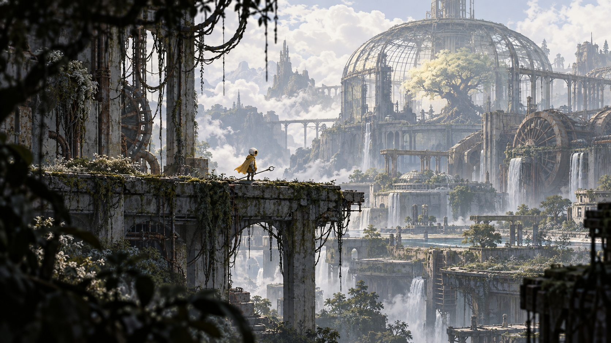
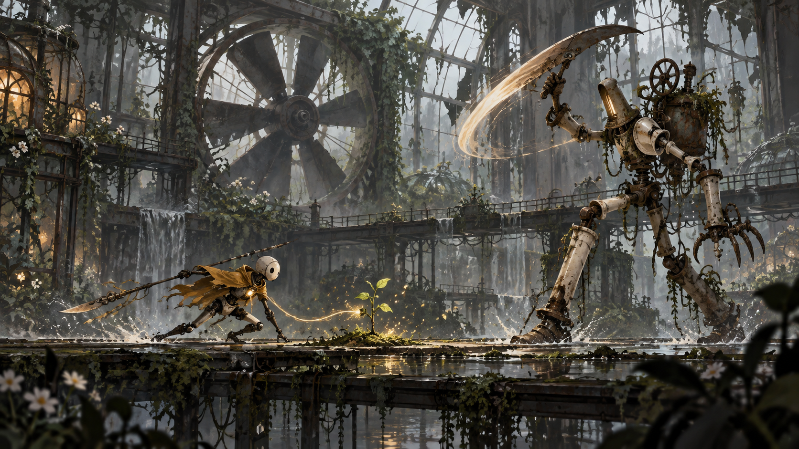

# Останній садівник

## Задум і досвід гравця
Андроїд повертає життя промисловому місту, віддаючи рослинам енергію власного тіла.

Відчути турботу, ціну відновлення та надію у світі, який давно перестав чекати на допомогу.

## Основні опори
1. Механіка виражає конфлікт історії: Та сама батарея живить бойові інструменти і рослини. Озеленення змінює геометрію доступних маршрутів.
2. Стан світу має читатися через простір, звук і поведінку, а не через довгі довідки.
3. Невдача навчає: швидкий повтор, зрозуміла причина, збереження завершених сюжетних кроків.
4. Обсяг визначаємо перевіркою прототипу. Нові системи додаємо, коли вони створюють нове рішення гравця.

## Ігровий цикл
Дії: **досліджувати, ухилятися, обрізати, пересаджувати, передавати енергію**.

побачити засохлий вузол → знайти заряд → подолати охоронця → оживити рослину → відкрити новий маршрут.

Короткий цикл триває від окремої дії до завершеної ситуації. За сесію гравець проходить маршрут і отримує нову можливість або розуміння. Кампанія повертає до знайомих місць із новим контекстом; обов’язковий повтор однакових завдань не використовується для збільшення часу.

## Головна механіка
**Передача енергії.** Вхід: Утримання взаємодії біля кореневого вузла. Результат: Перетворює 20 одиниць заряду на активний міст або джерело укриття. Невдача й обмеження: Не дозволяти витратити заряд нижче безпечного мінімуму в обов’язковому маршруті; необов’язкова жертва має попередження.

Ресурс: Заряд 0–100; запас для інструментів і відновлення. Заряд на базову атаку не витрачається.

Усі наведені числові параметри є стартовими значеннями для тесту. Змінюються у таблиці конфігурації, а не зашиваються в логіку.

## Перешкоди й навчання
| Роль | Дія | Сигнал | Рішення |
| --- | --- | --- | --- |
| Спринклер | Віяловий струмінь | Видимий поворот сопла | Ухил за суху колону |
| Обрізувач | Повільний широкий удар | Піднята рука з пилкою | Обійти і вдарити з тилу |
| Збирач | Забирає заряд із вузла | Пульсуючий кабель | Перервати кабель |

Нову взаємодію спочатку показуємо в безпечній ситуації, потім у простій задачі, далі поєднуємо з уже знайомою. Колір завжди дублюється формою, рухом або піктограмою.

## Керування та платформи
ПК: рух WASD або стік, головна дія миша або кнопка, взаємодія E, пауза Esc. Точне призначення додаткових дій залежить від жанру. Перепризначення обов’язкове для релізу.

iPhone: окремий тест сенсорного керування, без залежності від правого кліку чи наведення. Інтерфейс враховує safe area; дрібний текст і снаряди перевіряємо на реальному телефоні. Рушій і порядок платформ остаточно не затверджені.

## Прогресія й збереження
Відкриття дають новий спосіб розв’язати ситуацію. Для першого демо обмежуємося двома значущими відкриттями. Автозбереження після безпечного вузла, завершення сцени і ключового рішення. Смерть або скидання повертає локальну задачу, але не видаляє вже відкриті налаштування доступності.

## Тривалість і комерційна модель
Основна вимога для обраного «Хору»: демо не менше 60 хвилин змістовного першого проходження; повна кампанія має ціль 15 годин. Для цієї альтернативної концепції та сама тривалість використовується як сценарій оцінки обсягу, а не як затверджений виробничий план.

Пропозиція: платна завершена гра, без енергетичних таймерів та обов’язкових рекламних пауз. Ціна ще не визначена; $10 згадувались як можливість, а не як ухвалене рішення. Стартовий зовнішній бюджет — 0.

## Умова переходу до виробництва
Без підказки гравець розуміє, що рослина відкрила маршрут, а витрачена енергія створила осмислену ціну.

Головний ризик: Перетворення рівня після озеленення може ламати навігацію або робити рішення незворотними.

## Питання для наступної редакції
- Чи підтверджуємо саме цей задум і його ключову механіку?
- Яка мінімальна якість керування та звуку досяжна на цільовому iPhone?
- Які сцени можна зробити на власних ресурсах без закупівель?
- Який зміст виправдовує 15 годин без розтягування?

