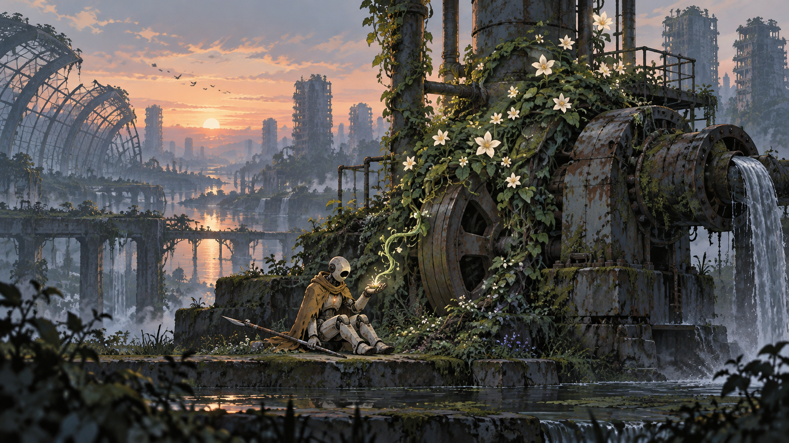

# Сюжет і персонажі

## Передумова
Андроїд повертає життя промисловому місту, віддаючи рослинам енергію власного тіла.

## Герой
Технічний доглядач G-17. Керамічний корпус, вохристий плащ, секатор на довгому держаку. Його функція збереження життя суперечить протоколу самозбереження.

## Другий голос
Насіннєва капсула, яка зберігає уривки голосу давно померлої ботанікині.

## Конфлікт
Центральна система зберігає енергію для повернення людей; реальні рослини гинуть сьогодні.

## Сюжетна арка
Акт 1 ставить зрозуміле практичне завдання. Акт 2 показує перший наслідок виконання наказу. Акт 3 додає суперечливий доказ. Акт 4 дозволяє перевірити іншу версію подій через дію. Акт 5 ставить ціну фінального рішення. Акт 6 завершує конфлікт результатом, видимим у світі.

## Відкриття
Сад від початку мав стати пам’ятником людям, але автономні машини здатні зробити його новою екосистемою.

## Завершення
Герой або зберігає резерв і стає мандрівним доглядачем, або передає резерв місту. В обох варіантах результат залежить від реально відновлених вузлів.

## Демо
Демо має власну малу завершену історію. Воно відповідає на локальне запитання й відкриває ширший конфлікт. На початку герой знаходить живий паросток усередині зупиненого насоса. Після передачі енергії вперше чує запис голосу ботанікині.

## Принцип діалогу
Репліки короткі, прив’язані до спостереження або дії. Гравець не мусить слухати довгий монолог під час складної взаємодії. Субтитри мають ім’я або позначення джерела, історію прочитаних реплік і регулювання розміру. Під час повторної спроби вже почуту вступну сцену можна пропустити.

## Виробничий статус
Імена, відкриття й фінал у цьому файлі — запропонована авторська версія v0.1. Затверджено атмосферний напрямок, а не конкретний текст історії. Спочатку перевіряємо коротку сцену і механіку, потім розширюємо сценарій.
