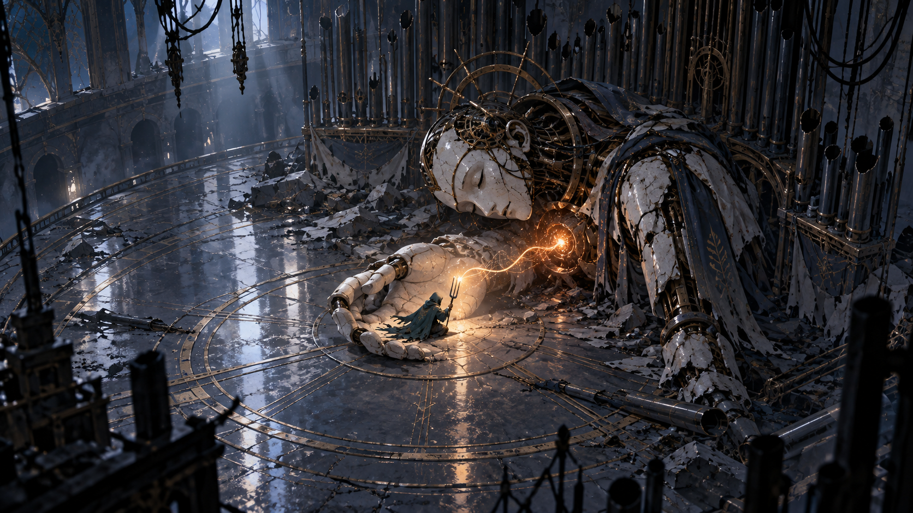
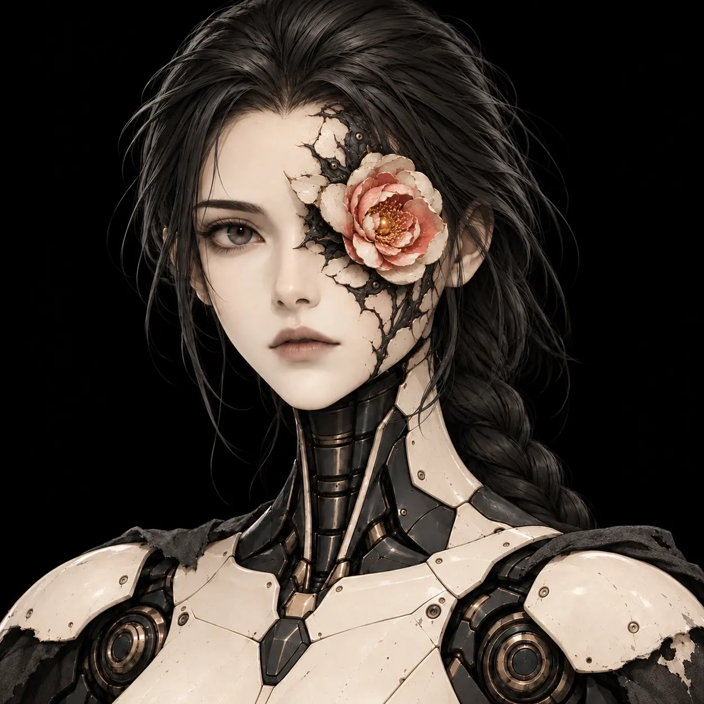

# Візуальна мова

Поточний напрям: слонова кістка та порцеляна, темний синьо-зелений метал, приглушена мідь і темно-рожева/нефритова квітуча аномалія в садах. Героїня має **маленьку камелію на місці одного ока**. Бурштиновий колір — атаки ворога; блакитний — резонанс героїні.

## Три ключові кадри

Композиція простору: масштаб героя, основний орієнтир, передній і дальній плани.

Читабельність дії: поза героя, контакт, напрямок небезпеки та маршрут відповіді.

Емоційний наслідок: зміна світла, стану об’єкта або звукового джерела після дії.

## Поточна стилістика героїні та садів

У новому арті застосовуємо ці образи замість старого обличчя без рис; при цьому не копіюємо архітектуру й персонажів конкретних чужих IP.

## Правила
Фон тихіший за інтерактивний шар. Значення тону відділяє персонажа від поверхні. Емісія не приховує форму. У кадрі є один головний фокус. Деталі першого плану не перетинають зону відповідального вводу. Об’єкт, що впливає на колізію, має помітний силует.

## Виробнича відповідність
Ці зображення — згенеровані концепт-референси; вони не доводять продуктивність, наявність моделей чи можливість автоматично відтворити картинку. Після вибору рушія створюємо один реальний еталонний кадр та порівнюємо саме його зі стилем. Дизайни оригінальні; настрій NieR використовується як культурний орієнтир, без перенесення її персонажів чи ресурсів.

## Формат презентації
Ключові механіки показуємо у дії: ігрова камера, герой, актуальний HUD, видима загроза або задача та короткі пояснення. Див. [концепти геймплею](GAMEPLAY_CONCEPTS.md). Художні референси доповнюють ці кадри.
