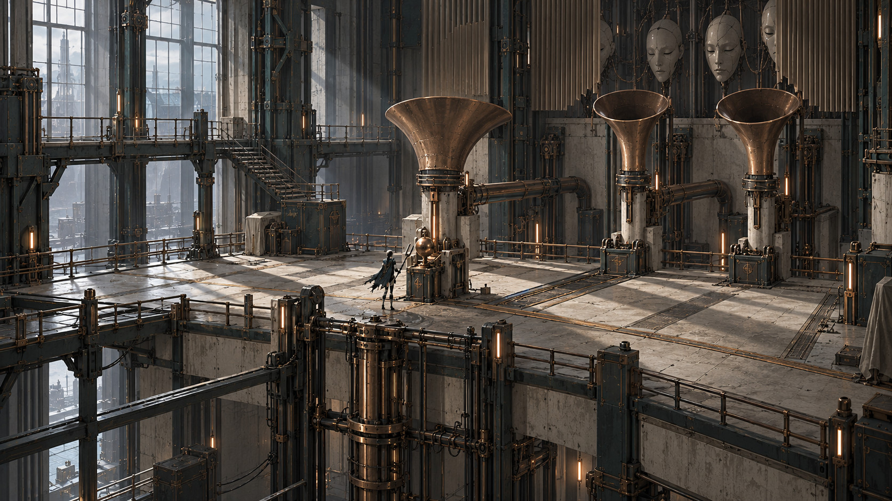
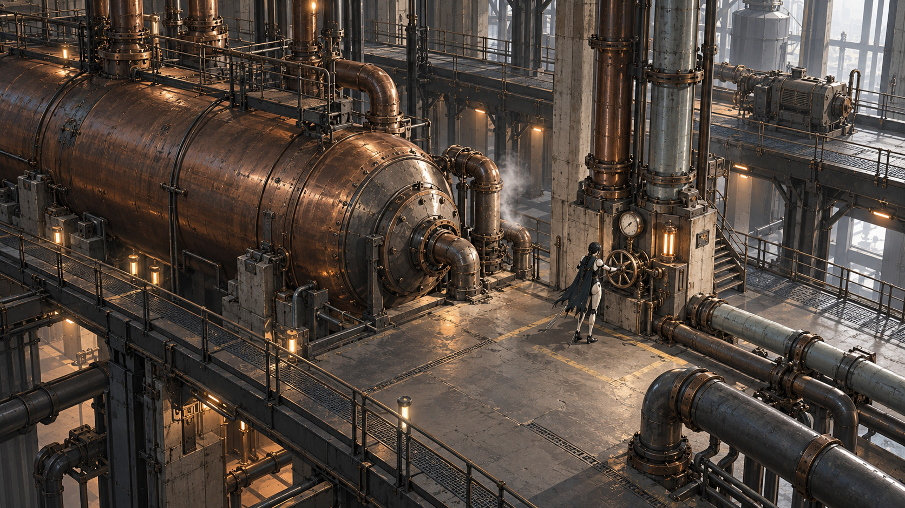
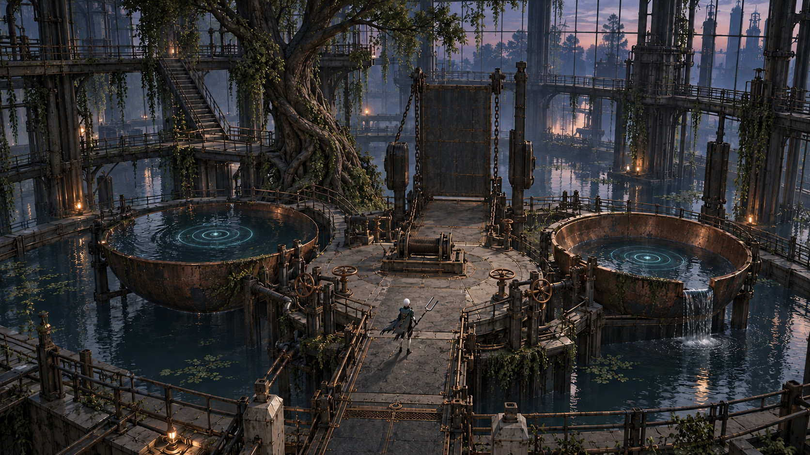
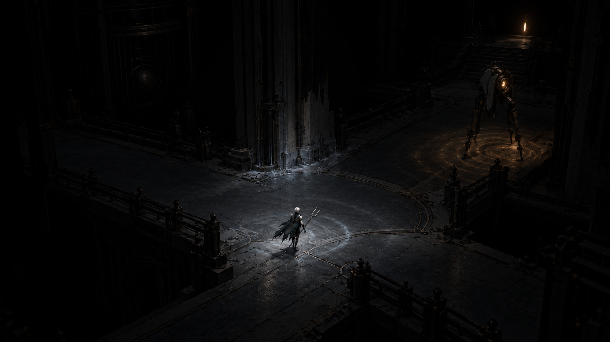

# Атмосфера і візуальна мова · v0.8

## Актуальний напрямок 27.10.2026

[Монументальний повітряний стиль v0.8: два нові кадри](STYLE_DIRECTION_v08.md) · [ігрова структура демо](L01_GAMEPLAY.md). Користувач уточнив: нескінченні величезні зали, платформи, багато повітря й мінімум environment-пропсів. Насамперед проєктуємо ігрові рішення та прохідний маршрут.

Попередні шість кадрів нижче збережені як пошук v0.7. Їхня густота дрібної механіки більше не є цільовою. Емоційний маршрут і функції рівнів зберігаються; архітектурну щільність, фон і набір деталей спрощуємо за v0.8. Величезні спокійні маси та порожнеча стають спільною мовою всіх районів; приватні побутові моменти можуть бути маленькими нішами всередині цього масштабу.

Редакція 0.7, 27.10.2026. Поточний фокус: атмосфера та візуал. Шість рівнів і розподіл по 30 хв є авторською пропозицією під робочу ціль близько трьох годин; це не виміряна тривалість і не затверджений фінальний обсяг.

## Художня теза

Місто працює після зникнення людей, але тепер його підтримують стосунки машин. Масштаб системи великий; важлива подія часто мала: згасле вікно, припинений робочий жест, підсунений стілець. Бойова перемога змінює знайомий простір, а побутова сцена пояснює її ціну.

Орієнтир NieR: Automata застосовуємо до піднятої камери, ритму великих мас, маленької постаті в промисловому просторі та спокійних пауз після бою. Іконографія, персонажі й конкретні моделі лишаються власними. Старі кадри з малим роботом є історичними: поточна героїня є дорослою андроїдкою зі світлою керамікою, графітовими суглобами, косою й окремою рваною накидкою.

## Емоційний і колірний маршрут

| Рівень | Відчуття | Головний образ | Світло |
| --- | --- | --- | --- |
| [L01 · Поріг тиші](art/L01.md) | Самотність і обережна цікавість переходять у перший сумнів | Підйомник крізь три яруси; три керамічні маски видно тільки біля кульмінації | Широке холодне небо через високе заводське вікно зліва; його проріз повторюється на підлозі |
| [L02 · Мідні легені](art/L02.md) | Небезпечна робота виявляється чиїмось життям | Один великий тисковий барабан із двома фізично різними контурами | Високі матові заводські вікна справа; робочі лампи теплі під верхньою галереєю |
| [L03 · Житлові тераси](art/L03.md) | Коротке відчуття дому й чужої турботи | Одне тепле вікно майстерні над спільним столом | Тепле вікно майстерні під козирком, сутінковий небесний заповнювач зверху |
| [L04 · Струнні сади](art/L04.md) | Крихкість і перший доказ, що місто може жити інакше | Дерево через каркас оранжереї та піднятий сухий місток | Останнє м’яке світло неба крізь старе скло, велика світла маса за деревом |
| [L05 · Архів голосів](art/L05.md) | Невпевненість, потім неприємна ясність | Перервана світлова вертикаль між двома рядами шаф | У читальній залі холодне верхнє вікно; в підархіві постійний слабкий вихідний маяк |
| [L06 · Підвішений собор](art/L06.md) | Вага рішення переходить у тихе повернення | Підвішений регулятор з видимими опорами і трьома незалежними лініями | Холодне ранньонічне небо через відкритий верх; світлі площини регулятора ловлять широкий відбитий внесок |

Шість районів використовують чотири типи середовища: завод, житлове місто, заросла/затоплена інфраструктура, акустичний архів/регулятор. Збережено спільний набір конструкції, але не однакове світло, щільність чи масштаб усіх сцен. Часова дуга йде від похмурого пізнього дня через сутінки до ранньої ночі; точних календарних годин не задаємо.

## Загальні правила кадру

1. Спершу читається активна дія або напрямок, потім великий орієнтир і лише після нього декор. Вікно або свічення на краю кадру не конкурує з дією.
2. Передній, середній і дальній плани відрізняються тоном, перекриттям і контрастом. Димка лише там, де її мотивує простір; вона не замінює композицію.
3. Підлога бою спокійніша за контур героя й снаряди. Мідна окантовка не утворює фальшиву небезпечну траєкторію.
4. Холодна світла кераміка, темний несучий метал і тьмяна мідь повторюються між районами. Житло додає латану тканину, сади скло й рослини, архів сухий папір.
5. Руйнування має причину: пил на нерухомій полиці, масло під приводом, потік іржі під кріпленням, волога нижче старої межі води. Випадковий grunge не робить світ переконливішим.
6. Символи, форми й рух дублюють кольорову інформацію. Темрява не ховає єдину опору або невидиму яму.
7. Монументальні простори є спільною мовою v0.8. Рівні відрізняються ігровою функцією, ритмом мас і світлом. Житлові сцени залишають малий масштаб взаємодії в окремій ніші; дрібний декор не заповнює все тло.

## Перехід між камерами

Один рівень має оглядовий 3/4, локальний top-down для рішення/бою й side-view для показу реальних ярусів. Перехід відбувається на безпечній площадці до нової загрози. Експозиція, баланс білого та стан неба узгоджені між камерами одного простору; зміна ракурсу сама по собі не змінює освітлення. Детальні дистанції та FOV визначає greybox, не картинка.

## Відгук світу

Не перемикаємо всі джерела, погоду й колір усього рівня за одним важелем. Гравець має впізнати той самий кадр і конкретно побачити, що змінилося. Приклад демо: героїня перемагає, орган стихає, одне далеке житлове вікно згасає. Це локальна художня гіпотеза, не підтверджена сюжетна істина користувача.

## L01 · Поріг тиші

Самотність і обережна цікавість переходять у перший сумнів. До бою жили шість малих вікон; після боса саме одне гасне, інші лишаються. Ключове світло не міняється, зникає лише локальний теплий внесок. [П’ять поставлених кадрів і виробничий порядок](art/L01.md).

## L02 · Мідні легені

Небезпечна робота виявляється чиїмось життям. До дії робочий цикл і житловий покажчик залежать від однієї команди; після від’єднання робоче світло стає стабільним, вікна не гаснуть. [П’ять поставлених кадрів і виробничий порядок](art/L02.md).

## L03 · Житлові тераси

Коротке відчуття дому й чужої турботи. До дії стілець стоїть осторонь і бічні двері закриті; після задачі двері відкриті, мешканець розвертає стілець до столу. [П’ять поставлених кадрів і виробничий порядок](art/L03.md).

## L04 · Струнні сади

Крихкість і перший доказ, що місто може жити інакше. До дії вода перекриває нижній берег; після дії відкривається смуга темного мокрого сліду й сухий обхід. Не змінювати час доби або всю експозицію. [П’ять поставлених кадрів і виробничий порядок](art/L04.md).

## L05 · Архів голосів

Невпевненість, потім неприємна ясність. До зіставлення дві версії не складаються; після на столі видимий один конкретний вилучений рядок. У лабіринті освітлюється тільки стабільний вихід. [П’ять поставлених кадрів і виробничий порядок](art/L05.md).

## L06 · Підвішений собор

Вага рішення переходить у тихе повернення. Після розділення загальний світловий пульс зникає, три місцеві індикатори працюють незалежно. В усіх фіналах фінальна камера повертається до людського масштабу столу. [П’ять поставлених кадрів і виробничий порядок](art/L06.md).

## Перевірка якості

Спочатку один greybox-кадр із простими матеріалами, потім основне світло, після цього контакт, матеріал і малий декор. Перевірка в робочій камері: зменшений кадр, читання великих тонів, вхід/вихід, один активний ворог, кадр до/після дії. Художні концепти не доводять продуктивність або працездатність рівня.

Поточні зображення є згенерованими артдирекційними цілями. Точна геометрія труб, послідовність кабелів, фізичні відблиски та проходи перевіряються окремо. Пропси відкладені, їхній попередній набір не розширюється. Нових 3D-мешів, GIF, ригів або UE-білдів у цьому проході не створено.
