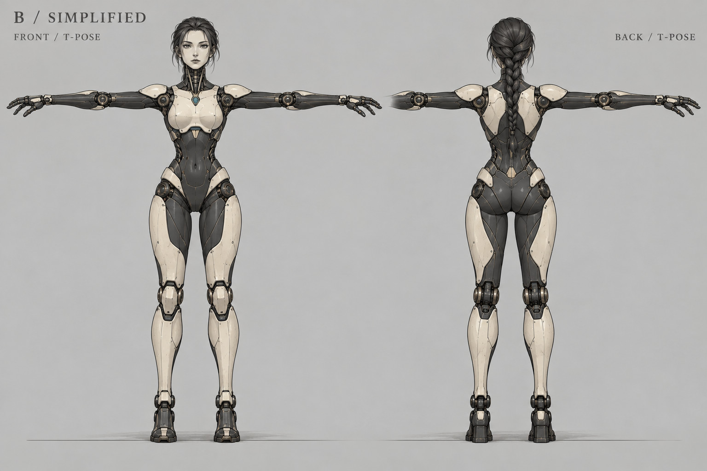
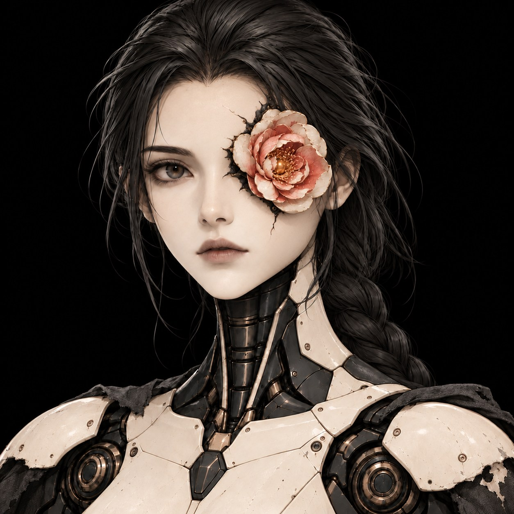

# Головна героїня · поточний спрощений B

Користувач обрав дорослу жіночну андроїдку, спрощений B, T-позу без зброї. Рвана накидка є окремим предметом. Світла сегментована кераміка, графітові механічні суглоби, коса і чорна тканина зберігають ідентичність. Камертон із двома зубцями лишається інструментом; не замінювати мечем.

Зріст 1,70 м є масштабною гіпотезою для greybox, не фінальним погодженим числом. Аркуш не є гарантованою ортографією або готовим 3D-мешем. Опори стоп і тонкі деталі перевіряються в реальній ігровій камері. Малий робот на ранніх концептах є історією.

Орієнтир NieR і Stellar Blade для елегантного роботизованого силуету не означає перенесення конкретного костюма, символів або персонажа. Нові атмосферні кадри є власними сценами. Риги, анімації й GIF ще не створені в поточному атмосферному проході.

## Поточне обличчя: компактна квітка замість лівого ока

Користувач попросив запушити цю версію: компактна шарувата квітка на місці лівого ока, невелике збільшення від попередньої компактної ітерації та значно менше тріщин. Лоб і щока переважно гладкі; темний обвід і кілька коротких швів лишаються біля квітки. Темна коса, графітова механічна шия, світла кераміка й рвана накидка зберігають B. T-поза вище задає базу корпусу та силуету; актуальне обличчя показане на цьому портреті.

[Історія портретів](references/characters/flower-eye/README.md). Готові 3D-моделі, риги й анімація квітки ще не створені.
