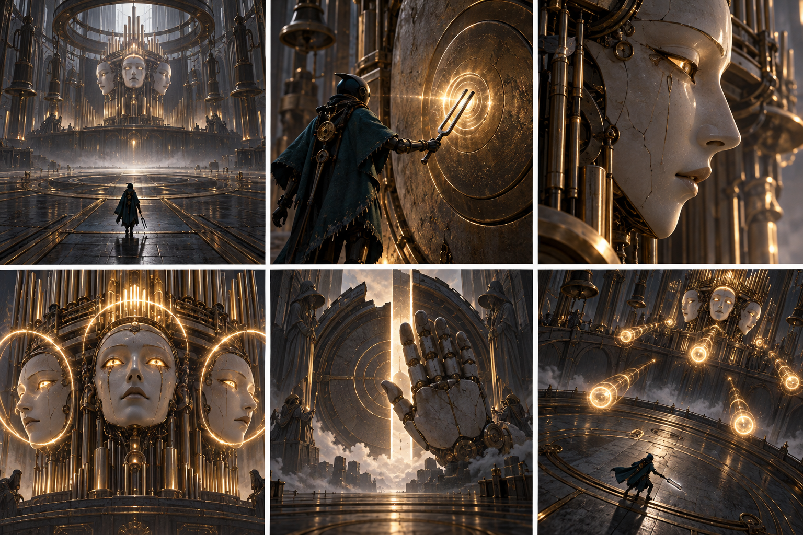

# Катсцени та сюжетні стани

Проектна версія v0.1.

## Катсцена входу до боса

CS03 починається після checkpoint перед ареною. Носій проходить поріг, звук зовнішнього світу поступово зникає. Камертон торкається металу. Обличчя відповідають із різних точок, і гравець уперше чує їх як співрозмовників.

Ілюстрований аркуш нижче показує послідовність зліва направо, зверху вниз. Тривалість сцени приблизно 36 секунд. На повторній спробі пропуск доступний одразу. Повернення до бойової камери завершується до першого небезпечного патерну.

| Кадр | Час | Звук і дія |
| --- | --- | --- |
| 1 | 6 с | Загальний зал; кроки і далекий бас |
| 2 | 5 с | Камертон торкається металу; сухий імпульс |
| 3 | 5 с | Прокидається ліве обличчя; локалізований голос |
| 4 | 6 с | Три послідовні відповіді; фраза про очікування |
| 5 | 7 с | Долоня закриває вихід; без шкоди герою |
| 6 | 7 с | Бойова камера; безпечна пробна фраза |

## Катсцени і сценарні стани

CS01 «Пробудження» триває 35–45 секунд. Камера проходить від мертвих труб до малого Носія. Провідник: «Сигнал триває. Джерело за мостом». Герой піднімає камертон; керування повертається на безпечному майданчику.

CS02 «Перший голос» триває 20 секунд. Після мінібоса голос не зникає, а переходить у камертон. Провідник: «Вимкнено». Носій повторює короткий мотив. Вперше відкривається відмінність між руйнуванням і збереженням.

CS04 «Долоня» триває 45–60 секунд. Затихає остання атака; велика рука лягає на підлогу долонею догори. Носій сам підходить до неї. Після взаємодії звучить «Тепер ти пам’ятаєш», хвіст залу згасає, з’являється вихід.

Післямова лишає керування: гравець проходить знайомий коридор, де раніше звучав бас. Тепер чути тільки механічні кроки. На запит Носія Провідник відповідає: «Завдання виконано… частково». Демо закінчується на новій музичній фразі, а не на рекламній картці.

| Прапорець | Коли фіксується | Що відкриває |
| --- | --- | --- |
| first_voice_taken | Кінець CS02 або його пропуск | Активну партію і замок галереї |
| choir_intro_seen | Кінець CS03 або пропуск | Бойовий стан без повторного вступу |
| choir_defeated | Бос досяг завершального стану | Вимкнення шкоди і CS04 |
| choir_voice_taken | Взаємодія з долонею | Вихід та післямову |
| demo_complete | Останній безпечний вузол | Запис завершення демо |

