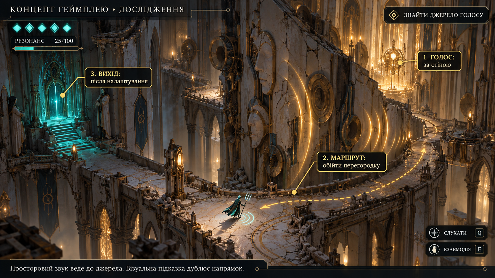
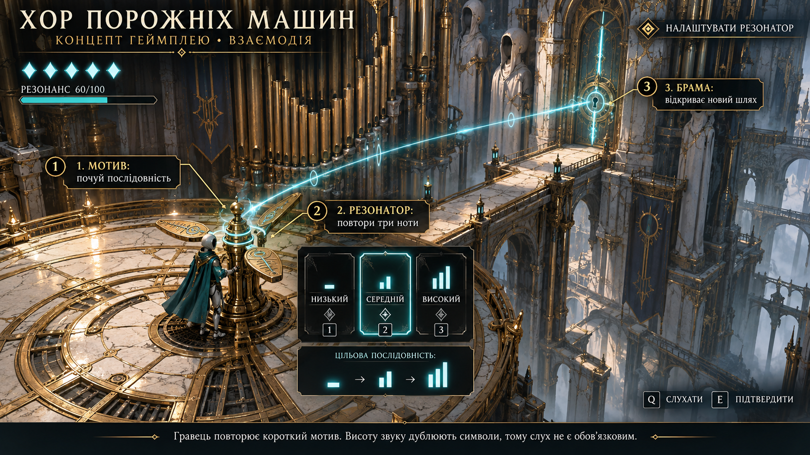

# Концепти геймплею з інтерфейсом

Ілюстрації майбутнього геймплею, не скриншоти готової гри. HUD і числа — пропозиції для обговорення. Підписи з номерами — редакційні пояснення; у грі вони не відображаються.

## Бій: читання фрази та безпечний сектор

## Дослідження: знайти джерело голосу

## Взаємодія: повторити мотив

