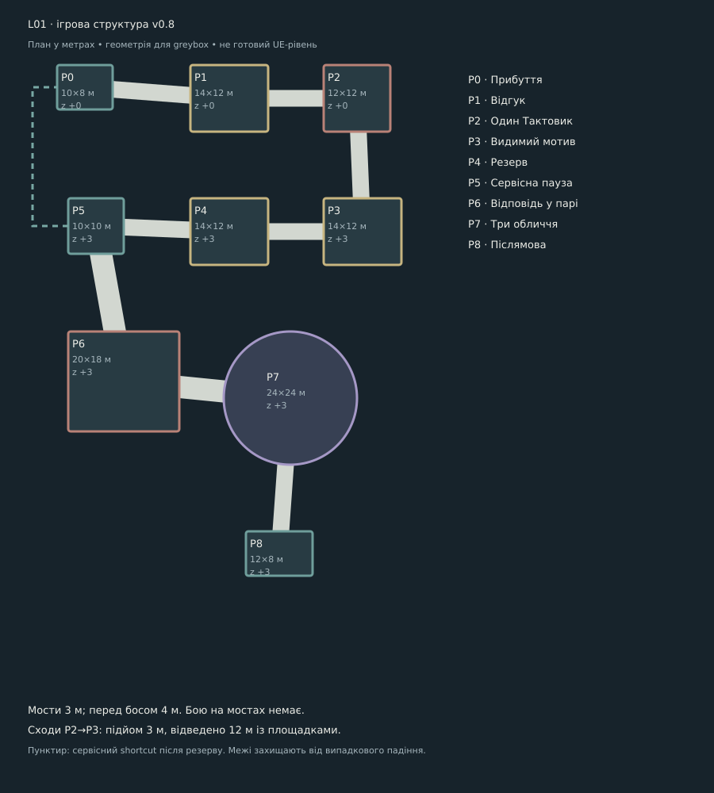

# L01: ігровий план до оточення · v0.8

Статус: конкретна пропозиція блокаута, ще не UE-рівень і не перевірене проходження. Користувач вимагає насамперед ігрові рівні; цей документ відокремлює реальну функцію маршруту від красивої картинки.

## Мета, напруга й цикл

Практична мета: дістатися джерела, вимкнути небезпечну команду і пройти далі. Напруга: герой вчиться давати відповідь машині; після успіху бачить, що сигнал підтримував чиюсь адресу. Цикл: помітити стан → спробувати знайому дію → зрозуміти відгук → вибрати позицію/контакт → змінити стан → побачити результат.

Демо має одну карту, три головоломки, три малі групи рядових і одного боса. Різні майданчики є ділянками цієї карти, не дев’ятьма окремими рівнями. Масштабний зал є фоном; маршрут між осмисленими діями короткий.

## Дев’ять майданчиків

| Вузол | Розмір / висота | Що робить гравець | Умова переходу | Перший бюджет |
| --- | --- | --- | --- | --- |
| P0 Прибуття | 10×8 м; z +0 | Героїня бачить три далекі маски, близький резонатор і міст далі. Потрібно лише пройти до P1 | вільний прохід | 1-2 хв |
| P1 Відгук | 14×12 м; z +0 | Три прості порти на одній платформі й один видимий покажчик. Тестові імпульси без шкоди. Повернути до у порт C, відкрити шлюз до P2 | PZ-01 розв’язана | 3-4 хв |
| P2 Один Тактовик | 12×12 м; z +0 | Один ворог показує сектор удару, потім паузу. Дві широкі сторони обходу; міст не є місцем бою | ворог зупинений | 1-2 хв |
| P3 Видимий мотив | 14×12 м; z +3 | На одній панелі схема 1→3→2 і три пластини. Звук дублює риски. Натиснути послідовність за видимою схемою, підтвердити й відкрити наступний міст | PZ-08 розв’язана | 3-4 хв |
| P4 Резерв | 14×12 м; z +3 | Два важелі: резерв ON, потім команда OFF; живлення залишається. Маятник за огорожею зупиняється; видно стабільний житловий покажчик | PZ-09 розв’язана | 3-4 хв |
| P5 Сервісна пауза | 10×10 м; z +3 | Одна сервісна станція суміщає ремонт, навчальну корекцію позиції ре й збереження. Немає нового мінібоса, окремих терміналів або бою | навчання ре завершене; ремонт добровільний | 1-2 хв |
| P6 Відповідь у парі | 20×18 м; z +3 | Спочатку Рупор окремо; після короткої паузи один Тактовик і один Рупор. Вороги входять із видимого дальнього порога. Не більше одного відповідального сигналу на першому суміщенні | обидві хвилі завершені | 2-3 хв |
| P7 Три обличчя | 24×24 м; z +3 | Кругла арена діаметром 24 м. Фази: басове віяло; кільце й спрямований імпульс; почергова комбінація. Розпізнавання форм до й ухилення вже відомі. На цій платформі немає пропсів, що закривають безпечний сектор | бос завершив фінальний стан | 4-6 хв |
| P8 Післямова | 12×8 м; z +3 | Небезпека вимкнена. Рука відкривається, героїня бере збережений голос, далекий житловий індикатор згасає. Видимий безпечний вихід | вільний вихід | 1 хв |

Усі числа є стартовими гіпотезами. Пазли займають орієнтовно 7-12 хв разом, а не гарантовано по чотири хв кожен. Досвідчений гравець може швидко прочитати видиму схему. Загальний орієнтир демо 20-30 хв із переходами й паузами; коротший якісний тест не розтягуємо ходьбою. Тригодинна ціль кампанії потребує окремої перевірки темпу інших рівнів.

## Вісім явних переходів

P0→P1→P2→P3→P4→P5→P6→P7→P8. Кожна сусідня пара має міст або сходовий міст. Обов’язкових стрибків через порожнечу, телепортації або стрибкової нової навички немає.

Мости від 3 м, підхід до боса 4 м. На мостах немає відповідального бою. Підйом P2→P3 має 3 м висоти й відведені 12 м горизонтального простору під сходи та площадки. Переходи камер починаються й закінчуються на безпечних площадках. Ривок і звичайний рух на межі демо не спричиняють випадкового смертельного падіння: край має стабільний видимий знак і послідовне зупинення руху. Це перевіряється на P0 до бою, а не з’являється невидимим винятком на босі.

Після резерву можна відкрити короткий сервісний зв’язок P5↔P0; він не пропускає обов’язкові задачі першого проходження. Його конкретний вид (міст/сервісний підйомник) визначає greybox. Основний шлях не залежить від нього.

## Як навчаємо, розвиваємо й перевіряємо

- **До.** P1 дає безпечний тест порту та видимий відгук; P6 використовує позначений імпульс Рупора; бос повертає те саме правило в іншій послідовності.
- **Ухилення.** P2 показує один широкий сектор і паузу; P6 додає просторовий вибір між двома знайомими джерелами; бос перевіряє позицію, не нову кнопку.
- **Ре.** P5 дає корекцію позиції між двома спокійними мітками. Звичайне ухилення вже працює без ре; мінібос для отримання здібності не потрібен.
- **Стан системи.** PZ-08 залишає схему видимою; PZ-09 розділяє два механічні стани. У першому випадку перевіряється читання символу, у другому причинний порядок. Якщо схема зводиться до миттєвого бездумного вводу, не рахуємо її довгою головоломкою.

## Рядові й бос як просторова перевірка

P2: один Тактовик. Він піднімає інструмент, показує сектор, б’є й лишає паузу. Широка площадка дозволяє обійти ліворуч або праворуч. Декор не закриває руку та сектор.

P6: спочатку один Рупор, потім один Рупор із Тактовиком. На першій комбінації атаки йдуть почергово. Для майбутнього одночасного варіанта має існувати досяжна безпечна область. До першої атаки обидва джерела видно; вороги не виникають із невідомої ніші. Закрита брама боса читається як майбутня ціль, не як вихід із цього бою.

P7: арена 24 м у діаметрі, не весь гігантський зал. Бос на дальньому краю; обвід і центр чисті. Перша фаза використовує широкі віяла з проходами; друга додає кільце й один спрямований імпульс; третя чергує відомі голоси. Переходи завершують небезпеку видимо, камера не від’їжджає під час ухилення. Детальний баланс і таймінг фаз ще треба перевірити.

## Ремонт, повтор і збереження

P5 поєднує ремонт, ре й checkpoint в одному функціональному пості. Перед входом на P7 є збереження без другого унікального корпусу станції. Після програшу босу гравець відновлюється біля входу P7, а не повторює PZ і три групи ворогів. Здоров’я і ремонтні заряди повертаються до передбойового стану; відкриті ноти й задачі лишаються.

Робоча пропозиція лікування: 2 заряди, кожен дає 2 з 5 HP після 0,9 с вразливої дії. До завершення дію можна скасувати без витрати; на завершенні витрата й HP змінюються один раз. Пауза після зрозумілої атаки повинна давати можливість лікування, але не постійну безпечну позицію. Числа не тестовані.

Баф/дебаф не потрібен для виправдання порожньої площадки. У демо спочатку доводимо рух, відповідь, лікування й джерело; додаткові ефекти не приховують навчання. Візуальне світло та туман не накладають прихованих штрафів.

## Просторова збірка з модулів

Маршрут P0–P8 складаємо з повторюваних плит, мостових настилів, площадок і сходового маршу. Розмір і чиста ширина проходів з таблиці лишаються контрактом ігрового блокаута; декоративний бортик, основа колони чи накладка не повинні віднімати корисний простір. Колони збираються з основи, повторюваного стовбура й верху, пілони працюють як великі фонові форми. На P2, P6 і P7 не ставити масиви в межах телеграфів атак, ліній огляду та двох сторін обходу.

До деталізації перевірити повторювані стики, зазори/перекриття колізій, ширину маршруту з камерою та послідовність країв на простому greybox. Концепт набору й рекомендовані правила наведені в [модульному кітбаш-напрямку](STYLE_DIRECTION_v08.md#модульна-архітектура-кітбаш-замість-унікальних-шматків). Аркуш показує ідею форм, його підписи й пропорції не є затвердженим технічним завданням на меші.

Круглу арену P7 діаметром 24 м збирати з центрального диска, радіальних підлогових секторів і восьми сегментів зовнішнього кільця по 45°. Бортик лишається послідовним, окрім основного входу; шви не мають виглядати як сигнали небезпеки. Центральний dais необов’язковий і проходить перевірку камери, огляду боса та простору для ухилення. Схема модулів наведена в [аркуші круглої арени](references/style-v08/04-circular-arena-kitbash.jpg).

## Мінімум ресурсів як наслідок функції

Один корпус резонатора повторюється на портах і пластинах, один важіль на двох контурах, один сервісний пост на ремонті/навчанні. Геометрія ділянки й відповідь змінюють задачу. Фонові пілони не є прохідними кімнатами, для них не потрібні повні інтер’єри. [Пошук стилю й запропонований набір](STYLE_DIRECTION_v08.md).

## Що мусить довести тест

1. Новий гравець бачить найближчу ціль і пояснює, чому прохід закритий.
2. Може спробувати до без шкоди, розв’язати три задачі без звуку й продовжити після помилки.
3. У першому бою розрізняє попередження, активну шкоду та паузу.
4. Має дві доступні відповіді на простий сектор; не притиснутий до краю через камеру або декор.
5. З утриманим вводом проходить camera blend без несподіваного розвороту; край працює однаково на всіх площадках.
6. Програє босу, повторює тільки босфайт, лікується й не втрачає вирішені задачі.
7. Проходить без жодного необов’язкового квесту. Порожнеча в кадрі дає масштаб, не зайві хвилини ходьби.

Це критерії майбутнього прохідного greybox, а не вже пройдені тести.
