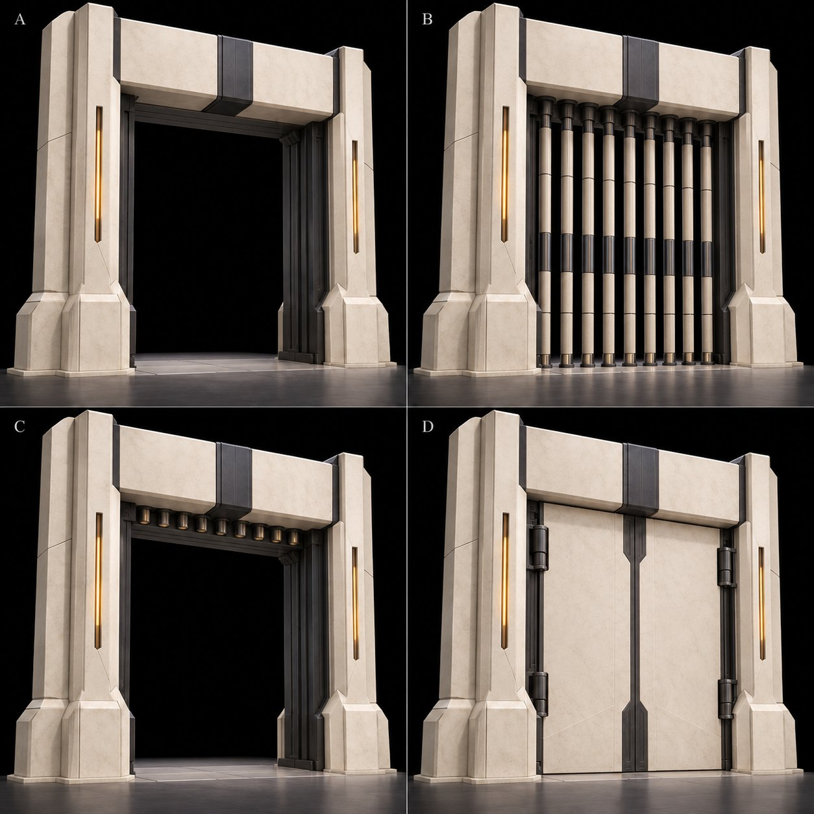
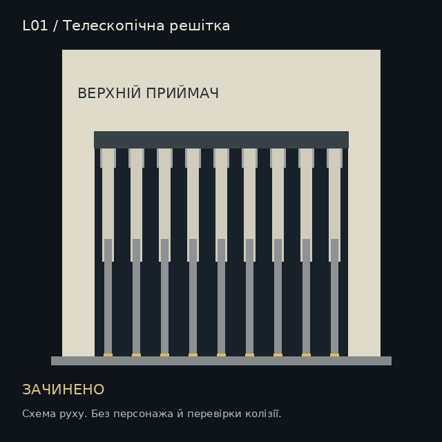

# L01: арки, решітки й двері · v0.8

27.10.2026. Набір стосується першої локації. Користувач запропонував додати арку, ворота, списоподібне перекриття або двері. Нижче авторська пропозиція для блокаута; вигляд і числа ще потребують оцінки та проходження в рушії.

A: порожня рама. B: закрита решітка. C: стрижні втягнуті в телескопічні секції. D: дві дверні стулки на бічних шарнірах. Це концепт форми; рисунок не доводить місткість приймача, точність зазорів або правильність колізії.

## Що працює на гру

Основний варіант для демо: **арка з вертикальною стрижневою решіткою**. Крізь неї видно продовження маршруту й об’єкт, до якого веде задача. Після розв’язання відкривається саме видимий раніше шлях. Для відкриття після боса пропонуються глухі двостулкові двері: вони дозволяють поставити коротке сюжетне розкриття виходу.

Порожня арка позначає напрямок; решітка показує фізичне блокування; двері приховують наступний простір. Усі користуються спільною матеріальною мовою L01: світла мінеральна кераміка, графіт, один тонкий функціональний акцент. Стани дублюються механічним положенням і піктограмою на стійці, звук і колір лише підсилюють їх.

## Мінімальний кітбаш

| ID | Частина | Повторне використання / рух |
| --- | --- | --- |
| L01-GT-FRAME | Ліва/права стійка й верхній приймач | Статична збірка, порожня арка без рухомого заповнення |
| L01-GT-ROD | Три вкладені секції одного стрижня | Один комплект дублюється по ширині; рух уздовж вертикальної осі, без деформації меша |
| L01-GT-SOCKET | Плоске гніздо в підлозі | Дублюється під стрижнями; врівень із підлогою, не чіпляє рух |
| L01-GT-LEAF | Одна дверна стулка та шарнір | Дві стулки з дзеркальними pivot; розкриваються в бік наступної площадки |
| L01-GT-STATE | Вставка стану в стійці | Спільна геометрія, піктограма/матеріальний стан замість нового термінала |

Решітка й двері є альтернативними заповненнями рами. Для першого прохідного тесту достатньо решітки; двері не створюють додаткової головоломки.

Стартова корисна ширина отвору 4 м. На мостах 3 м арка стоїть на площадці, а перед нею є розширення з настилом без сходинки. Основа стійки не віднімає ширину отвору. Висоту, перерізи й приймач уточнити разом із капсулою героїні та камерою. Зазор між закритими стрижнями менший за ширину капсули з запасом; художня решітка й колізія мають узгоджуватися.

Телескопічні секції реально вкладаються в верхній приймач; їхні довжини, перекриття й товщини визначають модель. Для стулок на приймальній площадці резервується весь сектор повороту з запасом. Механізм не зникає в тонкій перемичці або поза геометрією рами.

## Де перекриваємо L01

| Ворота | Зв’язок | Закрито до | Після відкриття |
| --- | --- | --- | --- |
| G01, решітка | P1 → P2 | Успіх PZ-01 | Лишається відкритою; повернення в P1 доступне |
| G02, решітка | P2 → P3 | Завершено бій з одним Тактовиком | Лишається відкритою; ворог не переслідує гравця на міст/P1 |
| G03, решітка | P3 → P4 | Успіх PZ-08 | Лишається відкритою; не вимагає повторного вводу мотиву |
| G04, решітка | P4 → P5 | Успіх PZ-09, резерв працює | Лишається відкритою; вимкнення команди не забирає живлення воріт |
| G05, решітка | P6 → P7 | Завершені обидві хвилі P6 | Відкриває вхід до боса; тимчасово закривається після безпечного входу в арену |
| G06, двері або та сама решітка | P7 → P8 | Бос завершив фінальний стан і всі атаки зняті | Відкриває післямову, лишається відкритою |

P0 → P1 і P5 → P6 не отримують нового замка. За потреби там стоїть лише порожня рама. У рядових боях дозволений відступ на попередню безпечну площадку; вороги мають межу переслідування всередині бойової ділянки. Фіксовані ворота виходу показують, яку вже наявну умову треба виконати.

G05 не є додатковою ареною або новим ресурсним замком. Коли героїня повністю пройшла поріг і відійшла щонайменше на 3 м у P7, можна почати закривання. Якщо вона повернулась у зону руху воріт, закривання скасовується. Перша атака боса починається після закриття, завершення переходу камери й короткої видимої підготовки. На смерть боса або повернення до checkpoint небезпечні атаки вже вимкнені.

## Стани й відгук

`LOCKED → OPENING → OPEN`. Для G01-G04 це постійний результат виконаної умови. Для G05 додаються `CLOSE_WARNING → CLOSING → LOCKED_FIGHT`; зайнятий поріг повертає рух у `OPENING`.

На закритих воротах стійка показує знак конкретної задачі або бойового джерела, а коротка лінія у підлозі веде до локального механізму. Невдалий мотив дає відгук на панелі PZ, ворота лишаються стабільно закритими. Відкритий прохід читається відсутністю фізичного перекриття і піктограмою проходу. Не додаємо нову кнопку взаємодії на кожні ворота.

Колізія рухається разом із твердими частинами. Статус OPEN настає, коли прохід має потрібну ширину й висоту з запасом для героїні. Ці умови не можна підміняти таймером або невидимою площиною перед уже вільним отвором.

## Анімація й звук

Наведені секунди є стартовими гіпотезами, не виміряним геймфілом. Усі рухи детерміновані станом; повторний сигнал відкриття не запускає анімацію вдруге.

| Кліп / перехід | Пропонований час | Рух і момент відгуку |
| --- | --- | --- |
| Решітка: LOCKED | Статичний | Стрижні в гніздах, відсутня нескінченна анімація деренчання |
| Решітка: OPENING | 1,2 с | Коротко розмикається фіксатор; нижня й середня секції складаються в приймач зі сповільненням наприкінці; завершення підтверджує сухий клацок |
| Решітка: OPEN | Статичний | Нижні кінці вище потрібного габариту проходу; піктограма проходу активна |
| CLOSE_WARNING | 0,35 с | Знак стійки переходить у стан замикання; короткий механічний сигнал із видимого джерела |
| Решітка: CLOSING | 1,2 с | Секції опускаються; зайнятий поріг зупиняє рух і запускає безпечне повернення в OPENING |
| Двері: OPENING | 1,4 с | Дві стулки розкриваються приблизно на 100-110° у зарезервований вільний простір, без зміщення pivot |
| Відновлення checkpoint | До повернення керування | Відразу встановлюється правильна поза зі збереженого стану; героїня не з’являється всередині стрижнів |

Решітка не завдає шкоди й не є пасткою зі списами. Зайнятість перевіряється для всього об’єму руху; захист від затискання працює і для дверних стулок. Під час відкривання маршруту гравець зберігає керування; якщо з його позиції ворота не видно, короткий показ відбувається лише в безпечному стані без активних ворогів.

Звук іде з приймача/шарніра: сухий фіксатор, тихий рух, підтвердження зупинки. Довгий хвіст залу окремий і тихіший. Ворота не займають той самий сигнал, що попереджає про удар Тактовика або постріл Рупора.

GIF є окремою схематичною анімацією руху, без персонажа та перевірки зіткнень. Це не анімація готового 3D-рига. Для дверей наразі розписаний кліп; його рендер ще не створений.

## Що перевірити в greybox

1. Із місця задачі видно потрібні ворота, їхню причину блокування та зміну стану.
2. Після успіху G01-G04 не замикаються повторно після відступу або завантаження.
3. Закриті стрижні не пропускають капсулу, відкритий прохід не має залишкової колізії.
4. Верхня рама не перекриває героїню/ворога на top-down і 3/4; ближня архітектура прозорішає або зрізається узгоджено з камерою.
5. G05 не затискає героїню, не дозволяє першій атаці застати її в camera blend і не вимагає повторювати P6 після смерті босу.
6. Двері G06 відкриваються після зняття всієї шкоди; за стулками є реальне місце для руху й сценічного відкриття.

[Ігровий план](L01_GAMEPLAY.md) · [Стиль](STYLE_DIRECTION_v08.md) · [Промпти концепту](references/style-v08/L01_GATE_PROMPTS.json)
