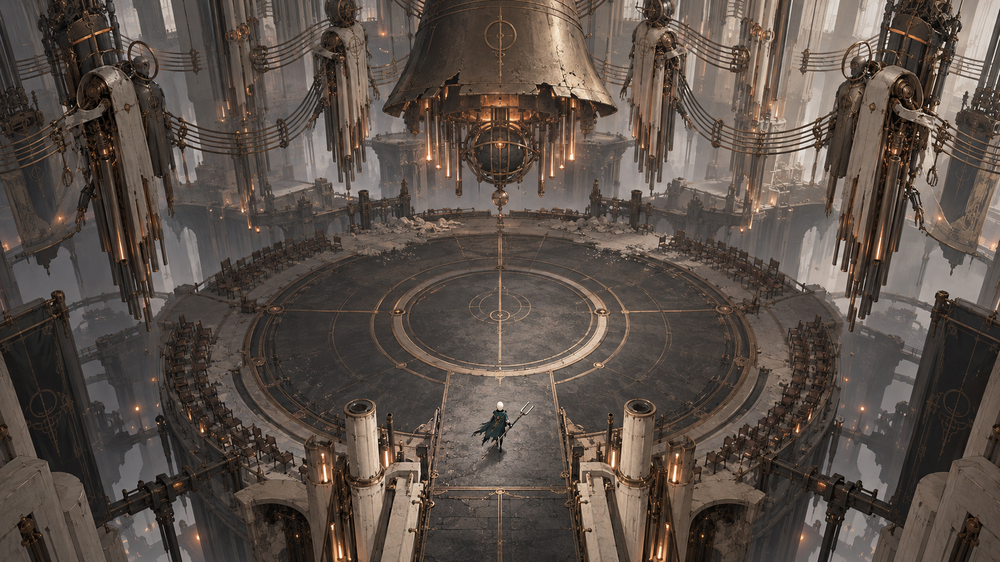
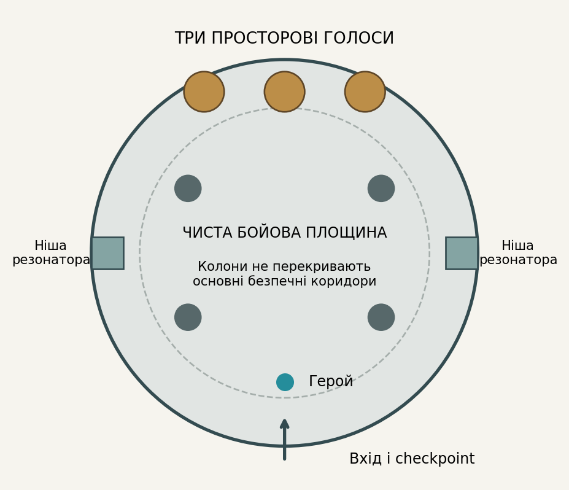

# Рівні та маршрути

## Просторова мова
Музичні фрази оголошують патерни атак. Різні голоси мають фізичне положення на арені, а здобуті партії стають здібностями героя.

Референс задає композицію й атмосферу. Він не є готовим рівнем: прохідні поверхні, колізії, камера, висота персонажа і видимість небезпеки мають окрему перевірку у greybox.

## Структура демо
Маршрут лінійний із двома короткими необов’язковими відгалуженнями. Перед складною ситуацією є точка безпеки. Після неї — тихий простір для осмислення результату. Повернення не повинно вимагати повторного проходження вже доведеної задачі.

| Вузол | Подія | Просторова функція |
| --- | --- | --- |
| D1 | Пробудження на мосту | Орієнтація і перший орієнтир |
| D2 | Зал відлунь | Безпечне навчання механіки |
| D3 | Нижня галерея | Комбінація двох знайомих дій |
| D4 | Перший голос | Перевірка розуміння |
| D5 | Сходи слухачів | Кульмінація маршруту |
| D6 | Три обличчя та післямова | Наслідок і вихід |

## Кампанія як гіпотеза обсягу
Шість розділів по 150 хвилин дають 900 хвилин. Це бюджет контенту, а не оцінка фактичної тривалості неіснуючої гри. Кожен розділ має нове просторове правило, повернення знайомої механіки та сюжетний наслідок.

| Розділ | Локація | Плановий бюджет |
| --- | --- | --- |
| 1 | Поріг тиші | 150 хв |
| 2 | Мідні легені | 150 хв |
| 3 | Струнні сади | 150 хв |
| 4 | Архів голосів | 150 хв |
| 5 | Підвішений собор | 150 хв |
| 6 | Незавершена пісня | 150 хв |

## Камера і читабельність
Межі камери описуємо окремими об’ємами. Персонаж та інтерактивні об’єкти відділяються від фону значенням тону. Передній план не перекриває активну небезпеку. Для сенсорного керування нижні кути кадру вважаємо частково закритими пальцями.

## План перевірки
Виміряти час до першої самостійної дії, число втрат маршруту, повернення до вже пройдених задач, читабельність під час руху. Перевірити перезапуск із кожного checkpoint, збереження стану переходів і неможливість потрапити у невідновний стан.

## Умова готовності greybox
Усі обов’язкові вузли прохідні без декору; маршрут читається без постійної стрілки; складність виникає з головної механіки. У тестовій арені гравець розрізняє три джерела, передбачає атаку за мотивом і може грати за візуальними сигналами без слуху.

## Деталізація основного проєкту

### План акустичного залу

Кругла арена має центральну чисту площину, зовнішній обхід і дві ніші перепочинку. Бос займає північний край; вхід і checkpoint розташовані на півдні. Чотири колони утворюють орієнтири, але не приховують головні траєкторії.

Колони перекривають лише спеціально позначений промінь. Звичайні музичні снаряди взаємодіють із геометрією за одним послідовним правилом. Якщо перешкода не захищає, це видно під час безпечного навчання.

Резонатор у боковій ніші приймає відбитий імпульс і тимчасово приглушує голос. Він не дає безкінечно безпечно стояти: перед повтором потрібне переміщення. Нішу ніколи не закриваємо невидимим collider.

Один екран охоплює весь активний майданчик. На телефоні масштаб героя і ширина проходу перевіряються до деталізації підлоги. Схема нижче — початковий план, а не фінальний greybox.

### План повної кампанії

Ціль 15 годин означає 900 хвилин змістовного першого проходження. Шість розділів по 150 хв — структура для оцінки, а не твердження про вже створений контент. Демо відкриває перший розділ і входить у кампанію, а не додається зверху.

Початковий кошторис контенту: 12 головних босів, до 6 необов’язкових сцен із голосами, близько 36 авторських бойових ситуацій і 18 акустичних задач. Кількість переглядаємо після виробничого тесту. Новий бос потребує власної музичної партії та анімацій, тому це суттєвий ресурсний ризик.

Типовий розділ: дослідження і просторові переходи 60 хв, акустичні задачі 35 хв, звичайні сутички 25 хв, два боси сумарно 15 хв, діалоги й постановочні сцени 15 хв. Сумарно 150 хв. Цей розподіл має підтвердитися тестами.

| Розділ | Нове правило | Сюжетний рух |
| --- | --- | --- |
| Поріг тиші | Розрізняти і повертати імпульси | Перша перемога викликає сумнів |
| Мідні легені | Повітряні канали й спрямовані хвилі | Сигнал підтримує життя машин |
| Струнні сади | Зв’язки між резонаторами | Голоси зберігають спільні спогади |
| Архів голосів | Вибір партії змінює маршрут | Наказ має неповні дані |
| Підвішений собор | Комбінація відомих мотивів | Провідник визнає власну роль |
| Незавершена пісня | Зібрані партії як фінальна дія | Вибір способу завершення хору |

