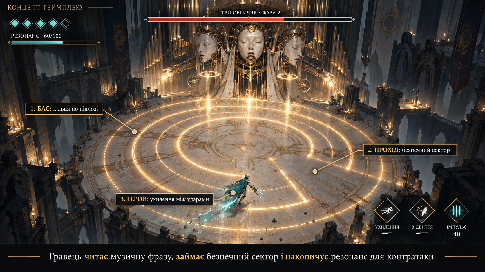
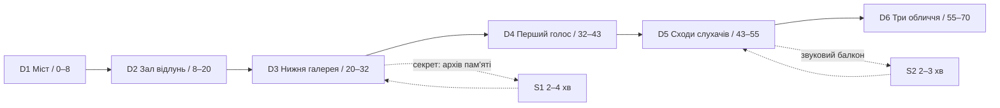

# Хор порожніх машин | Level Design v0.2

> **Статус:** робоча проєктна редакція, а не затверджений технічний level spec. Підтверджено основний напрям, мінімум 60 хв для демо, ціль 15 год та принцип ігрових кадрів із UI. Розміри/ракурси/склад подій нижче — **первинні параметри greybox** і можуть змінитися після тесту. Наявність згенерованого кадру не означає готову геометрію.

## 0. Що змінилося від v0.1

Уточнено маршрут кожної сцени, playable area, вимоги до камер, checkpoint, пазли, test gates і повну кампанію. Додано референсну вісь: **NieR:Automata** (динаміка камер і завод), **COCOON** (пазли), **Control** (монументальність), **Hell's Paradise** (квітучий рай / тривога), **BLAME!** (масштаб мегаструктури). Див. [refs](refs/README.md).

Нові концепти героїні з квіткою замість ока і райського саду **не анулюють** автоматично попереднє визначення Носія як андроїда без обличчя. Потрібно затвердити персонажа в GDD після перегляду в ігровому масштабі, перш ніж переробляти скелет, анімації й сценарій. LD працює з нейтральним actor-capsule.

## 1. Design pillars / принципи рівнів

1. **Hear → Locate → Understand → Respond.** Звук має фізичне джерело, але весь критичний feedback має візуальний еквівалент.
2. **Monumentality with playable clarity.** Величезні колони і вертикальні перспективи не заважають побачити підлогу, небезпеку, героя і вихід.
3. **World reacts to each voice.** Забраний голос змінює світло, рух, поведінку NPC або сам маршрут. Зміни відбуваються і без ролика.
4. **Camera as authoring tool.** Top-down / 3/4 / side — для конкретних завдань, не заради ефекту. Керування ніколи не змінюється несподівано.
5. **Beauty is not safety.** Після холодного машинного району світ переходить у квітучі сади, де краса приховує машинні правила. Візуал не повинен приховувати небезпеку.

## 2. Технічна система координат і blockout targets

| Параметр | Початковий greybox target | Перевірка |
|---|---|---|
| Рушій | UE 5.8 як орієнтир прототипу; фінальний вибір поки відкритий | Тест камера + бій + музичний transport |
| Рух | Plane-based combat, 5 м/с за GDD v0.1 | Кілька способів уникнути однієї атаки |
| Масштаб | 1 UE unit = 1 см (за вибору UE) | Capsule і mesh scaled один до одного |
| Звичайний прохід | 3,2–5 м шириною | Камера не приховує краї |
| Бойовий місток | 5–7 м шириною | Не поєднувати масові атаки й падіння без попередження |
| Малий безпечний майданчик | 8×8 м | Містить актор, checkpoint і хороший огляд |
| Арена D6 | 24 м діаметр | 3 голоси і всі safe lanes читабельні |
| Критичний telegraph | ≥0,8 с | Візуально впізнається без аудіо |
| Інтерактив | Контрастний акцент + унікальний shape language | Відрізняється від декоративних колон |
| Checkpoint | Перед мінібосом та головним босом, на вході в нові блоки | Повний reload з коректним state |

Глобально: gameplay collision окремо від декоративного mesh; суцільний floor proxy під рухом; кожен край біля безодні має consistent rule (бар’єр або обґрунтоване падіння з fast reset). Фізичні розміри не переносимо буквально з генеративних ілюстрацій.

## 3. Demo flow: 70 хв першого проходження

**Часові цілі взято з DEMO_SCENARIO.md.** Опційні відгалуження входять у приблизний бюджет і не потрібні для завершення гри. П'ять малих сутичок, дві головоломки, дві тихі сюжетні зони, один мінібос і один головний бос. Не створювати штучне 70-хвилинне демо через повтори або затримки.

### D1 | Пробудження на мосту | 00:00–08:00

**Intent:** hero silhouette на вузькому мосту; попереду монумент трьох керамічних облич, за спиною тиша. Гравець має за кілька секунд зрозуміти вектор руху.

- **Sequence:** spawn S0 → короткий огляд оточення з примусовим збереженням контролю → рух → безпечний перший об'єкт → кінцевий підйом до залу.
- **Massing:** стартова плита ~10×12 м; міст 4–5 м; середня оглядова плита ~12×14 м; без необов’язкової небезпечної вертикальності.
- **Framing:** 3/4 камера показує 2 найближчих переходи і кінцевий монумент. Далека домінанта ніколи не перекривається foreground масами.
- **Navigation:** сріблясто-білий прохід, локальний бурштиновий відблиск інтерактиву, темніші dead ends.
- **Narrative:** Провідник дає наказ відключити сигнал; на мості чутно тільки далекий бас.
- **Acceptance:** 5 нових гравців ідуть у потрібну сторону без waypoint протягом 20–30 секунд.

**Наш кадр:** [Головна архітектура](references/01-reference.png); останній концепт "Монументальна акустична зала: шлях героїні" — у [реєстрі імпорту](refs/FRAMES_TO_IMPORT.md).

### D2 | Зал відлунь | 08:00–20:00

**Intent:** навчити відбиттю в зоні нульового ризику; все вирішує відстань до джерела та кут.

- **Layout:** круговий зал ~24×28 м, центральна чиста зона 12–14 м, два віддалені резонатори в бокових кишенях, верхній балкон лише декор.
- **Teaching order:** помітити генератор → побачити колір і форму імпульсу → пересунутись → відбити до приймача → отримати зрозумілий feedback → повторити з іншим кутом.
- **Puzzle P01 (2 sources):** дві незалежні позиції імпульсу відкривають відповідні затвори. Кожен вузол має механічну фазу idle/charged/solved, повністю видиму.
- **Checkpoint CP1:** одразу після доведення першого механічного правила.
- **Camera:** top-down/3/4 в одній framing volume. Заборонено перекривати героїню арками; foreground roof fades.
- **Audio:** локалізований сигнал до відбиття, короткий імпульс підтвердження, не покладатися тільки на слух.
- **Acceptance:** P01 проходиться після однієї демонстрації без текстового туторіалу; softlock неможливий.

**Візуальні джерела:** G04 COCOON, G07 Control; [концепт інтерактиву](references/08-gameplay-interaction.png).

### D3 | Нижня галерея | 20:00–32:00

**Intent:** перевести знайоме правило до бойового ризику і навчити двох камер без втрати керування.

- **Massing:** галерея ~70–90 м маршруту через три плити, один перехід із майданчиком, один короткий простір перепочинку. Це не один суцільний вузький міст.
- **Encounter E01:** 1 автоматон з прямою хвилею. E02: 2 автоматони з почерговим telegraph; третя мала сутичка переноситься у D5.
- **Puzzle P02:** направити звук послідовно в два резонатори, обираючи безпечний сектор. Не вимагати відбиття під час нерозбірливої комбінованої атаки.
- **Optional S1:** короткий бічний шлях до зафіксованого голосу; повернення петлею без повторної загадки.
- **Camera:** на вузькому містку контрольована side-view ділянка, потім безпечний перехід до 3/4; тривалість переходу відповідає поетапній візуальній підказці.
- **Massing language:** опори, органні труби, підвісні балки, негативний простір нижче.
- **Acceptance:** рух лишається передбачуваним у 2 проєкціях, немає втрати героя за колоною.

**Кадр із нової генерації:** "Бій на підвішеній акустичній платформі" в [реєстрі](refs/FRAMES_TO_IMPORT.md).

### D4 | Перший голос / мінібос | 32:00–43:00

**Intent:** standalone encounter, який перевіряє читання фрази, а не максимальну реакцію.

- **Arena:** прямокутна плита ~18×20 м або овальна ~20 м, один статичний голос з двома типами атак.
- **Pattern A:** бурштиновий круглий імпульс, його можна відбити.
- **Pattern B:** темна широка хвиля, її потрібно обійти або ухилитися.
- **Rhythm:** коротка фраза → атака → явне recovery. Після 2 успішних відбиттів відкривається vulnerable window.
- **Checkpoint CP2:** у шлюзі перед боєм; повне відновлення героя.
- **Reward:** перша збережена партія; навколишня акустична інфраструктура змінює тон/стан.
- **Acceptance:** атаки розрізняються без кольору і звуку; вперше перемога досяжна без ідеального deflect.

### D5 | Сходи слухачів | 43:00–55:00

**Intent:** ескалація до фінального залу і повторення learned grammar.

- **Route:** два пандуси + сходові ділянки з landing кожні приблизно 12–18 м маршруту; ширина активних landing 7–9 м.
- **Encounters E03–E05:** мале прикриття голосом, потім коротка бічна сутичка, потім комбінація двох знайомих патернів на широкій плиті.
- **S2:** звуковий балкон із видом на справжній масштаб Трьох облич, сюжетний optional beat.
- **Camera:** короткий side-view з ясним напрямом підйому, на виході плавний 3/4 reveal. Без бойової атаки в момент незворотного camera switch.
- **Checkpoint CP3:** безпосередньо до порога D6, відновлення здоров'я, короткий випереджальний огляд.
- **Acceptance:** шорткат дозволяє повернутися в зону без повторення всіх E03–E05.

### D6 | Бос «Три обличчя» | 55:00–70:00

**Intent:** фінальна перевірка розрізнення 3 джерел і завершена сюжетна зміна. Бос на північному боці, вхід на півдні.

| Зона | Функція | Параметр greybox |
|---|---|---|
| C0 центр | Основна безпечна плита для руху | Коло 24 м діаметр |
| N бос | Три видимі джерела: бас, середній голос, дискант | За межами collision площі |
| S spawn | Вхід, checkpoint, відновлення | Відведений безпечний сектор |
| W/E бічні ніші | Резонатор, короткий cover, вихід із захисту | Не створювати безкінечного safe spot |
| 4 колони | Орієнтир, лише позначена хвиля блокується | Колізія послідовна для всіх інших патернів |
| Exit | Відкривається після результату | Видимий, але недоступний до перемоги |

- **Transport draft:** 96 BPM, 4/4; фраза попереджає про атаку. Telegraph ≥0,8 с. При зміні фаз поточні атаки завершуються або безпечно зникають.
- **Phase 1:** кожне обличчя поодинці; геометрична форма + видиме джерело + локалізація.
- **Phase 2:** парні фрази з протилежних частин стіни; не закривати всі safe sectors.
- **Phase 3:** триголосся, але на екрані не одночасно три непрозорі particle поля; відбити/ухилитися/контратакувати.
- **Camera:** один охоплюючий 3/4 top-down кадр; масштаб героя перевірити на ПК та iPhone до деталізації.
- **Outro:** після перемоги звук помітно слабшає; велика долоня змінює позу з загрозливої на захисну. Вихід відкривається.
- **Reset:** вступну сцену можна пропустити; після смерті не програються знову всі діалоги; CP3 відновлює стан бою.
- **Acceptance:** safe sector існує для кожної комбінації атак, навіть без дефлекту.

**Еталон:** [бойовий кадр із HUD](references/06-gameplay-combat.png) та [storyboard](references/04-storyboard.png).

## 4. Camera bible (для прототипу, підлягає тесту)

| ID | Режим | Де | Обмеження |
|---|---|---|---|
| CAM-A | High 3/4 exploration | D1, D2, D3, D5 | Об’єкти foreground fade перед актором |
| CAM-B | Orthographic side | Короткі секції D3/D5 | Axis mapping не інвертується від зміни виду |
| CAM-C | Fixed arena framing | D4, D6 | Снаряди й край арени завжди в кадрі |
| CAM-D | Cinematic reveal (без зміни collision) | Spawn/Outro | Повне повернення вводу до першої небезпеки |

Проекцію, фокусну, angle pitch і boom length підбираємо за реальним прототипом. Успадкувати NieR-підхід до подання, а не копіювати конкретні camera rigs. Внизу мобільного екрана HUD та пальці частково закривають область: критичні небезпеки не ставити тільки туди.

## 5. Графічна мова / світло / level art

| Сектор | Dominant shape | Palette | Локальна композиційна мета |
|---|---|---|---|
| D1 | Вісь мосту й три обличчя вдалині | Слонова кістка, холодний сірий | Показати масштаб і мету |
| D2 | Дві співвіднесені чаші/резонатори | Слонова кістка, бурштин | Пояснити взаємодію |
| D3 | Вертикальні труби і підвішені плити | Мідь, холодний графіт | Відділити playable layer від бекграунду |
| D4 | Один голос у чистій рамці | Білий + бурштин | Одна загроза |
| D5 | Діагональні сходи до круглого порталу | Білий + синьо-сірий | Прискорити рух погляду |
| D6 | Три маски за колом арени | Нейтральна підлога, 3 акценти сигналів | Читати бій і стан голосів |
| C3 Струнні сади | Дерево/лотос + нависаючі пласти | Смарагд, нефрит, рожевий | Красивий, але тривожний простір |

**Lighting test pass:** відокремити values героя/ворогів/інтерактивів; фоновий bloom нижчий за telegraph; не зсувати видимі межі hitbox туманом. Локальний акустичний сигнал повинен мати видиму прив’язку до об’єкта. Квітучі лабіринти та зарослі арени спочатку тестувати в unlit greybox.

## 6. Чіткий sound-driven puzzle grammar

| Token | Вигляд | Функція | Feedback |
|---|---|---|---|
| SOURCE | Порожниста мідна трубка | Генерує імпульс | Ring + вихідна хвиля |
| MIRROR | Керамічна відбивна чаша | Змінює напрям хвилі | Чистий відблиск на контакт |
| RECEIVER | Круглий нефритовий вузол | Приймає задану фразу | Заповнення сегмента / фіксація стану |
| GATE | Керамічні стулки | Відкриває маршрут | Рух двох мас, не лише звук |
| MEMORY | Тиха лілея/платівка | Дає уривок історії | Простий монотонний pulse + субтитр |

**Контракт:** джерело й приймач спочатку видно одночасно; гравець може перевірити гіпотезу без покарання; помилка скидає локальний стан, не весь рівень; після успіху прохід не закривається до checkpoint.

## 7. Кампанія | 6 розділів × 150 хв (гіпотеза)

| Глава | Художня домінанта | Нове просторове правило | Signature moment | Основна перевірка |
|---|---|---|---|---|
| C1 Поріг тиші | Білі акустичні храми/плити над порожнечею | Почути, побачити й повернути імпульс | Три обличчя | D1–D6 |
| C2 Мідні легені | Фабрики тиску, органні шахти, ремонтні тераси | Повітряні канали спрямовують імпульси й відкривають системи | Велика зала легеневих труб | Напрям/оклюзія звуку |
| C3 Струнні сади | Нефритова вода, райський двір, лотос і переплетена кераміка | Пара резонаторів діє як зв’язаний інструмент | Дерево підвісних масок | Красивий/небезпечний простір |
| C4 Архів голосів | Темні полиці, розриви пам'яті, фонографи | Вибір партії впливає на маршрут | Архів, що міняє геометрію після рішення | Consequence-based navigation |
| C5 Підвішений собор | Бездонна вертикальна святиня, обличчя у структурі | Переосмислення side/top-down в одному серіалі арен | Підйом до хорового ядра | Майстерність зміни камер |
| C6 Незавершена пісня | Змішані матеріали всіх глав | Складена партитура, можливі альтернативні маршрути | Світова тиша або нове завершення | Видимий наслідок вибору |

**Chapter-specific level beats (пропозиції):**

- **C2:** димна сервісна галерея → 2 навчальні канали → розгалужений ремонтний цех → зона зніженого тиску → бос регулятор. Небезпека не повинна вимагати точного слуху; хмари пари не приховують підлогу.
- **C3:** тиха водна площа → міст двох чаш → лотосовий перехід → підвісні сади → нефритова арена. У скрипті виразно видно, коли рослина є collision/hazard, а коли лише декор. Відповідність Hell's Paradise — **контраст краси й моторошності**, не копія фортеці.
- **C4:** архів першої неправди → вибір голосу → дві гілки із взаємним шорткатом → відновлений запис → наслідок, що змінює мапу.
- **C5:** переддвер'я → бічні сходи → 3/4 майданчик → сторона собору → центральне кільце → вертикальний boss reveal. Повернення через shortcut після першого підйому.
- **C6:** знайомі форми у новому освітленні; керований фінальний вибір реалізовано просторовою взаємодією, а не тільки кнопкою діалогу.

**Бюджет глави:** орієнтир 60 хв дослідження, 35 хв пазли, 25 хв малі сутички, 15 хв боси, 15 хв постановка. 900 хв — лише контент-план, підтвердити duration у плейтестах.

## 8. Мінімальний production package

1. **Greybox MVP:** D1–D2 і P01 + одна камера CAM-A + basic UI. Без Nanite/дорогих матеріалів.
2. **Mechanics test:** додати D3, CAM-B, E01–E02, перевірити камера/колізії/навігація.
3. **Boss prototype:** D4/D6, одна арена, music transport, telegraphs, pause/resume, accessibility.
4. **Vertical slice:** D1–D6 + 2 пазли + 5 боїв + 2 тихі зони + stage/cutscenes.
5. **Look-dev:** один реальний еталонний кадр на кожен біом; тільки потім збільшувати кількість props.

### Документи й рівневі owner checks

- `GDD.md`: уточнити героїню з квіткою, якщо вона стає каноном.
- `DEMO_SCENARIO.md`: звіряти таймкоди й кількість подій.
- `ART_DIRECTION.md`: зафіксувати новий садовий колірний режим.
- `ASSETS.csv`: виділити проходи, резонатори, модулі, кіти, портали, foliage.
- `refs/MOODBOARD.md`: кадри та їхні властивості.
- `refs/FRAMES_TO_IMPORT.md`: останні власні генерації, які ще потребують бінарного імпорту.

## 9. Acceptance tests перед переходом до art pass

- Усі 6 обов’язкових зон можна пройти в greybox без декору.
- Камера не заважає розрізнити ворога, героя, edge, telegraph і вихід; перевірено PC та mobile-framing.
- У кожної критичної атаки є візуальний pre-signal ≥0,8 с; проходження без звуку можливе.
- P01/P02 можуть бути завершені, перервані, перезапущені та повторно завантажені без softlock.
- Після CP2 і CP3 немає потреби перепроходити старі пазли чи діалоги.
- D6 можливо пройти ухиленням без perfect reflect; кожна комбінація має safe lane.
- Жодна дальня композиція не маскує важливе місце приземлення.
- Кожна завершена значуща подія змінює принаймні один спостережуваний стан світу.
- Під час плейтесту виміряти час по вузлах і загальну тривалість; фактичні 60+ хв не підміняти смертями.

**Позначення джерел:** попередні [GDD](GDD.md), [Демо](DEMO_SCENARIO.md), [Бойові концепти](GAMEPLAY_CONCEPTS.md), [Референси](refs/README.md). Нові образи використовуються як натхнення та проєктні пропозиції, а не як доказ готового рівня.
