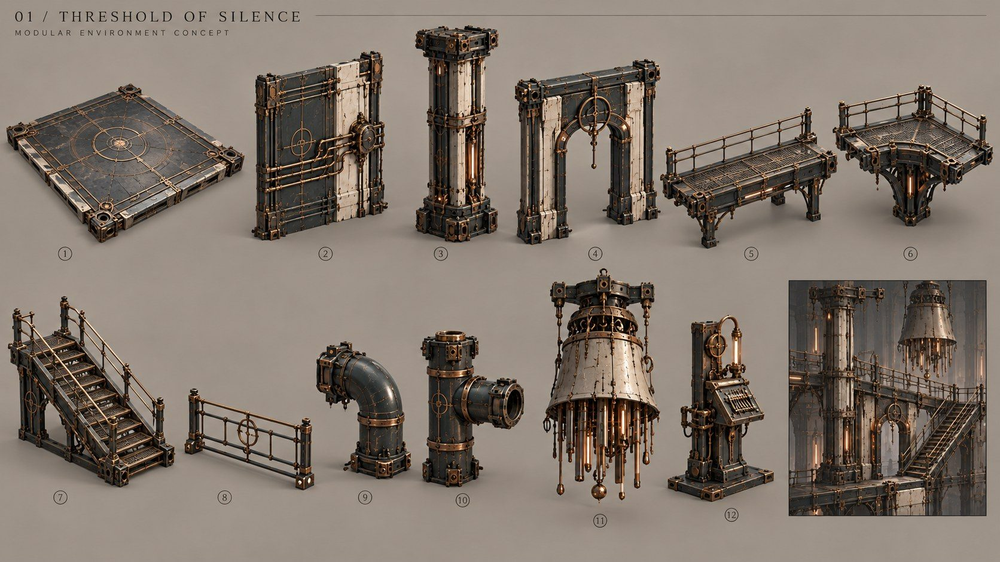
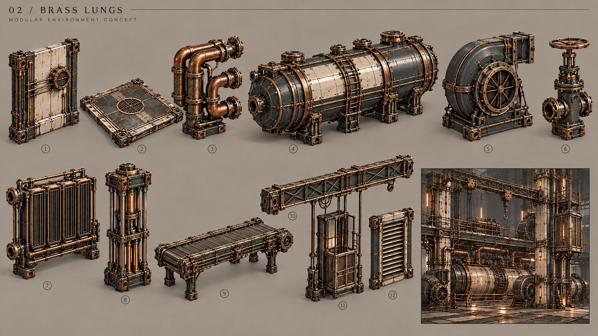
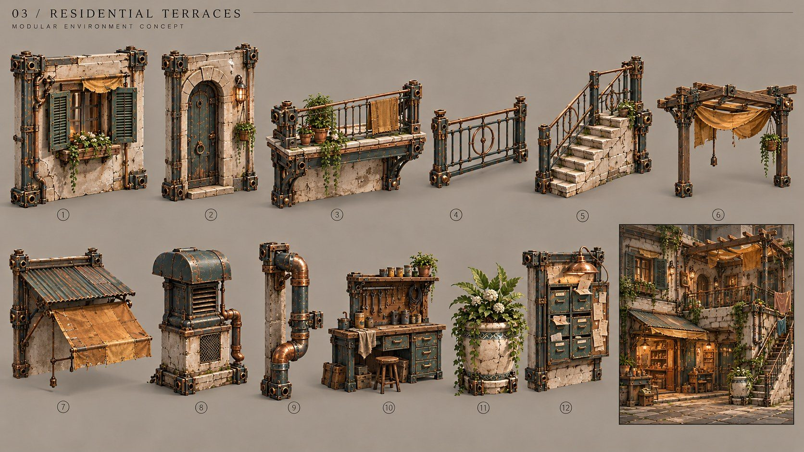
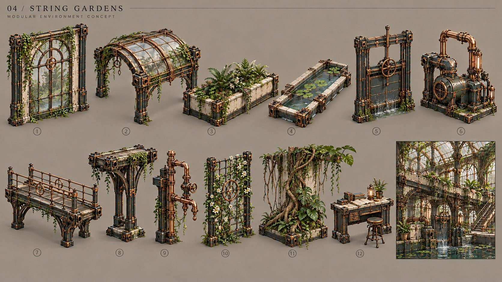
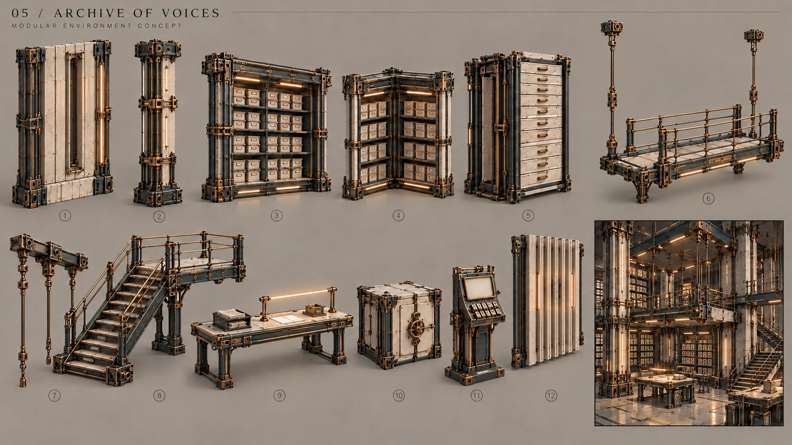
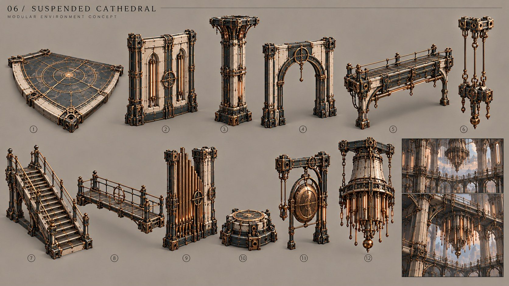

# Модульні концепт-набори · v0.2

Шість аркушів, по 12 пронумерованих концептів. Це згенеровані візуальні референси, не 3D-меші та не точні технічні креслення. Кількість концептів не дорівнює кількості унікальних майбутніх моделей: база й деталі повторюються між районами.

Поточний порядок: історія → блокаут → механіки → меші й оточення. Майбутній 3D-генератор тестується після затвердження розмірів у блокауті.

## Спільна мова

Темно-бірюзовий несучий метал, світла кераміка, приглушена мідь. Заводи мають різний стан роботи; житловий набір додає тканину й дерево, сади — скло й рослини, архів і собор — великі архітектурні маси. Чистота попередніх аркушів не є фінальним матеріальним напрямком; пріоритет v0.4 — причинне зношення і покинутість.

## Модульний контракт

Поворот і стикування на погодженій сітці; опорний pivot; прямий, кутовий і перехідний модулі; зрозумілі проходи; окремі колізії й рухомі частини. Конкретну сітку, розміри, трикутники й матеріальний бюджет визначає реальний еталон після блокаута, а не картинка.

Рослини, вода, декалі й світлові вставки не повинні бути невіддільно запечені у кожну стіну. Для генерації 3D спочатку вибираємо й ізолюємо один базовий модуль; не подаємо весь аркуш як запит на один великий меш.

## 1. Поріг тиші

| Номер | Концепт |
| --- | --- |
| 1 | Плита підлоги |
| 2 | Стінова панель |
| 3 | Колона |
| 4 | Дверний портал |
| 5 | Прямий місток |
| 6 | Кутовий місток |
| 7 | Сходи |
| 8 | Перила |
| 9 | Коліно труби |
| 10 | Т-подібна труба |
| 11 | Підвісний акустичний корпус |
| 12 | Технічний термінал |

## 2. Мідні легені

| Номер | Концепт |
| --- | --- |
| 1 | Коротка стіна |
| 2 | Сервісна плита |
| 3 | Повітряний колектор |
| 4 | Тисковий барабан |
| 5 | Повітродувка |
| 6 | Клапан |
| 7 | Радіатор |
| 8 | Поршень |
| 9 | Конвеєр |
| 10 | Кранова балка |
| 11 | Підйомникова кліть |
| 12 | Вентиляційна панель |

## 3. Житлові тераси

| Номер | Концепт |
| --- | --- |
| 1 | Стіна з вікном |
| 2 | Двері з порталом |
| 3 | Балкон |
| 4 | Балконні перила |
| 5 | Зовнішні сходи |
| 6 | Пергола |
| 7 | Навіс |
| 8 | Вентиляційний корпус |
| 9 | Водостічна труба |
| 10 | Ремонтний верстак |
| 11 | Керамічний вазон |
| 12 | Поштова та оголошувальна панель |

## 4. Струнні сади

| Номер | Концепт |
| --- | --- |
| 1 | Скляна стіна |
| 2 | Проліт даху |
| 3 | Грядка |
| 4 | Водний канал |
| 5 | Шлюз |
| 6 | Помпа |
| 7 | Місток |
| 8 | Опора верхнього проходу |
| 9 | Поливний колектор |
| 10 | Шпалера |
| 11 | Корені та ліани на базі |
| 12 | Сервісний стіл |

## 5. Архів голосів

| Номер | Концепт |
| --- | --- |
| 1 | Стінова панель |
| 2 | Колона |
| 3 | Пряма секція полиць |
| 4 | Кутова секція полиць |
| 5 | Шафа носіїв |
| 6 | Підвісний місток |
| 7 | Підвіс і кріплення |
| 8 | Сходи з площадкою |
| 9 | Читальний стіл |
| 10 | Сейф документів |
| 11 | Індексний термінал |
| 12 | Акустична панель |

## 6. Підвішений собор

| Номер | Концепт |
| --- | --- |
| 1 | Сектор арени |
| 2 | Стінова секція |
| 3 | Колона з капітеллю |
| 4 | Арка |
| 5 | Опорний місток |
| 6 | Підвісний вузол |
| 7 | Парадні сходи |
| 8 | Вузький місток |
| 9 | Органні труби |
| 10 | Тактильний резонатор |
| 11 | Гонг з рамою |
| 12 | Корпус центрального регулятора |

## Пов’язані документи

[Реєстр 72 концептів](MODULAR_ASSETS.csv) · [Головний реєстр](ASSETS.csv) · [Рівні](LEVEL_DESIGN.md) · [Промпти](references/modular-kits/PROMPTS.md).

## Поточний комплект першої локації

Кітбаш для L01 уточнюється в [STYLE_DIRECTION_v08](STYLE_DIRECTION_v08.md) і [L01_GATES](L01_GATES.md). До архітектури додано спільну раму, телескопічні секції решітки, підлогове гніздо, дверну стулку й вставку стану. Це концепти та вимоги до блокаута, готові 3D-меші ще не створені.
