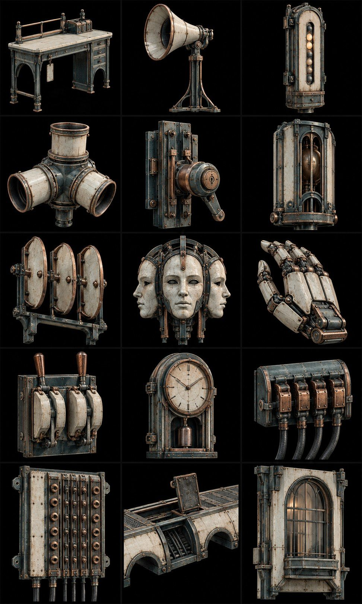
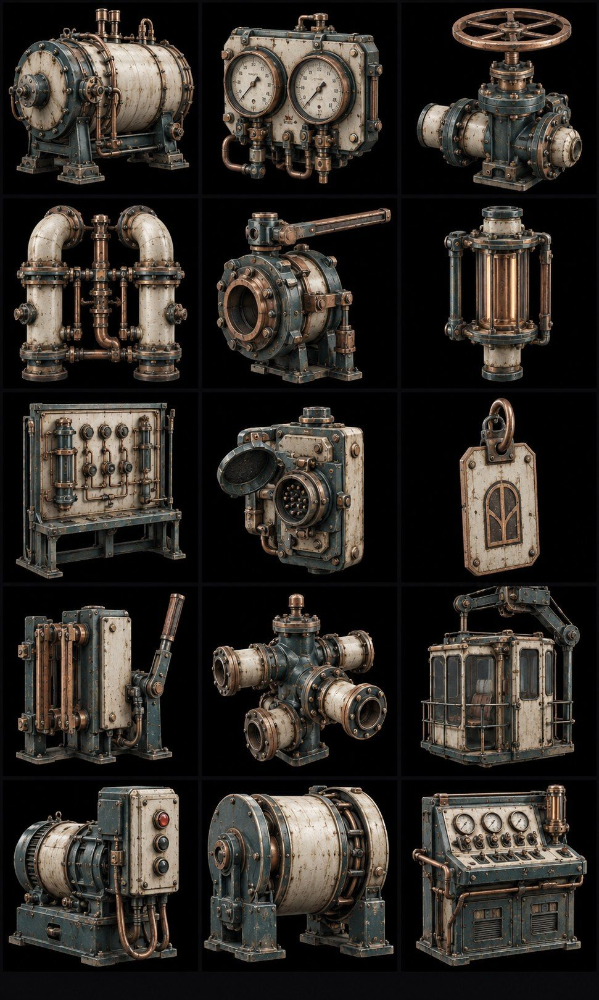
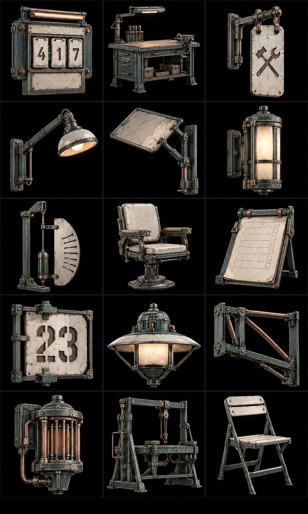

# Пропси і меші за рівнями · v0.6

90 ключових концептів із прив’язкою до 30 рівнів. Це список дизайнів, не обіцянка 90 унікальних фінальних моделей: корпуси, ручки й кріплення перевикористовуються. 3D-меші не створені. Зображення є концепт-рендерами; схеми не є обмірними кресленнями.

## Спільна конструкція

| ID | Модуль | Контракт |
| --- | --- | --- |
| B01 | Підлога 2×2 м | кут на сітці, статична колізія |
| B02 | Стіна 2×3 м | нижній кут, приховування перед камерою |
| B03 | Проліт стіни 4×3 м | без розтягування дверей |
| B04 | Портал 1,5×2,5 м | окрема стулка AN-P01 |
| B05 | Місток 1,5×4 м | опорний край, колізія проходу |
| B06 | Поворотна площадка 2×2 м | статична, перила окремо |
| B07 | Сходовий марш 1,5 м | підйом 0,15 м, проступ 0,30 м, колізійна рампа |
| B08 | Перила 2 м | не перекривають активний телеграф |
| B09 | Опора 0,5×0,5×3 м | кратна поверху 3 м |
| B10 | Кабелепровід 2 м та кут | фоновий, позначені контакти окремо |
| B11 | Сервісна станція ремонту | рухомий фіксатор AN-P06 |
| B12 | Checkpoint/контрольний маяк | світловий стан AN-P07 |

Розміри є стартовими гіпотезами [METRICS](METRICS.md). Перила, важелі, світло, VFX і колізія окремі від основної архітектури. Один mesh не містить весь район. На картинках кожна комірка має чорний фон, вузький кут огляду як ціль, об’єкт на більшій частині квадратного поля. Без точного turnaround не передаємо як гарантовану ортографію.

## 1. Поріг тиші

Рядки 1-5 відповідають C1L1-C1L5; колонки 1-3 відповідають ID 01-03.

| Ряд / рівень | Колонка 1 | Колонка 2 | Колонка 3 |
| --- | --- | --- | --- |
| 1 · [C1L1](levels/C1L1.md) | Сервісний стіл з биркою | Навчальний рупор на стійці | Індикатор підйомника |
| 2 · [C1L2](levels/C1L2.md) | Трійник акустичних труб | Сервісний замок підйомника | Калібрувальна камера відгуку |
| 3 · [C1L3](levels/C1L3.md) | Адресний резонатор з трьома пластинами | Маска Трьох облич | Складена механічна долоня |
| 4 · [C1L4](levels/C1L4.md) | Подвійний рубильник | Табельний годинник | Резервна кабельна колодка |
| 5 · [C1L5](levels/C1L5.md) | Розподільна панель адрес | Кабельний місток з люком | Віконний модуль житлової адреси |

Базова архітектура: [модульний аркуш](references/modular-kits/01-threshold.jpg). Малі форми й декалі беруться з DETAIL_ASSETS і SMALL_FORMS; не усі декоративні ресурси повторно намальовані в новому аркуші.

## 2. Мідні легені

Рядки 1-5 відповідають C2L1-C2L5; колонки 1-3 відповідають ID 01-03.

| Ряд / рівень | Колонка 1 | Колонка 2 | Колонка 3 |
| --- | --- | --- | --- |
| 1 · [C2L1](levels/C2L1.md) | Тисковий барабан | Панель двох манометрів | Ручний байпасний клапан |
| 2 · [C2L2](levels/C2L2.md) | Двоконтурний колектор | Поворотний клапан з фіксаторами | Оглядовий індикатор житлового контуру |
| 3 · [C2L3](levels/C2L3.md) | Контактний навчальний стенд | Клема ремонтного зв’язку | Адресна бирка мешканця |
| 4 · [C2L4](levels/C2L4.md) | Ізоляційний рубильник | Ремонтний розгалужувач | Кранова сервісна кабіна |
| 5 · [C2L5](levels/C2L5.md) | Стартер головної помпи | Демпфер барабана | Вихідний пульт резерву |

Базова архітектура: [модульний аркуш](references/modular-kits/02-brass-lungs.jpg). Малі форми й декалі беруться з DETAIL_ASSETS і SMALL_FORMS; не усі декоративні ресурси повторно намальовані в новому аркуші.

## 3. Житлові тераси

Рядки 1-5 відповідають C3L1-C3L5; колонки 1-3 відповідають ID 01-03.

| Ряд / рівень | Колонка 1 | Колонка 2 | Колонка 3 |
| --- | --- | --- | --- |
| 1 · [C3L1](levels/C3L1.md) | Адресна плита зі змінними вкладками | Спільний ремонтний стіл | Дверна бирка майстерні |
| 2 · [C3L2](levels/C3L2.md) | Поворотна сервісна лампа | Плоский відбивач на шарнірі | Адресний світлоприймач |
| 3 · [C3L3](levels/C3L3.md) | Щитовий тестовий маятник | Ремонтне крісло мешканця | Планшет паперової черги |
| 4 · [C3L4](levels/C3L4.md) | Трафарет старої адреси | Даховий світильник | Опорна рама знака |
| 5 · [C3L5](levels/C3L5.md) | Аварійний приймач такту | Робоча рама загального ремонту | Складаний стілець мешканця |

Базова архітектура: [модульний аркуш](references/modular-kits/03-residential.jpg). Малі форми й декалі беруться з DETAIL_ASSETS і SMALL_FORMS; не усі декоративні ресурси повторно намальовані в новому аркуші.

## 4. Струнні сади

Рядки 1-5 відповідають C4L1-C4L5; колонки 1-3 відповідають ID 01-03.

| Ряд / рівень | Колонка 1 | Колонка 2 | Колонка 3 |
| --- | --- | --- | --- |
| 1 · [C4L1](levels/C4L1.md) | Навчальна мембрана соль | Рівнемір води | Скляний вентиляційний ліхтар |
| 2 · [C4L2](levels/C4L2.md) | Резонансна чаша A | Резонансна чаша B | Противага підйомного містка |
| 3 · [C4L3](levels/C4L3.md) | Сухий контейнер кальки | Зрошувальний двовентильний вузол | Опора перенесеної лози |
| 4 · [C4L4](levels/C4L4.md) | Секційна ручна жалюзі | Локальний приймач помпи | Тепличний теплоіндикатор |
| 5 · [C4L5](levels/C4L5.md) | Стабілізатор мембрани | Помповий ручний стартер | Берегова адресна стійка |

Базова архітектура: [модульний аркуш](references/modular-kits/04-gardens.jpg). Малі форми й декалі беруться з DETAIL_ASSETS і SMALL_FORMS; не усі декоративні ресурси повторно намальовані в новому аркуші.

## 5. Архів голосів

Рядки 1-5 відповідають C5L1-C5L5; колонки 1-3 відповідають ID 01-03.

| Ряд / рівень | Колонка 1 | Колонка 2 | Колонка 3 |
| --- | --- | --- | --- |
| 1 · [C5L1](levels/C5L1.md) | Навчальна пара адресних вузлів | Рухомий читальний стіл | Світлова колона архіву |
| 2 · [C5L2](levels/C5L2.md) | Архівний програвач A | Архівний програвач B | Стіл суміщення кальок |
| 3 · [C5L3](levels/C5L3.md) | Тактильний стартер підархіву | Демпфований поворотний екран | Низький маяк виходу |
| 4 · [C5L4](levels/C5L4.md) | Фізичний картридж Провідника | Монтажна рамка запису | Іменний архівний осередок |
| 5 · [C5L5](levels/C5L5.md) | Регулятор команди стирання | Носій фізичної копії | Архівна вихідна брама |

Базова архітектура: [модульний аркуш](references/modular-kits/05-archive.jpg). Малі форми й декалі беруться з DETAIL_ASSETS і SMALL_FORMS; не усі декоративні ресурси повторно намальовані в новому аркуші.

## 6. Підвішений собор

Рядки 1-5 відповідають C6L1-C6L5; колонки 1-3 відповідають ID 01-03.

| Ряд / рівень | Колонка 1 | Колонка 2 | Колонка 3 |
| --- | --- | --- | --- |
| 1 · [C6L1](levels/C6L1.md) | Навчальний розподільник сі | Двопозиційний адресний пост | Тактильна діафрагма |
| 2 · [C6L2](levels/C6L2.md) | Захищений адресний приймач | Підіймальна противага | Натяжна опора мосту |
| 3 · [C6L3](levels/C6L3.md) | Переносний тактильний резонатор | Сидіння останнього слухача | Пюпітр незавершеного протоколу |
| 4 · [C6L4](levels/C6L4.md) | Триконтурний пульт регулятора | Видимий ізолятор команди | Серцевина підвішеного органа |
| 5 · [C6L5](levels/C6L5.md) | Фінальний пульт трьох дій | Двері зі знаком майстра | Стіл повернення з вільним місцем |

Базова архітектура: [модульний аркуш](references/modular-kits/06-cathedral.jpg). Малі форми й декалі беруться з DETAIL_ASSETS і SMALL_FORMS; не усі декоративні ресурси повторно намальовані в новому аркуші.

## Анімаційний контракт і приймання

Рухомий об’єкт розбивається на нерухомий корпус і рухомі частини з фізично правильною віссю. Стани closed/open/blocked/reset, позначені анімацією AN-Pxx, мають узгоджену колізію й звук. Реєстри: [LEVEL_MESHES.csv](LEVEL_MESHES.csv), [ANIMATION_REGISTER.csv](ANIMATION_REGISTER.csv), [ENEMIES](ENEMIES.md), [BOSSES](BOSSES.md). Вода, світло індикатора й reveal хвиль можуть бути матеріальними станами; їм не потрібен скелетний mesh, але потрібний таймінг.

Для кожного рівня: спільні B01-B12 + перелічені PR + вибрані MOD/DET/DEC + героїня/Провідник + явно названі вороги. Невикористана прикраса з аркуша не стає автоматично вимогою. Для C1L1 додатково використовуються PR-C1L2-01/02, PR-C1L3-01/02/03, PR-C1L4-01/03, бо три задачі та бос перенесені в один деморівень. Калібрувальна камера на аркуші 1/ряд2/кол3 була згенерована під стару назву Перший голос; тепер це нерухомий навчальний стенд, бос із неї не виробляється.
