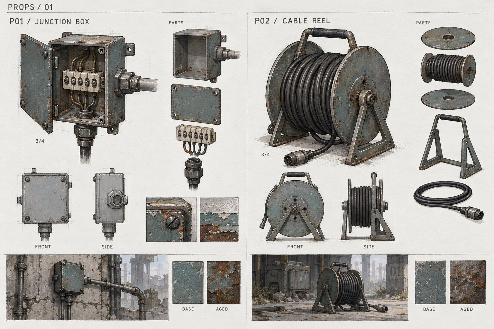
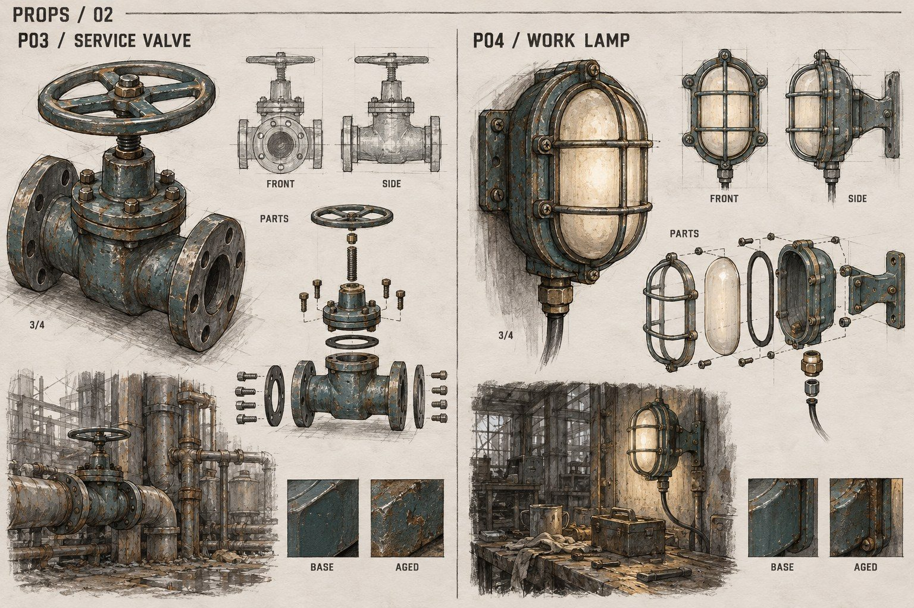
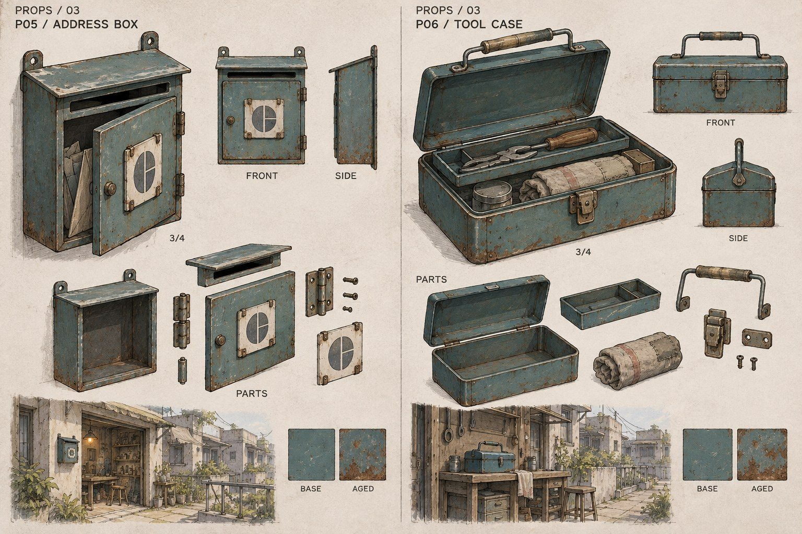
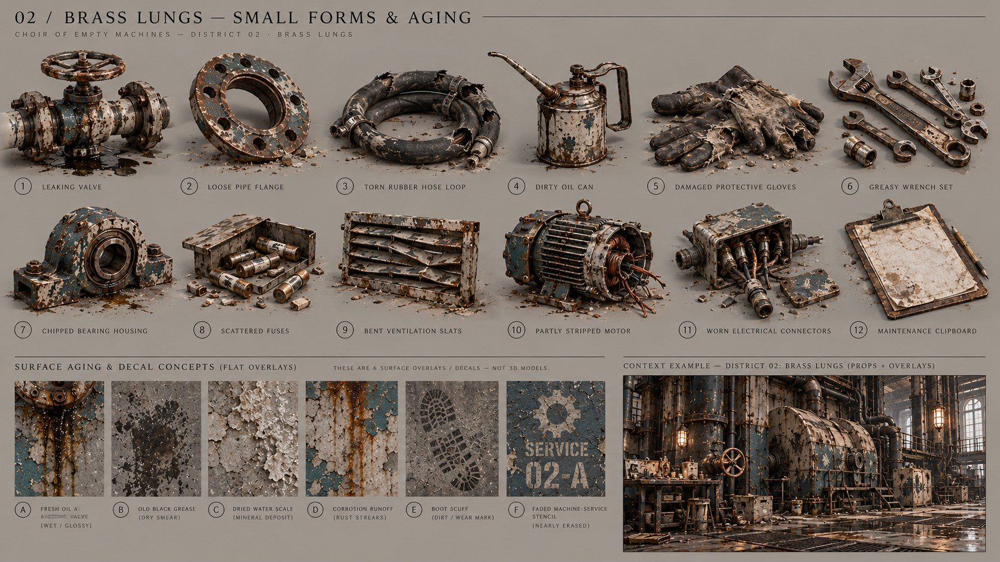
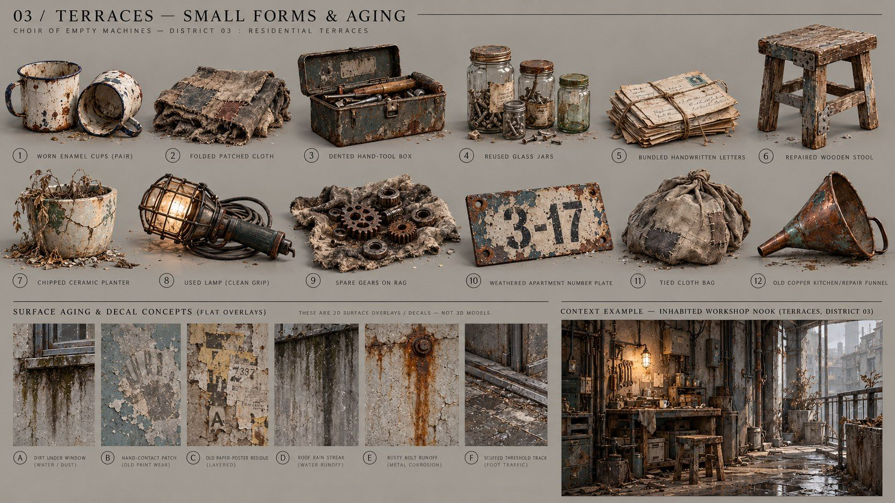
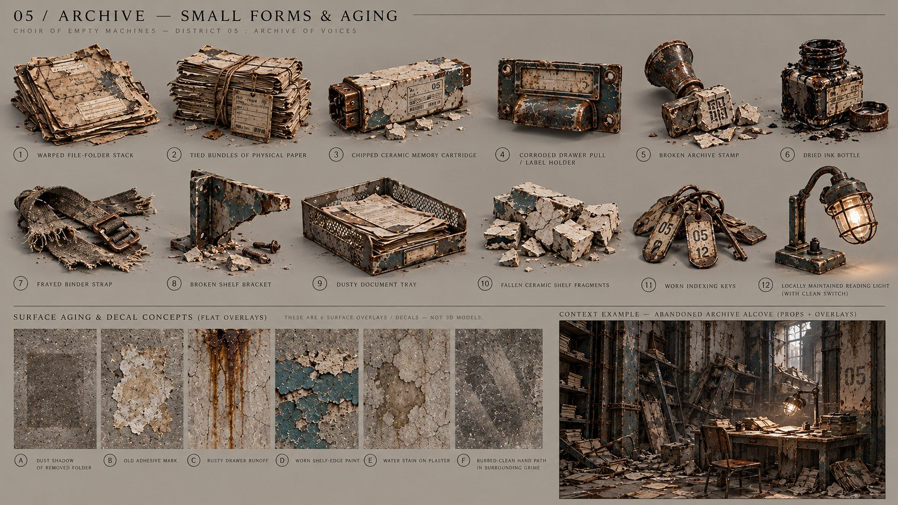

# Малі форми й конструктивні замальовки · v0.4

Архівний матеріал v0.4. Пропси наразі відкладені; цей документ не є активним обсягом робіт. Поточний фокус: ігровий блокаут і великі модульні форми.

## Готові конструктивні аркуші

Це шість детально розібраних предметів у трьох районах; не шість завершених районних наборів. Для садів, архіву й собору конструктивні аркуші ще потрібні. Дрібні болти, хомути, шарніри, кришки й ручки повторно використовуються як кітбаш-деталі; не зливаємо їх без потреби в один неперевикористовуваний меш.

## Ранні пошуки дрібних форм і плям

П'ять аркушів нижче збережено як ранні пошуки: предмети у одному ракурсі, по 12 позицій і шість зразків зносу. Їх недостатньо як самостійної основи для 3D-генерації; потрібен вибраний ізольований предмет і розробка конструкції. Смуги декалей є малюнками плям, не готовими безшовними текстурами з альфою.

### Поріг тиші

> Прев’ю не включене: вихідне зображення обрізане. Запис збережено лише як архівний матеріал.

### Мідні легені

### Житлові тераси

### Струнні сади

> Прев’ю не включене: вихідне зображення обрізане. Запис збережено лише як архівний матеріал.

### Архів голосів

## Реєстр і статус

[DETAIL_ASSETS.csv](DETAIL_ASSETS.csv) містить 109 позицій: 73 пропси й 36 декалей. З них 90 показані на п'яти ранніх аркушах; окрема поштова скринька має конструктивний малюнок; 18 позицій собору поки заплановано. Детальніший малюнок уже внесеного предмета не рахується другим готовим ресурсом. Готових 3D-мешів чи декаль-текстур ці зображення не додають.

[Промпти й спосіб генерації](references/prop-studies/PROMPTS.md) · [Зношення](DECALS_AND_AGING.md) · [Покриття](ASSET_COVERAGE.md) · [Метрики](METRICS.md).

