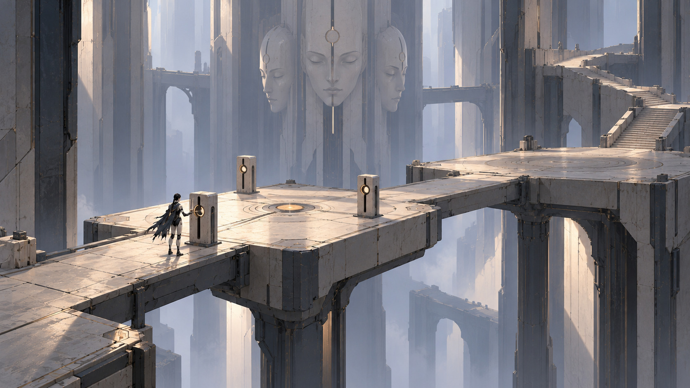
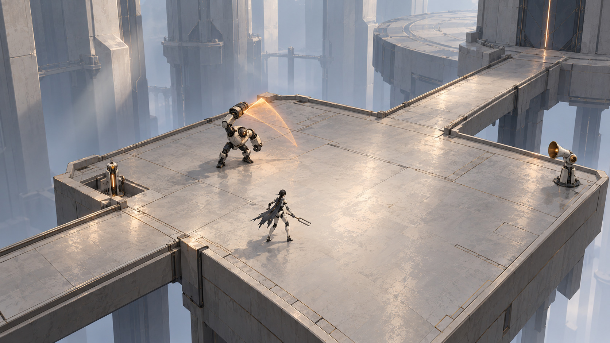

# Стиль v0.8: монументальність, повітря і гра

27.10.2026. Напрямок користувача: зали без видимого кінця й краю, ігрові платформи серед величезної архітектури, більш повітряний простір і мінімум environment-пропсів. Нові два кадри є пошуком цього напрямку, їхнє фінальне схвалення не вигадуємо. Перший пріоритет користувача: думати як геймдизайнер, щоб рівні були ігровими.

## Загальний простір

Кілька гігантських мас виходять за межі кадру. Верх, низ і дальня межа залу губляться в повітряній перспективі; між ними багато вільного простору. Ігровий маршрут компактний і має читабельні з’єднання. Архітектура підтримує відчуття нескінченності через повтор ритму, втрату контрасту й перекриття великих форм; гравець не має йти кілометрами до наступної дії.

Пропонуємо світлу мінеральну кераміку, темні великі вставки, широке розсіяне світло й невеликі теплі функціональні акценти. Блакитна відстань додає глибину; об’єкти біля героя лишаються контрастними. Темний підархів зберігається як локальний контрастний епізод, а не загальне освітлення всієї гри.

## Ігрова камера

Ближча піднята камера показує героя, активних ворогів, край площадки та місце для контрдії. Широкий простір перед героїнею дозволяє вибрати сторону обходу. Один Тактовик і Рупор навчають різних відповідей; перший спільний тест чергує їхні сигнали.

На зображенні дуга піднятої руки є художнім ескізом руху. Реальний сектор шкоди повинен читатися на підлозі й збігатися з hitbox, що належить перевірити в greybox. Статичний кадр не доводить правильність колізії, радіуса, ширини проходу чи таймінгу.

## Щільність і форми

- Великі площини з одним-двома зрозумілими стиками. Контакт і легка матеріальна неоднорідність дають масштаб без сітки дрібних накладок.
- Один головний орієнтир на ділянку. Декоративна деталь має лишатися тихішою за потрібний механізм.
- Простий циліндр, плита, проріз, кільце або маска читаються з ігрової камери й підходять для подальшого створення окремими ресурсами.
- Зношення локальне й широке за масштабом. Без суцільних дрібних тріщин і сколів на всіх ребрах.
- Світло спрямовує до дії; фон не засипаний ліхтарями, кабелями, ящиками й дрібним механічним декором.

Це зменшує число унікальних деталей, але не доводить автоматично низьку вартість генерації або хорошу топологію. Геометрію, стики й колізію перевіряємо на одному пробному модулі після блокаута.

## Модульна архітектура: кітбаш замість унікальних шматків

Цей аркуш є візуальним напрямком кітбашу, а не фінальними моделями чи затвердженим розмірним стандартом. Для блокаута пропоную базовий крок сітки 2 м: прості плити 2×2 і 4×4 м, настил мосту шириною 4 м і довжинами 4/8 м, окремі торцева площадка та сходовий марш із площадкою. Фактичний набір уточнити після перевірки масштабу героїні, камери, колізій та стиків у рушії.

Колону збирати з окремих основи, повторюваної секції стовбура та капітелі; висоту набирати кількістю секцій, а не моделлю на кожну висоту. Великі пілони та портали мають кілька сумісних частин і чисті площини. Кутові, прямі й круглі кромки арени потрібні як окремі форми, щоб маршрут можна було компонувати, а не вирізати з одного унікального меша.

Правила кітбашу для ігрового маршруту:

- Прохідні поверхні та їхня колізія мають залишатися простими й передбачуваними. Декоративні накладки не звужують заявлену ширину мосту.
- Кожен стик вирівнюється по спільному кроку; модулі не перекриваються випадково, між ними немає щілин для падіння.
- Ширина основного мосту для демо лишається щонайменше 3 м, підхід до арени 4 м згідно з блок-аутом. Кітбаш не змінює ці ігрові розміри.
- Бортик/край є окремим повторюваним модулем. Він має однакову висоту, видимість і поведінку на всіх небезпечних краях; його не слід підміняти непомітною декорацією.
- Великі колони й пілони переважно ставимо за межами лінії руху. Якщо вони стоять на бойовій площадці, перевіряємо, що не перекривають ворога, телеграф атаки, обхід і камеру.
- Варіацію створюють перестановка, висота, поворот, великі матеріальні панелі й світло. Не додаємо десятки дрібних унікальних деталей заради відмінності кімнат.

Для вертикальної збірки першими потрібні: плита; міст; площадка; сходовий марш; бортик; основа, секція й верх колони; пілон; рамка проходу; сегмент круглого краю. Інтерактивні корпуси та актори лишаються окремими ресурсами, щоб їх можна було читати й анімувати незалежно від архітектури.

## Пропонований мінімальний набір для демо

| Група | Унікальні форми | Використання |
| --- | --- | --- |
| Архітектура, 6 базових форм | Плита; край/низький бортик; міст; сходовий марш; рамка шлюзу; великий фоновий пілон | Розмір і повороти узгоджені зі сіткою; не генеруємо кожну площадку як окрему складну модель |
| Взаємодія, 3 корпуси | Резонатор; важіль; інтегрована сервісна станція | Порт, пластина, покажчик і навчальна нота використовують ці корпуси з окремим графічним станом |
| Бос, 2 основні збірки | Маска; долоня | Три обличчя є варіаціями однієї базової конструкції; це анімовані актори, не декор кожної кімнати |
| Актори | Героїня; Провідник; Тактовик; Рупор | Поза й поведінка окремі від архітектурного набору |

Це пропозиція кількості після поточного обмеження, не вже створені або затверджені фінальні меші. Нові пропс-рендери зараз не робимо. Два атмосферні кадри не є замовленням на генерацію всіх об’єктів із них.

## Як відрізняються шість рівнів при малій кількості ресурсів

| Рівень | Ігрова відмінність | Сценографія й великий образ |
| --- | --- | --- |
| L01 Поріг | Навчання; три локальні задачі; рядові; один бос | Повітряна група платформ і три далекі маски як орієнтир |
| L02 Легені | Два контури, вертикальний огляд і розрив керівного зв’язку | Один великий барабан і два широкі канали замість сотень труб |
| L03 Тераси | Знайти адресу й спрямувати локальне світло | Заселена ніша в гігантській оболонці; один стіл, лампа й теплий отвір |
| L04 Сади | Вода змінює доступ до нижнього маршруту | Одне дерево, дві чаші, широка вода й чисті містки; без десятків рослинних пропсів |
| L05 Архів | Зіставлення доказів і короткий темний шлях за хвилями | Два масиви полиць як великі форми, один стіл, локальні сліди кроку |
| L06 Собор | Зібрати відомі відповіді й обрати режим | Кілька підвішених мас регулятора та три пости на широких площадках |

Функціональні відмінності передують перестановці декору. Райони відрізняються доступом, задачею і ритмом, а світло й великі маси підсилюють цю різницю.

## Порядок наступної перевірки

[Ігровий план L01](L01_GAMEPLAY.md) і [схема](references/style-v08/L01-blockout.svg) задають маршрут до фінального оточення. Спочатку проходимо його з простими площинами й двома типами ворогів; перевіряємо ціль кожної зупинки, час, відповідь на небезпеку та повернення після смерті. Потім збираємо один еталонний кадр.

Кадри v0.7 з густою механікою лишаються історичними пошуками. Новий пріоритет: багато повітря, небагато сильних форм, мінімум унікальних дрібних пропсів, ігровий маршрут у кожному кадрі. Сюжет, сім нот, один деморівень і робоча ціль близько трьох годин зберігаються.
