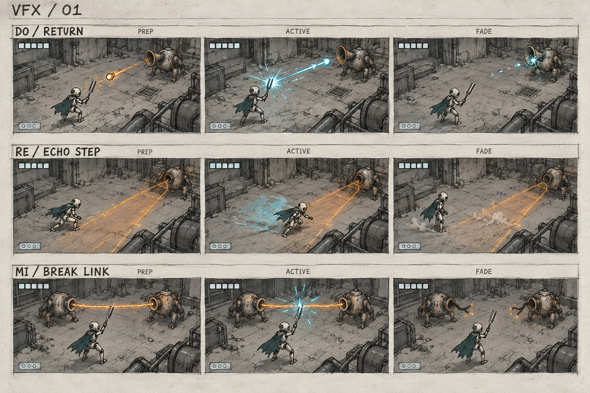
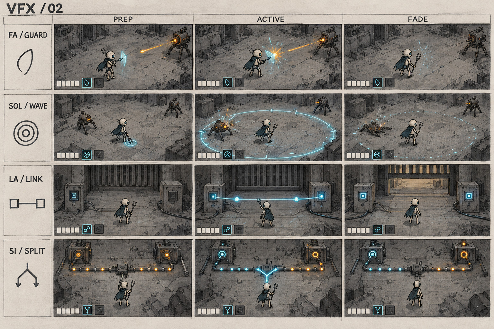

# VFX · замальовки і контракт v0.4

Користувач додав замальовки VFX. Аркуші є концептами станів; їх ще не реалізовано в Unreal. Спочатку читається намір та край небезпеки, потім прикраса. Фантастичний резонанс поєднується з пилом, механічним контактом і старими матеріалами світу.

## Готові замальовки

Сім навичок: до — повернення, ре — крок відлуння, мі — розрив, фа — захисний такт, соль — хвиля, ля — зв’язок, сі — розділення. Значення й відкриття: [PROGRESSION](PROGRESSION.md). HUD на малюнках схематичний; кількість маленьких позначок на першому аркуші не визначає число активних слотів.

Окремо [водоподібний відгук кроків](SONAR_MAZE.md): це базове сприйняття руху, не восьма навичка. Аркуші ворогів і фонових ефектів ще не намальовано; таблиці нижче є планом, а не доказом готових зображень. Точні таймінги, кількість частинок і GPU-вартість з картинки не визначаються.

## Герой

| ID | Ефект | Підготовка → дія → згасання | Межа читабельності |
| --- | --- | --- | --- |
| VFX-P01 | Крок і контакт | Невеликий пил або волога від матеріалу | Не світиться як снаряд |
| VFX-P02 | Ухилення | Стисла поза → коротка розірвана бірюзова траса → швидкий хвіст | Видимий герой не ховається за хмарою |
| VFX-P03 | Відбиття | Камертон замикає контакт → малий яскравий акцент → направлений відгук | Збігається з фактичним вікном і напрямком |
| VFX-P04 | Удар | Коротка дуга біля інструмента → контакт і дрібна крихта | Дуга не обіцяє шкоди за межами hitbox |
| VFX-P05 | Хвиля соль | Збір тону → тонка читабельна межа хвилі → розпад на слід | Розмір відповідає метриці дії, не довільному bloom |
| VFX-P06 | Передача голосу | Видима точка джерела → стримана спрямована лінія → згасання в інструменті | Лишається дія й джерело, не абстрактний спалах на весь екран |

## Вороги

| ID | Ефект | Завчасний сигнал | Активна шкода |
| --- | --- | --- | --- |
| VFX-E01 | Удар Тактовика | Сектор інструмента і механічна підготовка | Чіткий короткий сектор контакту |
| VFX-E02 | Імпульси Рупора | Напрямок віяла й виразна форма відбивного імпульсу | Видиме контрастне ядро |
| VFX-E03 | Ривок Катушки | Лінія натягу і локальний пил | Видима колія; уламки декоративні |
| VFX-E04 | Зв’язок Зшивача | Дві точки, кабель або спрямований слабкий пульс | Переривання дає короткий ясний відгук |
| VFX-E05 | Кільце | Показ джерела і підготовка | Тонкий видимий край, який не плутається з фоновою декаллю |
| VFX-E06 | Промінь | Напрямок фіксується на початку попередження | Активна форма збігається з раніше показаною лінією |

## Середовище

| Район | Фонові ефекти | Що не повинні закривати |
| --- | --- | --- |
| Поріг тиші | Пил у світлі, рідкісна крихта, рух паперу | Силует, проходи й сюжетний лист |
| Мідні легені | Переривчастий витік пари, локальна масляна крапля, вібрація | Бойовий телеграф і працюючий клапан |
| Житлові тераси | Тканина, малі теплі пилові плями біля лампи, побутова дія | Вікно, знак адреси й контакт мешканця |
| Струнні сади | Краплі, невеликі водні кола, листя й відгук клапана | Прохідний берег і активну хвилю |
| Архів голосів | Повільний пил, окремий папір, дрібний контакт носія | Читання і шлях між полицями |
| Підвішений собор | Стриманий пил, відгук підвісу, хвіст партії | Центр дії й видимий край небезпеки |

## Виробничі правила

Геометрія шкоди є авторитетною, VFX наслідує її. Стан підготовки, активності й згасання має різний силует або характер руху, не лише інший колір. Важливий сигнал читається без bloom, без звуку й з меншою якістю ефектів.

Зображення не визначає точні кількості частинок чи підтримку графічного профілю. На етапі механік спочатку робимо простий читабельний маркер, потім замінюємо його на ефект. Матеріал сцени визначає пил, іскри чи воду, але не змінює дистанцію шкоди.

## Перевірка

Переглянути кожен ефект на найбруднішому фоні й на охайному робочому місці. Перевірити hero/target на іншому ярусі, дві одночасні загрози, зміну камери, паузу й менший Android-профіль. Виміряти екранну площу прозорості та GPU-час; декоративний хвіст можна скорочувати, телеграф залишається чесним.

## Актуалізація героїні v0.5

ГГ змінено на [жіночний роботизований образ](CHARACTER_DESIGN.md). Малий робот на цих двох аркушах — історичний носій ефекту. Форми, стани й зв'язок із дією зберігаються; прив'язку до руки, камертону, стопи й нового силуету перевіряємо після вибору дизайну.
