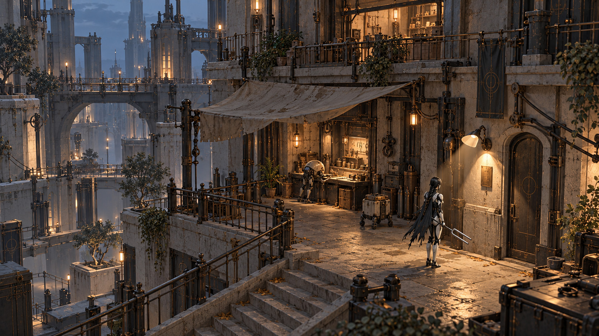

# L03 · Житлові тераси: атмосфера

> Стиль оновлено до [повітряної монументальності v0.8](../STYLE_DIRECTION_v08.md). Кадр v0.7 нижче є історичним пошуком густоти деталей; функція й ритм ділянок зберігаються. Насамперед перевіряємо маршрут, а не наповнюємо декором.

Редакція 0.7, 27.10.2026. Поточний фокус: атмосфера та візуал. Шість рівнів і розподіл по 30 хв є авторською пропозицією під робочу ціль близько трьох годин; це не виміряна тривалість і не затверджений фінальний обсяг.

## Відчуття та композиційна опора

Коротке відчуття дому й чужої турботи. Орієнтир: Одне тепле вікно майстерні над спільним столом. Головний сюжетний рух: Побачити за адресами мешканців.

## Світло, колір і матеріал

Головне джерело: Тепле вікно майстерні під козирком, сутінковий небесний заповнювач зверху. Заповнення: М’який холодний внесок від відкритого двору; тепло не розливається по всій вулиці. Тональна структура: Ближня арка темна, середній стіл спокійний, двері майстерні мають один світлий край. Матеріальна поведінка: Латаний текстиль, фарбований метал зі стертими ручками, матова кераміка, сухе дерево тільки в побутових вставках.

Палітра sRGB для розмови про колір, не фізичні значення світла чи альбедо: `#26333D` · `#626B74` · `#B9A991` · `#B87E48` · `#D3C8B0`. Бурштиновий небезпечний імпульс і холодний відгук героїні зберігають однаковий зміст у всіх рівнях. Спокійне робоче світло відрізняється формою й нерухомістю від телеграфа.

## П’ять поставлених кадрів

### 1. З нижнього провулка у двір

Камера: **3/4**. Темна вхідна арка утворює рамку; тепле вікно трохи вище центра, стіл нижче.

Читабельність: Передній текстиль прибирається з контуру героїні. Подія/відгук: Спокійні робочі рухи мешканців замість монологу.

### 2. Стара адреса

Камера: **3/4 з балкона**. Звідси дві половини знака видно разом; внизу читається стіл як орієнтир повернення.

Читабельність: Форма знака важливіша за яскравість, дрібні написи дублюються в читанні. Подія/відгук: Знак не стає неоновим маркером після розв’язання.

### 3. Лампа та відбивач

Камера: **top-down / 3/4 фіксований**. Лампа, один відбивач і приймач вміщуються в один кадр трикутником.

Читабельність: Світлова пляма має тихіший край за активний приймач; маршрут без небезпеки. Подія/відгук: Відкриваються саме бокові двері, не освітлюється вся вулиця.

### 4. Балкон догляду

Камера: **side-view**. З двох ярусів видно сліди побуту, але активний лише один маршрут.

Читабельність: Нейтральний фон за світлою рукою, контакт захисної фа видно силуетом. Подія/відгук: Мешканець не змінює рутину через випадковий дотик.

### 5. Спільний стіл

Камера: **3/4 з тієї самої осі**. Повертаємося у знайомий кадр, тепер місце біля столу зайняте.

Читабельність: Новий стілець ставиться в середньому плані, а не у фокусі з іконкою нагороди. Подія/відгук: Біля майстерні лишається тепле життя, герой іде далі.

## Зміна після дії

До дії стілець стоїть осторонь і бічні двері закриті; після задачі двері відкриті, мешканець розвертає стілець до столу. Для порівняння станів зберігаємо ту саму камеру, експозицію, баланс білого й джерело неба. Спершу змінюємо саме механізм, локальне джерело або маршрут. Довільна зміна постпроцесу не замінює наслідок.

## Збірка еталонного кадру

Спочатку п’ять великих мас, один герой-dummy і прохідний маршрут. Далі основне світло й нейтральні матеріали. Потім перевірка тонів без VFX, один активний ефект та кілька причинних слідів роботи. Деталі не додаються, доки фокус не читається на зменшеному кадрі.

Зняти: робочу камеру; ту саму камеру без звуку; з активною загрозою; до/після головної дії; ближню межу зміни ракурсу. Художній кадр тут задає настрій, але не доводить правильність колізій, освітлення в UE або прохідність.

## Що не виробляємо на цьому етапі

Окремі рендери пропсів відкладені користувачем. Для блокаута достатньо наявної спільної архітектури і простих функціональних вузлів. GIF і готові анімаційні кліпи не створені цією редакцією. [Активна картка рівня](../levels/L03.md).
