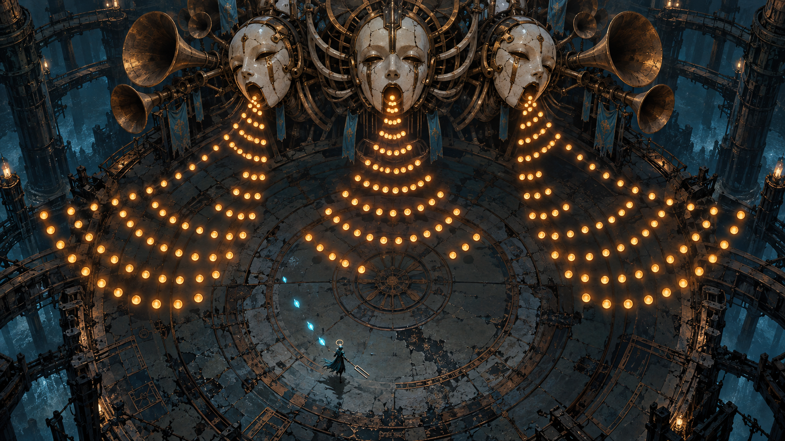

# Хор порожніх машин — GDD v0.1

## Хор порожніх машин

Геймдизайн і постановка гри

Носій входить у місто, де машини підтримують одна одну спільною піснею. Його наказ — припинити сигнал. Кожна перемога дає новий голос, але залишає за собою тишу.

Обраний візуальний напрямок: монументальні акустичні зали, керамічні обличчя, мідні органні системи та маленький герой. Гра поєднує дослідження, музично читабельний бій і короткі сюжетні сцени.

Підтверджені рамки: стартовий бюджет 0; демо від 60 хвилин; ціль кампанії 15 годин. Рушій, ціна, остаточний сюжет і формат графіки ще відкриті. Числа та сюжетні подробиці далі — пропозиції v0.1 від 14 жовтня 2026 року.

## Досвід гравця

Обіцянка гри: навчитися чути супротивника і зрозуміти, чому перемога над ним не відчувається простим звільненням. Гра не вимагає музичної освіти або абсолютного слуху.

Основний цикл: почути голос здалеку, пройти пов’язаний із ним простір, вивчити мотив у безпечній ситуації, застосувати знання в бою, забрати партію, побачити і почути зміну світу.

Три опори: голос має фізичне джерело; атака має чесний завчасний сигнал; кожна перемога змінює світ. Якщо нова функція не підтримує жодну опору, відкладаємо її.

Аудиторія: гравці, яким цікаві атмосферні бойові пригоди, виразні боси та історія через середовище. Конкретний попит на цю гру ще не перевірений.

Музика оголошує намір, а не змушує натискати кнопку на кожну долю. Можна пройти гру за візуальними сигналами. Опційне відбиття винагороджує точність, але звичайне ухилення лишається повноцінною відповіддю.

| Шар | Дія | Результат |
| --- | --- | --- |
| Мить | Прочитати фразу і обрати позицію | Уникнути шкоди або відкрити контратаку |
| Сутичка | Поєднати рух, удар і резонанс | Зрозуміти голос і пройти перешкоду |
| Розділ | Дослідити акустичний район | Нова партія та сюжетний наслідок |
| Кампанія | Скласти частини пісні | Усвідомлений фінальний вибір |

## Герой і керування

Носій — невеликий сервісний андроїд у темно-бірюзовій мантії. Камертон одночасно є зброєю, ключем до резонаторів і носієм зібраних голосів. Провідник — механічний метроном, який надає простий пульс і короткі коментарі.

ПК: WASD або лівий стік — рух; основна кнопка — удар; Space — ухилення; друга кнопка — налаштування; E — взаємодія. При використанні геймпада є м’яка фіксація цілі. Перепризначення входить у релізний обсяг.

iPhone: лівий віртуальний стік, праворуч великі кнопки удару, ухилення та партії; налаштування можна поєднати з контекстною кнопкою. Це окрема гіпотеза для тесту. Нижні кути арени не містять єдиного безпечного проходу під пальцями.

| Дія | Початкове правило | Перевірка |
| --- | --- | --- |
| Рух | 5 ігрових метрів за секунду | Читабельний контроль між снарядами |
| Удар | Комбінація з 3 ударів, один тип зброї | Контакт збігається зі звуком і шкодою |
| Ухилення | 0,24 с невразливості; 0,7 с відновлення | Не дає проходити весь бій утриманням кнопки |
| Відбиття | Вікно 0,12 с; допоміжне 0,22 с | Зрозуміле на реальному пристрої |
| Резонанс | 0–100; активна партія коштує 40 | Немає нескінченного безпечного відновлення |

## Бойова система

Простір бою — ігрова площина з фіксованою піднятою камерою. Висота декору не змінює hitbox. Навіть за 3D-візуалу дистанції та траєкторії визначаються в цій площині.

Снаряди мають контрастне ядро, форму й передбачувану швидкість. Бурштинові круглі імпульси можна відбивати; широкі темні ударні хвилі вимагають переміщення або ухилення. Відмінність дублюється контуром, а не лише кольором.

Герой має 5 сегментів міцності. Після пошкодження діє 1 секунда захисту від повторного контакту. Звичайний промах або невдале відбиття не обнуляє всю спробу. Відновлення перед головним босом повне.

Кожен патерн проходить перевірку досяжної безпечної області. Не накладаємо два патерни, якщо їхні коридори суперечать один одному. Снаряд не з’являється в зоні героя без завчасного локального сигналу.

Для еталонного бою: telegraph щонайменше 0,8 с; візуальна активна арена приблизно 24 м у діаметрі; hitbox героя менший за декоративний плащ. Це значення для першого тесту, не остаточний баланс.

## Геймплей: бій і HUD

Стан кадру: у героя 4 з 5 одиниць здоров’я, резонанс 60/100; бос у другій фазі. Гравець читає кільця басового голосу і переміщується у відкритий сектор.

HUD у бою показує здоров’я, резонанс, фазу боса та доступні дії. Підписи з номерами пояснюють механіку в документі й не є елементами ігрового інтерфейсу.

У зображенні наведено художню інтерпретацію патерна. Точні межі шкоди, колайдери та проходи задаються схемою і перевіряються у прототипі.

## Головний бос Три обличчя

Бос має три незалежні голоси, спільне тіло і видимий стан кожного обличчя. Протягом демо гравець спочатку вчиться розрізняти їх окремо, лише потім — у комбінації.

Музичний транспорт: початкова пропозиція 96 BPM, 4/4. Доля триває 0,625 с, такт — 2,5 с. Патерн готується за такт; фаза переходить на наступній музичній межі після досягнення порогу міцності.

Перехід фази не завдає прихованої шкоди: снаряди завершуються або розчиняються з видимим сигналом. Камера не змінює масштаб під час відповідального ухилення.

Після відключення останнього голосу музика не обривається різко. Зал віддає останній хвіст, герой отримує партію, а центральне обличчя робить тихий захисний жест.

| Фаза | Правило | Контрдія |
| --- | --- | --- |
| I 100–70% | Лівий бас: три широкі віяла із стабільними проходами | Змінити сектор, відбити один позначений імпульс |
| II 70–35% | Центральний голос: кільця, пауза, один точний промінь | Ухилитися крізь кільце, використати паузу |
| III 35–0% | Правий дискант додає спіраль; голоси чергуються | Читати черговість; одночасно активні не більш як два голоси |
| Завершення | Небезпека припиняється; партія переходить герою | Наблизитися і виконати взаємодію |

## План акустичного залу

Кругла арена має центральну чисту площину, зовнішній обхід і дві ніші перепочинку. Бос займає північний край; вхід і checkpoint розташовані на півдні. Чотири колони утворюють орієнтири, але не приховують головні траєкторії.

Колони перекривають лише спеціально позначений промінь. Звичайні музичні снаряди взаємодіють із геометрією за одним послідовним правилом. Якщо перешкода не захищає, це видно під час безпечного навчання.

Резонатор у боковій ніші приймає відбитий імпульс і тимчасово приглушує голос. Він не дає безкінечно безпечно стояти: перед повтором потрібне переміщення. Нішу ніколи не закриваємо невидимим collider.

Один екран охоплює весь активний майданчик. На телефоні масштаб героя і ширина проходу перевіряються до деталізації підлоги. Схема нижче — початковий план, а не фінальний greybox.

## Годинне демо

Демо має завершену локальну арку: Носій приходить вимкнути сигнал, вчиться розуміти голоси, перемагає Три обличчя і вперше сумнівається у наказі. Орієнтир — 70 хвилин першого проходження; обов’язкова ціль — щонайменше 60 хвилин змістовної гри.

Перший голос — окремий навчальний мінібос, а не спрощена копія головного. Він дає одну партію для проходження акустичних замків. Демо містить п’ять малих сутичок, дві головоломки та дві тихі сюжетні зони.

Час не спирається на багаторазові смерті. Якщо досвідчений гравець проходить демо швидше години, додаємо новий осмислений маршрут або задачу. Примусове очікування сигналу не використовується як наповнення.

| Час | Вузол | Зміст |
| --- | --- | --- |
| 00–08 | Пробудження на мосту | Рух, ціль, перша фраза Провідника |
| 08–20 | Зал відлунь | Два джерела; безпечне відбиття; перший checkpoint |
| 20–32 | Нижня галерея | Дві сутички і задача з резонаторами |
| 32–43 | Перший голос | Мінібос, нова партія, коротка тиха сцена |
| 43–55 | Сходи слухачів | Повернення механіки в іншому контексті |
| 55–70 | Три обличчя | Головний бій, передача партії, післямова |

## Геймплей: дослідження

Носій чує голос за центральною перегородкою. Прямого проходу немає; видимий маршрут огинає стіну і приводить до резонатора. Наступний вихід поки замкнений.

Слухання підкреслює напрямок джерела, але не малює весь маршрут автоматично. Опційний візуальний покажчик дублює змістовну звукову інформацію.

У цьому стані немає шкали боса. Поточна задача коротка: знайти джерело голосу. Загальна мова HUD та сама, що в бою.

## Геймплей: резонатор

Гравець слухає три ноти, обирає низький, середній і високий регістр, підтверджує мотив. Правильна послідовність відкриває браму.

Висоту дублюють символи з однією, двома й трьома смугами. Помилка дає короткий нейтральний відгук і дозволяє повторити; здоров’я та резонанс не знімаються.

Перша головоломка навчає впізнавати регістри перед боєм. Вона не перевіряє абсолютний слух і не вимагає музичної освіти.

## План повної кампанії

Ціль 15 годин означає 900 хвилин змістовного першого проходження. Шість розділів по 150 хв — структура для оцінки, а не твердження про вже створений контент. Демо відкриває перший розділ і входить у кампанію, а не додається зверху.

Початковий кошторис контенту: 12 головних босів, до 6 необов’язкових сцен із голосами, близько 36 авторських бойових ситуацій і 18 акустичних задач. Кількість переглядаємо після виробничого тесту. Новий бос потребує власної музичної партії та анімацій, тому це суттєвий ресурсний ризик.

Типовий розділ: дослідження і просторові переходи 60 хв, акустичні задачі 35 хв, звичайні сутички 25 хв, два боси сумарно 15 хв, діалоги й постановочні сцени 15 хв. Сумарно 150 хв. Цей розподіл має підтвердитися тестами.

| Розділ | Нове правило | Сюжетний рух |
| --- | --- | --- |
| Поріг тиші | Розрізняти і повертати імпульси | Перша перемога викликає сумнів |
| Мідні легені | Повітряні канали й спрямовані хвилі | Сигнал підтримує життя машин |
| Струнні сади | Зв’язки між резонаторами | Голоси зберігають спільні спогади |
| Архів голосів | Вибір партії змінює маршрут | Наказ має неповні дані |
| Підвішений собор | Комбінація відомих мотивів | Провідник визнає власну роль |
| Незавершена пісня | Зібрані партії як фінальна дія | Вибір способу завершення хору |

## Історія і персонажі

Місто було акустичною системою: його машини координували роботу через звук. Після зникнення людей протокол підтримки поступово перетворився на хор. Він не дозволяє голосам замовкнути, але руйнує їхні корпуси постійним резонансом.

Носій отримав простий наказ: припинити небезпечне мовлення. Він не є таємним обраним героєм. Його здатність зберігати партії була утилітарним інструментом обслуговування, який набуває нового змісту.

Провідник знає технічну інструкцію, але не розуміє переживань голосів. У демо він упевнено називає боса несправністю. Після перемоги вперше затримується перед відповіддю.

Три обличчя — бас, середній голос і дискант. Вони сперечаються рухом і тембром, але завершують фрази одне одного. Перед боєм праве обличчя каже: «Побудь до кінця фрази». Після бою центральне: «Тепер ти пам’ятаєш».

Фінал кампанії має три логічні дії: повне вимкнення, продовження циклу або нове завершення пісні. Третій варіант виникає з почутих зв’язків та виконаних сюжетних дій. Він не потребує збору сотень предметів.

## Катсцена входу до боса

CS03 починається після checkpoint перед ареною. Носій проходить поріг, звук зовнішнього світу поступово зникає. Камертон торкається металу. Обличчя відповідають із різних точок, і гравець уперше чує їх як співрозмовників.

Ілюстрований аркуш нижче показує послідовність зліва направо, зверху вниз. Тривалість сцени приблизно 36 секунд. На повторній спробі пропуск доступний одразу. Повернення до бойової камери завершується до першого небезпечного патерну.

| Кадр | Час | Звук і дія |
| --- | --- | --- |
| 1 | 6 с | Загальний зал; кроки і далекий бас |
| 2 | 5 с | Камертон торкається металу; сухий імпульс |
| 3 | 5 с | Прокидається ліве обличчя; локалізований голос |
| 4 | 6 с | Три послідовні відповіді; фраза про очікування |
| 5 | 7 с | Долоня закриває вихід; без шкоди герою |
| 6 | 7 с | Бойова камера; безпечна пробна фраза |

## Катсцени і сценарні стани

CS01 «Пробудження» триває 35–45 секунд. Камера проходить від мертвих труб до малого Носія. Провідник: «Сигнал триває. Джерело за мостом». Герой піднімає камертон; керування повертається на безпечному майданчику.

CS02 «Перший голос» триває 20 секунд. Після мінібоса голос не зникає, а переходить у камертон. Провідник: «Вимкнено». Носій повторює короткий мотив. Вперше відкривається відмінність між руйнуванням і збереженням.

CS04 «Долоня» триває 45–60 секунд. Затихає остання атака; велика рука лягає на підлогу долонею догори. Носій сам підходить до неї. Після взаємодії звучить «Тепер ти пам’ятаєш», хвіст залу згасає, з’являється вихід.

Післямова лишає керування: гравець проходить знайомий коридор, де раніше звучав бас. Тепер чути тільки механічні кроки. На запит Носія Провідник відповідає: «Завдання виконано… частково». Демо закінчується на новій музичній фразі, а не на рекламній картці.

| Прапорець | Коли фіксується | Що відкриває |
| --- | --- | --- |
| first_voice_taken | Кінець CS02 або його пропуск | Активну партію і замок галереї |
| choir_intro_seen | Кінець CS03 або пропуск | Бойовий стан без повторного вступу |
| choir_defeated | Бос досяг завершального стану | Вимкнення шкоди і CS04 |
| choir_voice_taken | Взаємодія з долонею | Вихід та післямову |
| demo_complete | Останній безпечний вузол | Запис завершення демо |

## Музика і просторова акустика

Музична основа тримає ритм і гармонію без різких стрибків панорами. Дієгетичні голоси боса мають три просторові джерела. Звук, що пояснює небезпеку, подається коротким прямим сигналом; довгий хвіст залу йде окремою шиною і не маскує цей сигнал.

Один транспорт керує музикою та плануванням атак. Фаза перемикає шари на межі такту. Усі кліпи мають погоджену довжину, початок і кінець; переходи тестуються на клацання. Після паузи і відновлення transport та симуляція повинні зійтися до наступного відповідального вводу.

Відстань і HRTF, реверберація залу та геометрична акустика є трьома окремими задачами. Для демо достатньо контрольованого просторового міксу й переконливого залу; фізична симуляція всіх відбиттів не є автоматичною вимогою.

Перевірки: навушники, динамік iPhone, моно, низька гучність, вимкнений звук, Bluetooth. Додаткову затримку бездротового аудіо не можна повністю виправити вибором рушія; потрібні калібрування і візуальні сигнали.

Стартові цілі тесту: стабільні 60 кадрів на цільовому пристрої; видимий і почутий телеграф не суперечать один одному; жодна атака не залежить тільки від висоти тону. Допустиму числову затримку затверджуємо за вимірюваннями, не за припущенням.

| Шина | Призначення |
| --- | --- |
| Music Foundation | Основа і музичні межі |
| Diegetic Voices | Три голоси боса і голоси світу |
| Combat Cues | Короткі сигнали загрози |
| Foley and Ambience | Кроки, механізми, повітря |
| Dialogue | Репліки та відповідні субтитри |
| Reverb Returns | Ранні відбиття і довгий хвіст |

## Ресурси і виробничий підхід

Концепти задають художню ціль. Вони не є готовими спрайтами, моделями, анімаціями чи доказом того, що агент відтворить картинку автоматично. Перший завершений кадр у рушії має довести реальну якість і вартість виробництва.

Для демо потрібні Носій із базовими станами, Провідник, мінібос, Три обличчя з окремими джерелами та анімаціями, три типи звичайних ворогів, модульний набір акустичної архітектури й набір снарядів. Стан пошкодження та вимкнення необхідний усім голосам.

Музичний комплект: основа дослідження, мотив навчання, партія мінібоса, три голоси головного боса, переходи фаз, перемога і тиша після неї. Кількість хвилин унікальної музики визначається після музичного ескізу; саме зациклення не замінює композицію.

Повний реєстр із ID, пріоритетом, власником, статусом і критеріями приймання зберігається в ASSETS.csv. Спочатку P0: герой, керування, головний патерн, transport і читабельна арена. Декор і кінематографічні деталі йдуть після цього.

| Група | Демо | Кампанія як гіпотеза |
| --- | --- | --- |
| Райони | Частина першого розділу | 6 тематичних районів |
| Головні боси | 1 головний і 1 мінібос | 12 головних; до 6 додаткових голосів |
| Сутички | 5 малих авторських ситуацій | Приблизно 36 |
| Акустичні задачі | 2 основні | Приблизно 18 |
| Катсцени | 4 постановочні сцени | Плануються після тесту демо |

## Рушій і порядок платформ

Остаточного рішення немає. Unreal відповідає наявним навичкам автора й підходить для об’ємної арени, світла та складного нативного звуку. Godot дає компактний редактор і 2D-процес; його вебзвук потребує окремої перевірки режиму й затримки. Рушій ref2game — можливий швидкий вебпрототип, але не готовий редактор рівнів.

Умовний вибір робимо за однією однаковою тестовою сценою: три голоси на арені, один музичний цикл, телеграф, ухилення, хвіст залу та пауза. Порівнюємо якість, затримку, стабільність на пристрої та зручність ручної роботи.

Wwise, FMOD та Steam Audio залишаються кандидатами. Їх не потрібно підключати одночасно. Спочатку фіксуємо конкретну проблему нативного рішення, потім перевіряємо можливості, підтримку платформи й умови ліцензії потрібного інструмента.

Стартовий зовнішній бюджет 0. Під час документування не плануємо закупівель. Вихід в App Store має окремі витрати, зокрема стандартне членство Apple Developer Program $99 на рік. Це майбутній етап після перевірки гри, а не необхідна витрата сьогодні.

| Якщо головне | Кандидат | Умова |
| --- | --- | --- |
| ПК і знайомий художній процес | Unreal | Відмова від штатного автономного вебекспорту |
| Компактна 2D гра з редактором | Godot | Аудіотест і перевірка iPhone |
| Браузер насамперед | WebGL і Web Audio | Власні інструменти сцени та аудіо |
| iPhone як платний реліз | Нативний експорт обраного рушія | Реальний білд, керування, збірка та акаунт |

## План перевірки і наступні рішення

Етап 0: звук і transport. Етап 1: керований бій на 5–10 хвилин із заповнювачами. Етап 2: одна завершена арена як еталон. Етап 3: годинне демо. Етап 4: повторна оцінка 15-годинної кампанії за виміряним ресурсом. Календарних обіцянок немає, доки не визначено доступні години на тиждень.

Перший раунд — п’ять нових гравців. Автор не пояснює патерни наперед. Записуємо час до розуміння трьох голосів, причини кожного пошкодження, повтори бою, проблеми камери і бажання продовжувати. П’ять тестів дають якісні спостереження, не доказ майбутніх продажів.

Готовність демо: шлях завершується без невідновних станів; пропуск катсцени зберігає логіку; музика переживає паузу; атаки читабельні без звуку; телефонне керування не закриває небезпеку; перше проходження має годину змісту.

Пріоритетні рішення власника: обов’язковість вебу, 2D або 2.5D, порядок платформ, ступінь ритмічності бою, спосіб створення музики. Сюжетні імена та фінал можна змінювати, не втрачаючи опор голосу, чесної атаки та наслідку перемоги.

Джерело правди — документи у папці проєкту. Після узгодження змінюємо реєстр рішень і пов’язані сценарії, рівні, ресурси та тести; експорт оновлюємо з тієї самої редакції.

