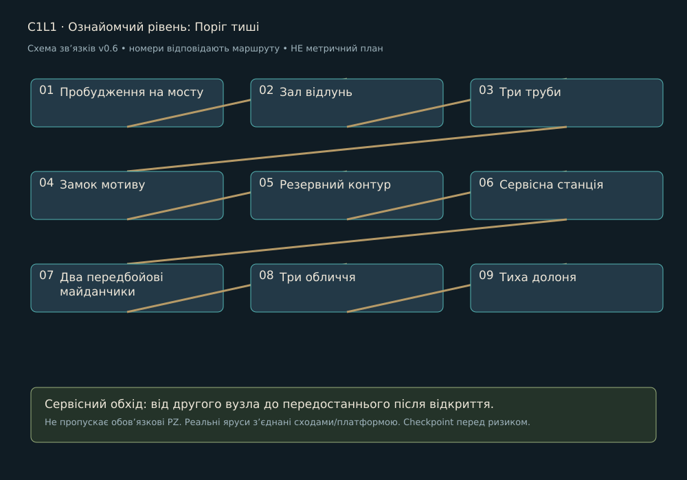

> Історична чернетка v0.6 для плану на 15 годин. Замінено [кампанією v0.7 на близько 3 години](../LEVEL_DESIGN.md). Не використовувати для поточного обсягу.

# C1L1 · Ознайомчий рівень: Поріг тиші

Редакція 0.6, 27.10.2026. Проєктна пропозиція. Район: Поріг тиші. Попередній вузол: Початок гри. Наступний: C1L2.

## Намір і вихідний стан

Мета: Дістатися джерела, навчитися основам і перемогти одного боса. Гравець бачить майбутній вихід із першого огляду, але отримує доступ через зрозумілу локальну дію. Нову ноту ре видаємо тільки в зазначеному навчальному вузлі району, не на кожній карті.

## Просторовий маршрут

1. **Пробудження на мосту**. Показати орієнтир і доступний шлях.
2. **Зал відлунь**. Постановка відповідає функції нижче; не приховувати вхід, дію або зворотний прохід декором.
3. **Три труби**. Постановка відповідає функції нижче; не приховувати вхід, дію або зворотний прохід декором.
4. **Замок мотиву**. Постановка відповідає функції нижче; не приховувати вхід, дію або зворотний прохід декором.
5. **Резервний контур**. Постановка відповідає функції нижче; не приховувати вхід, дію або зворотний прохід декором.
6. **Сервісна станція**. Постановка відповідає функції нижче; не приховувати вхід, дію або зворотний прохід декором.
7. **Два передбойові майданчики**. Постановка відповідає функції нижче; не приховувати вхід, дію або зворотний прохід декором.
8. **Три обличчя**. Постановка відповідає функції нижче; не приховувати вхід, дію або зворотний прохід декором.
9. **Тиха долоня**. Підтвердити зміну стану й наступну практичну мету.

PZ-01 → PZ-08 → PZ-09; безпечний стенд видає ре без мінібоса; три короткі групи рядових перед одним босфайтом.

Схема задає порядок і додатковий обхід. Точний контур кімнат, висоти та довжини визначає greybox: низ 0 м, основний шар +3 м, верхній +6 м як стартова сітка. Вхід/вихід різних ярусів з’єднуються реальними сходами чи платформою, не невидимим телепортом. Пропонований боковий сервісний обхід повертається до передостаннього вузла; він не замінює обов’язкову головоломку.

## Дії, головоломки й сутички

[PZ-01](../puzzles/PZ-01.md), [PZ-08](../puzzles/PZ-08.md), [PZ-09](../puzzles/PZ-09.md)

G-D1: один Тактовик; G-D2: один Рупор; G-D3: Тактовик + Рупор з почерговими атаками. Єдиний бос: Три обличчя, три фази. Катушка не входить у демо.

Після відбиття сигнал не проходить крізь інший ярус. У вузькому проході тільки один відповідальний патерн. Бос, якщо є, розписаний у [BOSSES](../BOSSES.md). Жоден вузол без боса не отримує додатковий босфайт заради тривалості.

## Історія і наслідок

Хор локально замовкає; тепле житлове вікно гасне; Носій запитує, кого вона щойно від’єднала.

Повний текст сцени й діалогів: [SC-C1L1](../STORY_SCRIPT.md#sc-c1l1). Районні докази: N01, N02; квест Q01 доступний тільки у власній точці, не повторюється на кожній карті. Прочитану сторінку можна відкрити в журналі; пропуск розмови не скидає стан.

## Камера, світло і звук

Камери: top-down → side-view містка → фіксований 3/4. Безпечні площадки зміни кадру не мають активних атак. Світловий задум: холодне бокове світло, мідний відгук, пил і сліди зупинки. На першому огляді домінує один орієнтир; на дії фон тихіший за герой/вузол. Звукове джерело прив’язане до видимого механізму, звукова інформація дублюється рухом покажчика, формою і субтитром. [Ключовий кадр району](../references/atmosphere-v07/01-keyframe.jpg) показує напрямок, не кожну кімнату.

## Ремонт, ефекти і збереження

Checkpoint: До відповідального майданчика; після завершення локальної задачі; перед виходом. У демо додатково перед єдиним босом. Перший сервіс відновлює 5/5 HP і 2/2 ремонтні заряди, не накопичує понад місткість. Умови району: EF-B01 / EF-D01; застосування й вихід із зон у [HEALING_AND_STATUS](../HEALING_AND_STATUS.md). Не розміщувати дебаф так, щоб єдиний шлях вимагав невідомої навички.

Зберігати: відкриті переходи, ноти, прочитані записи, розв’язані PZ, локальний NPC/квест, безпечний стан води/живлення. Незавершений ввід головоломки відновлюється в її стартовому стані, але розв’язана не повторюється. Перезапуск босфайту повертає HP/заряди до передбойового стану, не переносить накопичений дебаф.

## Меші, рухомі частини і збірка

| ID | Меш | Розмір для greybox | Розбір / анімація |
| --- | --- | --- | --- |
| PR-C1L1-01 | Сервісний стіл з биркою | 1,6×0,8×0,8 м | каркас, стільниця/сидіння, окремі сюжетні предмети; STATIC |
| PR-C1L1-02 | Навчальний рупор на стійці | 0,8×0,5×1,2 м | несучий корпус, кріплення, окремий індикатор за потреби; AN-P07 |
| PR-C1L1-03 | Індикатор підйомника | 0,8×0,5×1,2 м | несучий корпус, кріплення, окремий індикатор за потреби; AN-P07 |

Три рядки на цьому рівні: ряд 1, колонки 1-3 [районного аркуша](../references/campaign-v06/01-mesh-renders.jpg). Повний список ключових ID для збірки: PR-C1L1-01, PR-C1L1-02, PR-C1L1-03, PR-C1L2-01, PR-C1L2-02, PR-C1L3-01, PR-C1L3-02, PR-C1L3-03, PR-C1L4-01, PR-C1L4-03. Аркуш ілюструє концепт, не метричне креслення і не наявний 3D.

Спільний конструктив: B01-B10; B11 ремонт; B12 checkpoint. Районний набір MOD-01-xx з [MODULAR_ASSETS](../MODULAR_ASSETS.csv); малі форми DET-01-xx і декалі DEC-01-xx вибирати тільки за причиною зношення. Використати відомі корпуси ворогів із описаної сутички, героїню й Провідника. VFX телеграфів, звукові емітери, collision, gameplay-вузли та UI є окремими ресурсами, не запеченими деталями mesh-sheet.

## Темп і критерій блокаута

Бюджет 40 хв: огляди/переходи й зміна стану 14, головоломки 12, бій/перевірки 10, сюжет 4. Це гіпотези першого проходження, не гарантія. Час повторних смертей і бездіяльності не зараховується. Якщо темп не підтверджується, переглянути обсяг, а не подовжувати коридори.

Перевірити обидва напрями на сходах; утриманий ввід через camera blend; хіл під загрозою; доступ без бойового комплекту потрібної контекстної ноти; reload до/після зміни механізму; читабельність без звуку; прохід без жодного необов’язкового квесту. Статус: не реалізовано і не протестовано в UE.
