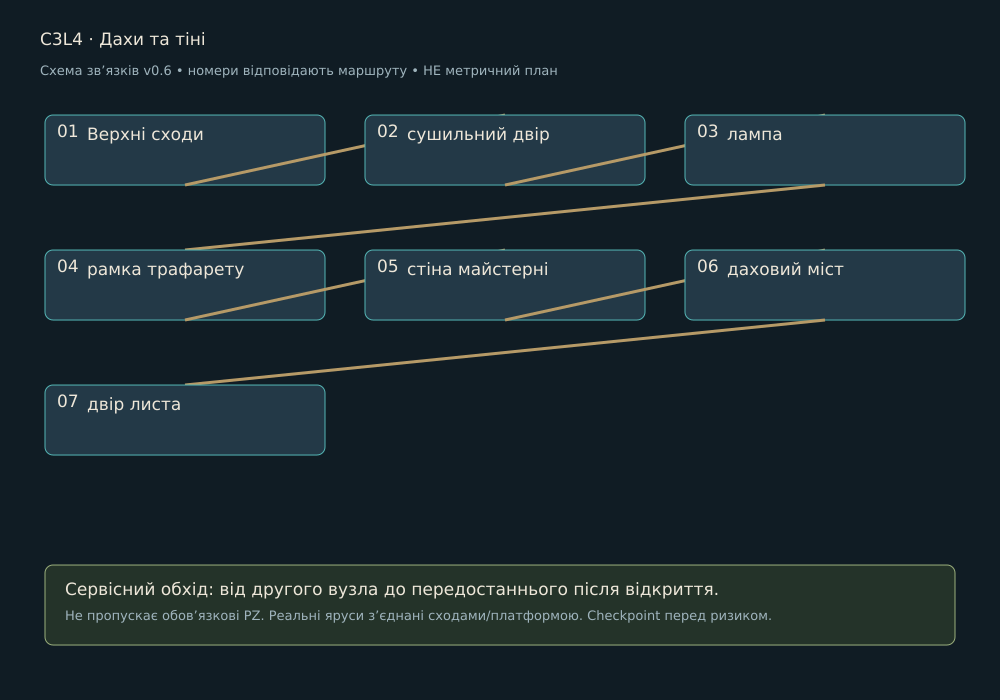

> Історична чернетка v0.6 для плану на 15 годин. Замінено [кампанією v0.7 на близько 3 години](../LEVEL_DESIGN.md). Не використовувати для поточного обсягу.

# C3L4 · Дахи та тіні

Редакція 0.6, 27.10.2026. Проєктна пропозиція. Район: Житлові тераси. Попередній вузол: C3L3. Наступний: C3L5.

## Намір і вихідний стан

Мета: Відновити напрям старого знака без глобального перемикання світла. Гравець бачить майбутній вихід із першого огляду, але отримує доступ через зрозумілу локальну дію. Нову ноту фа видаємо тільки в зазначеному навчальному вузлі району, не на кожній карті.

## Просторовий маршрут

1. **Верхні сходи**. Показати орієнтир і доступний шлях.
2. **сушильний двір**. Постановка відповідає функції нижче; не приховувати вхід, дію або зворотний прохід декором.
3. **лампа**. Постановка відповідає функції нижче; не приховувати вхід, дію або зворотний прохід декором.
4. **рамка трафарету**. Постановка відповідає функції нижче; не приховувати вхід, дію або зворотний прохід декором.
5. **стіна майстерні**. Постановка відповідає функції нижче; не приховувати вхід, дію або зворотний прохід декором.
6. **даховий міст**. Постановка відповідає функції нижче; не приховувати вхід, дію або зворотний прохід декором.
7. **двір листа**. Підтвердити зміну стану й наступну практичну мету.

Повернути трафарет і лампу так, щоб тінь збіглася з видимою рамкою; застосувати правило прямої видимості.

Схема задає порядок і додатковий обхід. Точний контур кімнат, висоти та довжини визначає greybox: низ 0 м, основний шар +3 м, верхній +6 м як стартова сітка. Вхід/вихід різних ярусів з’єднуються реальними сходами чи платформою, не невидимим телепортом. Пропонований боковий сервісний обхід повертається до передостаннього вузла; він не замінює обов’язкову головоломку.

## Дії, головоломки й сутички

[PZ-13](../puzzles/PZ-13.md)

Катушка на окремій сервісній доріжці; розв’язування задачі поза зоною атаки.

Після відбиття сигнал не проходить крізь інший ярус. У вузькому проході тільки один відповідальний патерн. Бос, якщо є, розписаний у [BOSSES](../BOSSES.md). Жоден вузол без боса не отримує додатковий босфайт заради тривалості.

## Історія і наслідок

Відкривається верхній маршрут для листа Q03; прохолодний дах повертає до теплого столу.

Повний текст сцени й діалогів: [SC-C3L4](../STORY_SCRIPT.md#sc-c3l4). Районні докази: N05, N06; квест Q03 доступний тільки у власній точці, не повторюється на кожній карті. Прочитану сторінку можна відкрити в журналі; пропуск розмови не скидає стан.

## Камера, світло і звук

Камери: 3/4 → короткий side-view переходу → 3/4. Безпечні площадки зміни кадру не мають активних атак. Світловий задум: теплі вікна на тлі прохолодного двору, тканина й ремонтні латки. На першому огляді домінує один орієнтир; на дії фон тихіший за герой/вузол. Звукове джерело прив’язане до видимого механізму, звукова інформація дублюється рухом покажчика, формою і субтитром. [Ключовий кадр району](../references/atmosphere-v07/03-keyframe.jpg) показує напрямок, не кожну кімнату.

## Ремонт, ефекти і збереження

Checkpoint: До відповідального майданчика; після завершення локальної задачі; перед виходом. У демо додатково перед єдиним босом. Перший сервіс відновлює 5/5 HP і 2/2 ремонтні заряди, не накопичує понад місткість. Умови району: EF-B03 / EF-D03; застосування й вихід із зон у [HEALING_AND_STATUS](../HEALING_AND_STATUS.md). Не розміщувати дебаф так, щоб єдиний шлях вимагав невідомої навички.

Зберігати: відкриті переходи, ноти, прочитані записи, розв’язані PZ, локальний NPC/квест, безпечний стан води/живлення. Незавершений ввід головоломки відновлюється в її стартовому стані, але розв’язана не повторюється. Перезапуск босфайту повертає HP/заряди до передбойового стану, не переносить накопичений дебаф.

## Меші, рухомі частини і збірка

| ID | Меш | Розмір для greybox | Розбір / анімація |
| --- | --- | --- | --- |
| PR-C3L4-01 | Трафарет старої адреси | 1,0×0,1×1,2 м | опора, рухома площина, вісь і обмежувач; AN-P03 |
| PR-C3L4-02 | Даховий світильник | 0,5×0,5×1,6 м | кронштейн, корпус лампи, окремий шарнір; AN-P03 |
| PR-C3L4-03 | Опорна рама знака | 0,8×0,5×1,2 м | несучий корпус, кріплення, окремий індикатор за потреби; AN-P07 |

Три рядки на цьому рівні: ряд 4, колонки 1-3 [районного аркуша](../references/campaign-v06/03-mesh-renders.jpg). Повний список ключових ID для збірки: PR-C3L4-01, PR-C3L4-02, PR-C3L4-03. Аркуш ілюструє концепт, не метричне креслення і не наявний 3D.

Спільний конструктив: B01-B10; B11 ремонт; B12 checkpoint. Районний набір MOD-03-xx з [MODULAR_ASSETS](../MODULAR_ASSETS.csv); малі форми DET-03-xx і декалі DEC-03-xx вибирати тільки за причиною зношення. Використати відомі корпуси ворогів із описаної сутички, героїню й Провідника. VFX телеграфів, звукові емітери, collision, gameplay-вузли та UI є окремими ресурсами, не запеченими деталями mesh-sheet.

## Темп і критерій блокаута

Бюджет 35 хв: огляди/переходи й зміна стану 19, головоломки 6, бій/перевірки 6, сюжет 4. Це гіпотези першого проходження, не гарантія. Час повторних смертей і бездіяльності не зараховується. Якщо темп не підтверджується, переглянути обсяг, а не подовжувати коридори.

Перевірити обидва напрями на сходах; утриманий ввід через camera blend; хіл під загрозою; доступ без бойового комплекту потрібної контекстної ноти; reload до/після зміни механізму; читабельність без звуку; прохід без жодного необов’язкового квесту. Статус: не реалізовано і не протестовано в UE.
