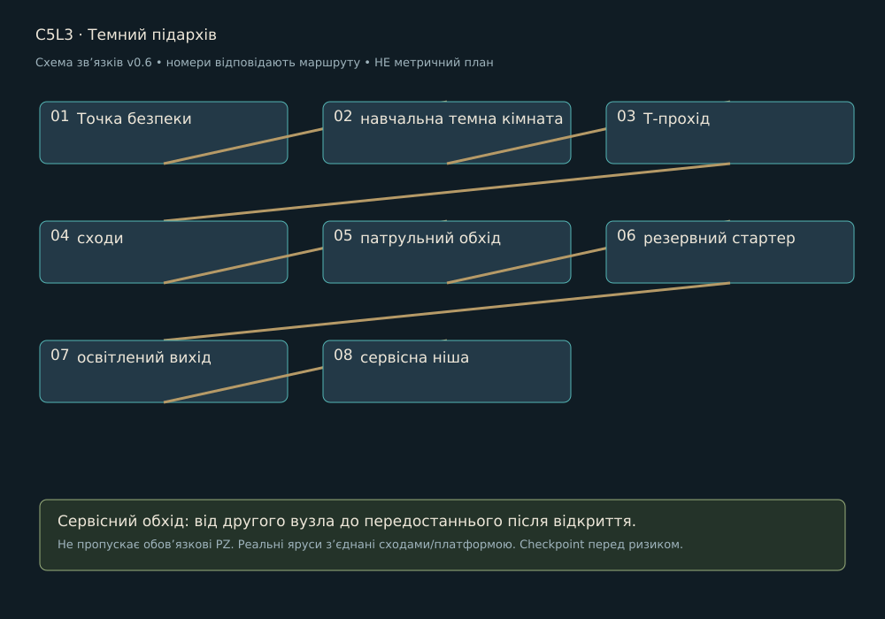

> Історична чернетка v0.6 для плану на 15 годин. Замінено [кампанією v0.7 на близько 3 години](../LEVEL_DESIGN.md). Не використовувати для поточного обсягу.

# C5L3 · Темний підархів

Редакція 0.6, 27.10.2026. Проєктна пропозиція. Район: Архів голосів. Попередній вузол: C5L2. Наступний: C5L4.

## Намір і вихідний стан

Мета: Знайти резерв за короткими водоподібними відгуками. Гравець бачить майбутній вихід із першого огляду, але отримує доступ через зрозумілу локальну дію. Нову ноту ля видаємо тільки в зазначеному навчальному вузлі району, не на кожній карті.

## Просторовий маршрут

1. **Точка безпеки**. Показати орієнтир і доступний шлях.
2. **навчальна темна кімната**. Постановка відповідає функції нижче; не приховувати вхід, дію або зворотний прохід декором.
3. **Т-прохід**. Постановка відповідає функції нижче; не приховувати вхід, дію або зворотний прохід декором.
4. **сходи**. Постановка відповідає функції нижче; не приховувати вхід, дію або зворотний прохід декором.
5. **патрульний обхід**. Постановка відповідає функції нижче; не приховувати вхід, дію або зворотний прохід декором.
6. **резервний стартер**. Постановка відповідає функції нижче; не приховувати вхід, дію або зворотний прохід декором.
7. **освітлений вихід**. Постановка відповідає функції нижче; не приховувати вхід, дію або зворотний прохід декором.
8. **сервісна ніша**. Підтвердити зміну стану й наступну практичну мету.

PZ-07 триває 6-8 хв; решта рівня: освітлене дослідження, тиха записка, обходи і відкритий shortcut.

Схема задає порядок і додатковий обхід. Точний контур кімнат, висоти та довжини визначає greybox: низ 0 м, основний шар +3 м, верхній +6 м як стартова сітка. Вхід/вихід різних ярусів з’єднуються реальними сходами чи платформою, не невидимим телепортом. Пропонований боковий сервісний обхід повертається до передостаннього вузла; він не замінює обов’язкову головоломку.

## Дії, головоломки й сутички

[PZ-07](../puzzles/PZ-07.md)

Один повільний патруль у темній частині; у світлі один Хранитель зі знайомою черговістю, без накладання атак.

Після відбиття сигнал не проходить крізь інший ярус. У вузькому проході тільки один відповідальний патерн. Бос, якщо є, розписаний у [BOSSES](../BOSSES.md). Жоден вузол без боса не отримує додатковий босфайт заради тривалості.

## Історія і наслідок

Резерв освітлює вихід і відкриває прямий шлях, лабіринт не треба проходити вдруге.

Повний текст сцени й діалогів: [SC-C5L3](../STORY_SCRIPT.md#sc-c5l3). Районні докази: N09, N10; квест Q05 доступний тільки у власній точці, не повторюється на кожній карті. Прочитану сторінку можна відкрити в журналі; пропуск розмови не скидає стан.

## Камера, світло і звук

Камери: top-down → side-view містка → фіксований 3/4. Безпечні площадки зміни кадру не мають активних атак. Світловий задум: світлі документи, темні шафи, одна перервана світлова вертикаль. На першому огляді домінує один орієнтир; на дії фон тихіший за герой/вузол. Звукове джерело прив’язане до видимого механізму, звукова інформація дублюється рухом покажчика, формою і субтитром. [Ключовий кадр району](../references/atmosphere-v07/05-keyframe-v2.jpg) показує напрямок, не кожну кімнату.

## Ремонт, ефекти і збереження

Checkpoint: До відповідального майданчика; після завершення локальної задачі; перед виходом. У демо додатково перед єдиним босом. Перший сервіс відновлює 5/5 HP і 2/2 ремонтні заряди, не накопичує понад місткість. Умови району: EF-B05 / EF-D05; застосування й вихід із зон у [HEALING_AND_STATUS](../HEALING_AND_STATUS.md). Не розміщувати дебаф так, щоб єдиний шлях вимагав невідомої навички.

Зберігати: відкриті переходи, ноти, прочитані записи, розв’язані PZ, локальний NPC/квест, безпечний стан води/живлення. Незавершений ввід головоломки відновлюється в її стартовому стані, але розв’язана не повторюється. Перезапуск босфайту повертає HP/заряди до передбойового стану, не переносить накопичений дебаф.

## Меші, рухомі частини і збірка

| ID | Меш | Розмір для greybox | Розбір / анімація |
| --- | --- | --- | --- |
| PR-C5L3-01 | Тактильний стартер підархіву | 0,8×0,5×1,2 м | нерухомий корпус, важіль/штурвал, механічний покажчик; AN-P02 |
| PR-C5L3-02 | Демпфований поворотний екран | 0,8×0,5×1,2 м | несучий корпус, кріплення, окремий індикатор за потреби; AN-P07 |
| PR-C5L3-03 | Низький маяк виходу | 0,8×0,5×1,2 м | несучий корпус, кріплення, окремий індикатор за потреби; AN-P07 |

Три рядки на цьому рівні: ряд 3, колонки 1-3 [районного аркуша](../references/campaign-v06/05-mesh-renders.png). Повний список ключових ID для збірки: PR-C5L3-01, PR-C5L3-02, PR-C5L3-03. Аркуш ілюструє концепт, не метричне креслення і не наявний 3D.

Спільний конструктив: B01-B10; B11 ремонт; B12 checkpoint. Районний набір MOD-05-xx з [MODULAR_ASSETS](../MODULAR_ASSETS.csv); малі форми DET-05-xx і декалі DEC-05-xx вибирати тільки за причиною зношення. Використати відомі корпуси ворогів із описаної сутички, героїню й Провідника. VFX телеграфів, звукові емітери, collision, gameplay-вузли та UI є окремими ресурсами, не запеченими деталями mesh-sheet.

## Темп і критерій блокаута

Бюджет 25 хв: огляди/переходи й зміна стану 8, головоломки 7, бій/перевірки 6, сюжет 4. Це гіпотези першого проходження, не гарантія. Час повторних смертей і бездіяльності не зараховується. Якщо темп не підтверджується, переглянути обсяг, а не подовжувати коридори.

Перевірити обидва напрями на сходах; утриманий ввід через camera blend; хіл під загрозою; доступ без бойового комплекту потрібної контекстної ноти; reload до/після зміни механізму; читабельність без звуку; прохід без жодного необов’язкового квесту. Статус: не реалізовано і не протестовано в UE.
