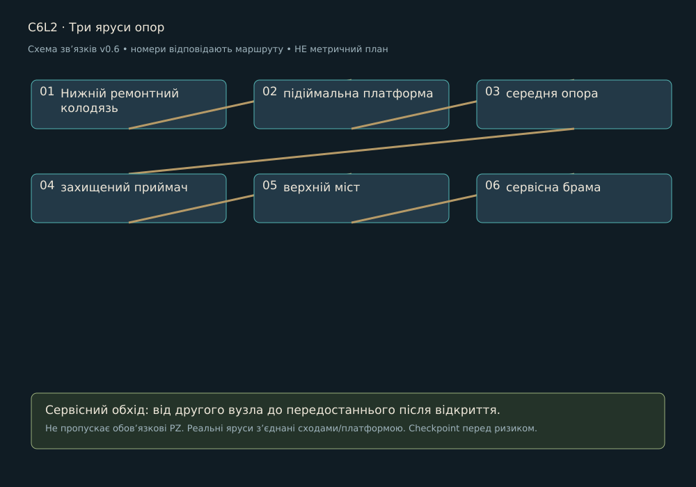

> Історична чернетка v0.6 для плану на 15 годин. Замінено [кампанією v0.7 на близько 3 години](../LEVEL_DESIGN.md). Не використовувати для поточного обсягу.

# C6L2 · Три яруси опор

Редакція 0.6, 27.10.2026. Проєктна пропозиція. Район: Підвішений собор. Попередній вузол: C6L1. Наступний: C6L3.

## Намір і вихідний стан

Мета: Дістатися регулятора, повторивши просторові правила. Гравець бачить майбутній вихід із першого огляду, але отримує доступ через зрозумілу локальну дію. Нову ноту сі видаємо тільки в зазначеному навчальному вузлі району, не на кожній карті.

## Просторовий маршрут

1. **Нижній ремонтний колодязь**. Показати орієнтир і доступний шлях.
2. **підіймальна платформа**. Постановка відповідає функції нижче; не приховувати вхід, дію або зворотний прохід декором.
3. **середня опора**. Постановка відповідає функції нижче; не приховувати вхід, дію або зворотний прохід декором.
4. **захищений приймач**. Постановка відповідає функції нижче; не приховувати вхід, дію або зворотний прохід декором.
5. **верхній міст**. Постановка відповідає функції нижче; не приховувати вхід, дію або зворотний прохід декором.
6. **сервісна брама**. Підтвердити зміну стану й наступну практичну мету.

PZ-18 поєднує до з фронтальним захистом фа біля вже знайомого вузла; не вимагає двох одночасних кнопок.

Схема задає порядок і додатковий обхід. Точний контур кімнат, висоти та довжини визначає greybox: низ 0 м, основний шар +3 м, верхній +6 м як стартова сітка. Вхід/вихід різних ярусів з’єднуються реальними сходами чи платформою, не невидимим телепортом. Пропонований боковий сервісний обхід повертається до передостаннього вузла; він не замінює обов’язкову головоломку.

## Дії, головоломки й сутички

[PZ-18](../puzzles/PZ-18.md)

Рупор і Хранитель рознесені в часі та по поверхнях; атака не пробиває перекриття.

Після відбиття сигнал не проходить крізь інший ярус. У вузькому проході тільки один відповідальний патерн. Бос, якщо є, розписаний у [BOSSES](../BOSSES.md). Жоден вузол без боса не отримує додатковий босфайт заради тривалості.

## Історія і наслідок

Головний шлях з’єднує всі яруси, нижній ліфт стає shortcut.

Повний текст сцени й діалогів: [SC-C6L2](../STORY_SCRIPT.md#sc-c6l2). Районні докази: N11, N12; квест Q06 доступний тільки у власній точці, не повторюється на кожній карті. Прочитану сторінку можна відкрити в журналі; пропуск розмови не скидає стан.

## Камера, світло і звук

Камери: 3/4 → короткий side-view переходу → 3/4. Безпечні площадки зміни кадру не мають активних атак. Світловий задум: холодна маса залу, теплі незалежні контури, довгі видимі опори. На першому огляді домінує один орієнтир; на дії фон тихіший за герой/вузол. Звукове джерело прив’язане до видимого механізму, звукова інформація дублюється рухом покажчика, формою і субтитром. [Ключовий кадр району](../references/atmosphere-v07/06-keyframe.jpg) показує напрямок, не кожну кімнату.

## Ремонт, ефекти і збереження

Checkpoint: До відповідального майданчика; після завершення локальної задачі; перед виходом. У демо додатково перед єдиним босом. Перший сервіс відновлює 5/5 HP і 2/2 ремонтні заряди, не накопичує понад місткість. Умови району: EF-B06 / EF-D06; застосування й вихід із зон у [HEALING_AND_STATUS](../HEALING_AND_STATUS.md). Не розміщувати дебаф так, щоб єдиний шлях вимагав невідомої навички.

Зберігати: відкриті переходи, ноти, прочитані записи, розв’язані PZ, локальний NPC/квест, безпечний стан води/живлення. Незавершений ввід головоломки відновлюється в її стартовому стані, але розв’язана не повторюється. Перезапуск босфайту повертає HP/заряди до передбойового стану, не переносить накопичений дебаф.

## Меші, рухомі частини і збірка

| ID | Меш | Розмір для greybox | Розбір / анімація |
| --- | --- | --- | --- |
| PR-C6L2-01 | Захищений адресний приймач | 0,8×0,5×1,2 м | несучий корпус, кріплення, окремий індикатор за потреби; AN-P07 |
| PR-C6L2-02 | Підіймальна противага | 2,0×0,3×2,5 м | рама, стулка/платформа, видимий привод; AN-P01 |
| PR-C6L2-03 | Натяжна опора мосту | 0,8×0,5×1,2 м | несучий корпус, кріплення, окремий індикатор за потреби; AN-P07 |

Три рядки на цьому рівні: ряд 2, колонки 1-3 [районного аркуша](../references/campaign-v06/06-mesh-renders.png). Повний список ключових ID для збірки: PR-C6L2-01, PR-C6L2-02, PR-C6L2-03. Аркуш ілюструє концепт, не метричне креслення і не наявний 3D.

Спільний конструктив: B01-B10; B11 ремонт; B12 checkpoint. Районний набір MOD-06-xx з [MODULAR_ASSETS](../MODULAR_ASSETS.csv); малі форми DET-06-xx і декалі DEC-06-xx вибирати тільки за причиною зношення. Використати відомі корпуси ворогів із описаної сутички, героїню й Провідника. VFX телеграфів, звукові емітери, collision, gameplay-вузли та UI є окремими ресурсами, не запеченими деталями mesh-sheet.

## Темп і критерій блокаута

Бюджет 30 хв: огляди/переходи й зміна стану 14, головоломки 6, бій/перевірки 6, сюжет 4. Це гіпотези першого проходження, не гарантія. Час повторних смертей і бездіяльності не зараховується. Якщо темп не підтверджується, переглянути обсяг, а не подовжувати коридори.

Перевірити обидва напрями на сходах; утриманий ввід через camera blend; хіл під загрозою; доступ без бойового комплекту потрібної контекстної ноти; reload до/після зміни механізму; читабельність без звуку; прохід без жодного необов’язкового квесту. Статус: не реалізовано і не протестовано в UE.
