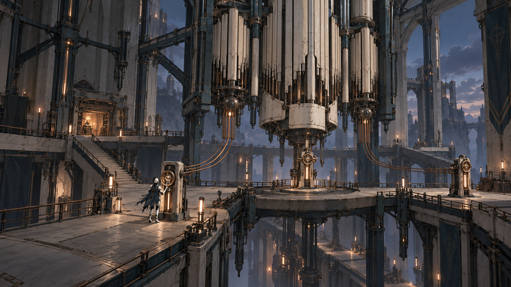

# L06 · Підвішений собор

Редакція 0.7, 27.10.2026. Поточний фокус: атмосфера та візуал. Шість рівнів і розподіл по 30 хв є авторською пропозицією під робочу ціль близько трьох годин; це не виміряна тривалість і не затверджений фінальний обсяг.

Орієнтир **30 хв** у кампанії 180 хв. Попередній рівень: L05. Наступний: післямова. Демо: ні.

## Мета і доступні дії

Вибрати режим і знайти місце повернення. Навчання: сі на маленькому локальному контролері до фінальної перевірки. Зберігаємо рівно сім активних нот; ремонт є базовою дією, звичайний крок теж не додає навичку.

## Маршрут і постановка

1. **Незалежні голоси**. З вузького входу видно велику порожню масу регулятора; навчальна пара контролерів ближче до героїні. Два покажчики починають рухатися незалежно.
2. **Три доступні яруси**. Видимі сходи зв’язують три площадки, опори не зливаються з героїнею. Чужа атака не малюється крізь плиту іншого поверху.
3. **Останній слухач**. Малий слухач у бічній ніші на тлі величезного механізму. Його повторювана рутина може зупинитися без руйнування.
4. **Бій і вибір**. Орган у дальній верхній частині, активна підлога вміщується у кадр. Після бою небезпека закінчується до вибору; пульт не має таймера.
5. **Адреса повернення**. Переходимо з великого залу до простого столу під знайомим вікном. Вільний стілець завершує історію; остання картинка дихає тишею.

Повна артдирекція: [п’ять кадрів, світло й матеріали](../art/L06.md). Це п’ять ділянок одного рівня, а не п’ять окремих карт із власним бюджетом. Перед складною дією є безпечна площадка; після кульмінації відкривається короткий шлях до входу. Реальні яруси з’єднані видимими сходами або платформою.

## Головоломки, вороги та кульмінація

[PZ-06](../puzzles/PZ-06.md). Конкретні рішення наведені в картках; повторне навчальне натискання не рахується новою головоломкою.

Рядові: Хранитель і відомі патерни регулятора; нових типів рядових немає.

Кульмінація: Фінальний регулятор: три контури по черзі; після бою вибір без таймера. Детальний бойовий контракт залишається окремим наступним завданням.

## Наслідок, ремонт і збереження

Після розділення загальний світловий пульс зникає, три місцеві індикатори працюють незалежно. В усіх фіналах фінальна камера повертається до людського масштабу столу. Докази сюжету N11/N12 доступні поряд із практичною дією. Необов’язковий побутовий квест не є умовою єдиного проходу або третього фіналу.

Сервісний checkpoint перед кульмінацією відновлює HP і ремонтні заряди до місткості; бойове лікування та ефекти ще потребують окремого затвердження чисел. Баф/дебаф показується станом героя, назвою й причиною у світі, не тільки кольором фільтра. Художня темрява не є прихованим штрафом.

Зберігати: відкриті ноти, PZ, прочитані записки, короткі шляхи, стан механізмів і квесту. Після смерті дебаф не накопичується; вступ боса можна пропустити; розв’язана PZ не повторюється.

## Темп для перевірки

Переміщення/огляди 13 хв, задачі 7, бойові перевірки 7, сюжет і паузи 3 = 30 хв. Бездіяльність, повторні смерті та повторне читання не входять у кошторис. Темний епізод у L05 займає 6-8 хв із його бюджету, не весь рівень.

Критерій greybox: усі п’ять ділянок прохідні без фінальних мешів; герой читається з ігрової камери; маршрут і контрдії зрозумілі без звуку; camera blend не приховує небезпеку; після зміни стану видно результат.
