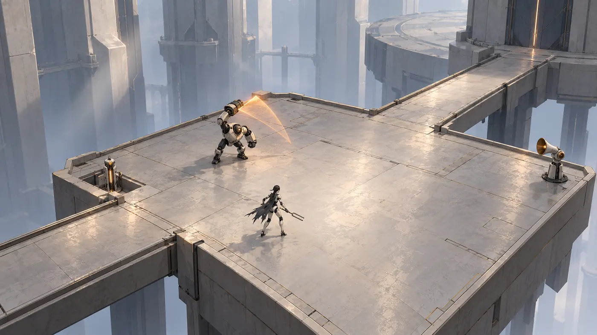
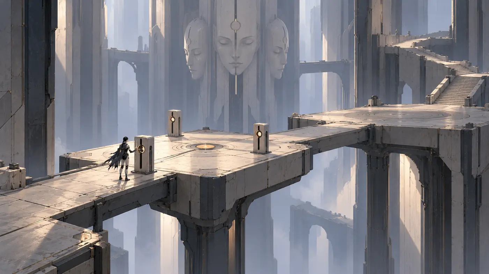
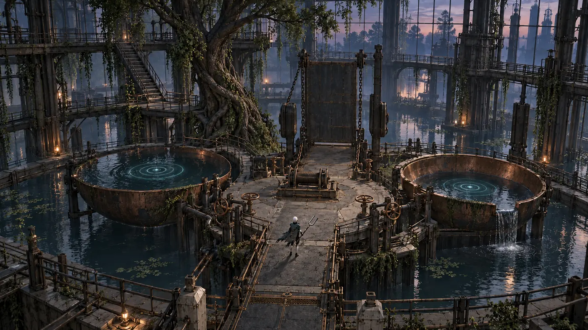
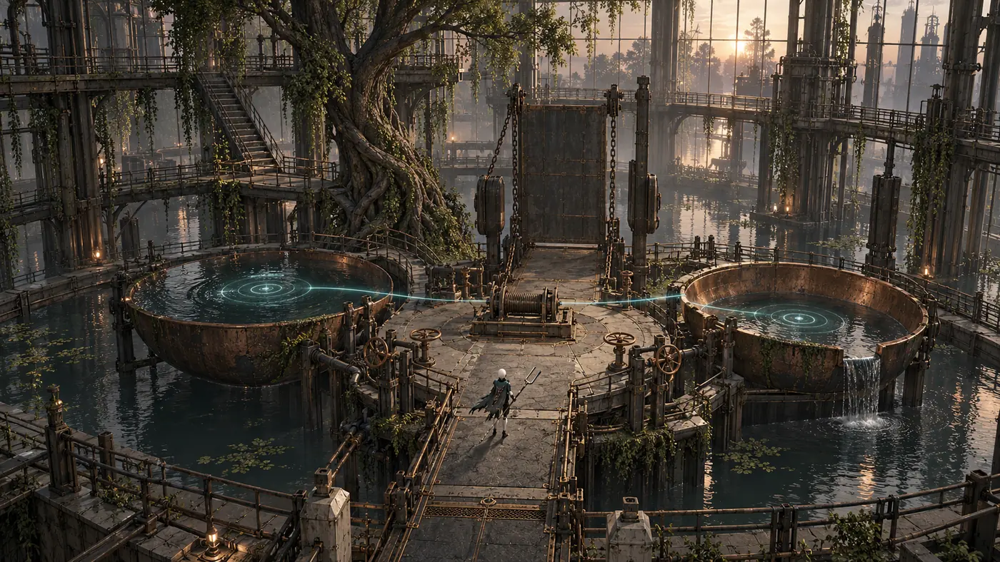
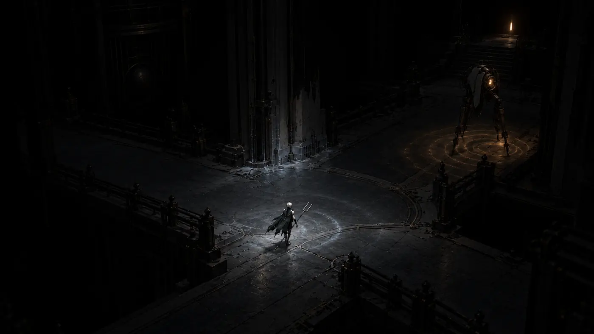
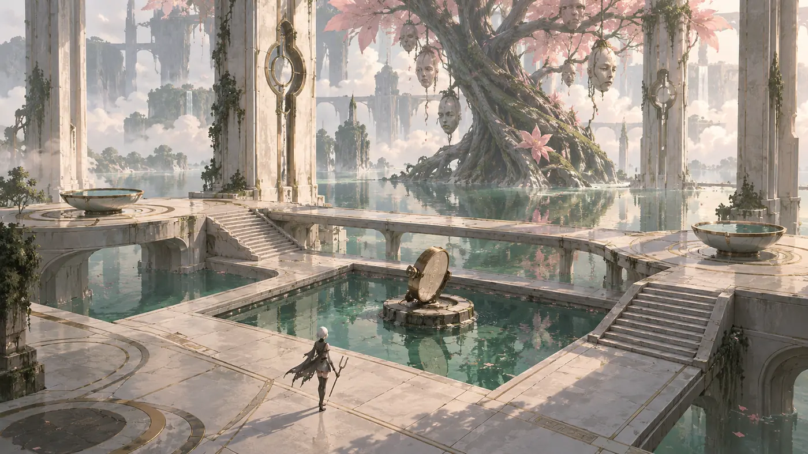
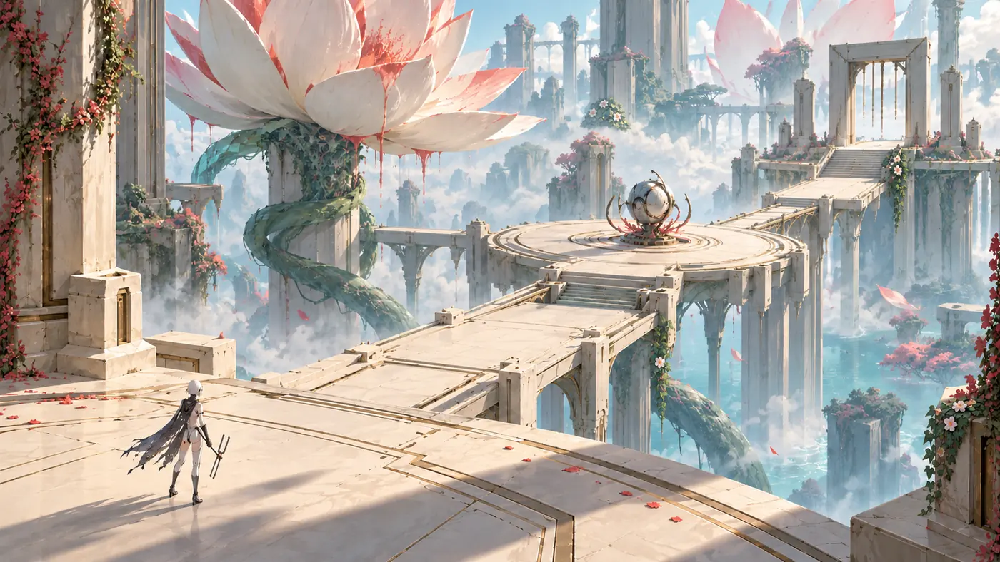
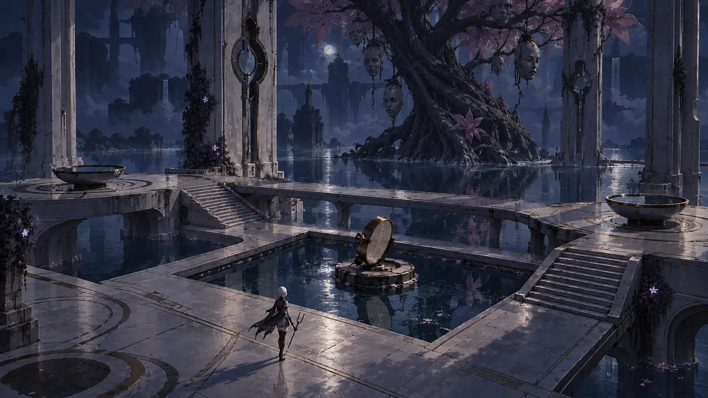

# Reference Art | Choir of Empty Machines
**Оновлено:** 27.10.2026. **Завантажено:** 29 нових авторських концептів у WebP + раніше наявні PNG (без видалення). Це не скриншоти готової гри.

## Точна структура
- [🎮 Gameplay — 11 нових кадрів та 4 старі PNG](gameplay/README.md): бої, exploration, puzzle, платформинг, камера.
- [🏛 Environments — 5 концептів](environments/): нефритовий сад, небесні платформи, зарослі арени, машинний сад.
- [🤖 Characters — 6 концептів](characters/): героїня, мала камелія, вороги й бос саду.
- [🧱 Modular — 7 концептів](modular/): арена, архітектура, брами, контактні листи.
- [Історичні кадри та storyboard](./): 01–04-reference / storyboard, GDD посилання незмінні.
- [Матриця референсів із зовнішніх медіа](../refs/LEVEL_REFERENCE_MATRIX.md).
- [Новий Level Design v0.2](../LEVEL_DESIGN_V02.md).

## Gameplay / Puzzle

| Preview | Механіка / роль у LD |
|---|---|
|  | D3: читабельна бойова площина; випромінювач і safe-sector |
|  | D1: композиція шляху, величезні вертикалі |
|  | D2 / C3: дві резонансні чаші, проста puzzle grammar |
|  | C3: головоломка на воді, шляхи через оранжерею |
|  | C4: тимчасове проявлення маршруту сонарною хвилею |

## Atmosphere / Level Art

| Preview | Принцип |
|---|---|
|  | C3: прекрасний сад із тривожною органікою |
|  | C3/C5: читається дальня мета; маршрут над порожнечею |
|  | C3: світлове протиставлення природи і машини |

## Героїня та виробничі набори
- [Остаточний напрямок героїні з невеликою камелією](characters/02-hero-small-camellia.webp): концепт, вимагає затвердження масштабу квітки.
- [Ворог-садівник](characters/04-mechanical-gardener.webp), [Хранитель цвітіння](characters/06-bloom-guardian.webp).
- [Кругла арена](modular/01-circular-arena-module-set.webp), [монументальна архітектура](modular/02-monumental-architecture-kit.webp), [Мідні легені, контактний лист](modular/04-copper-lungs-contact-sheet.webp).

## Точність
Згенеровані концепти призначені для LD/Level Art/Lighting; вони не є game build і не підтверджують працездатність камери, hitbox, продуктивність або доступність ассетів. Зовнішні медіа посилаються на правовласників у [refs](../refs/README.md), а не імпортуються як чужі PNG.
