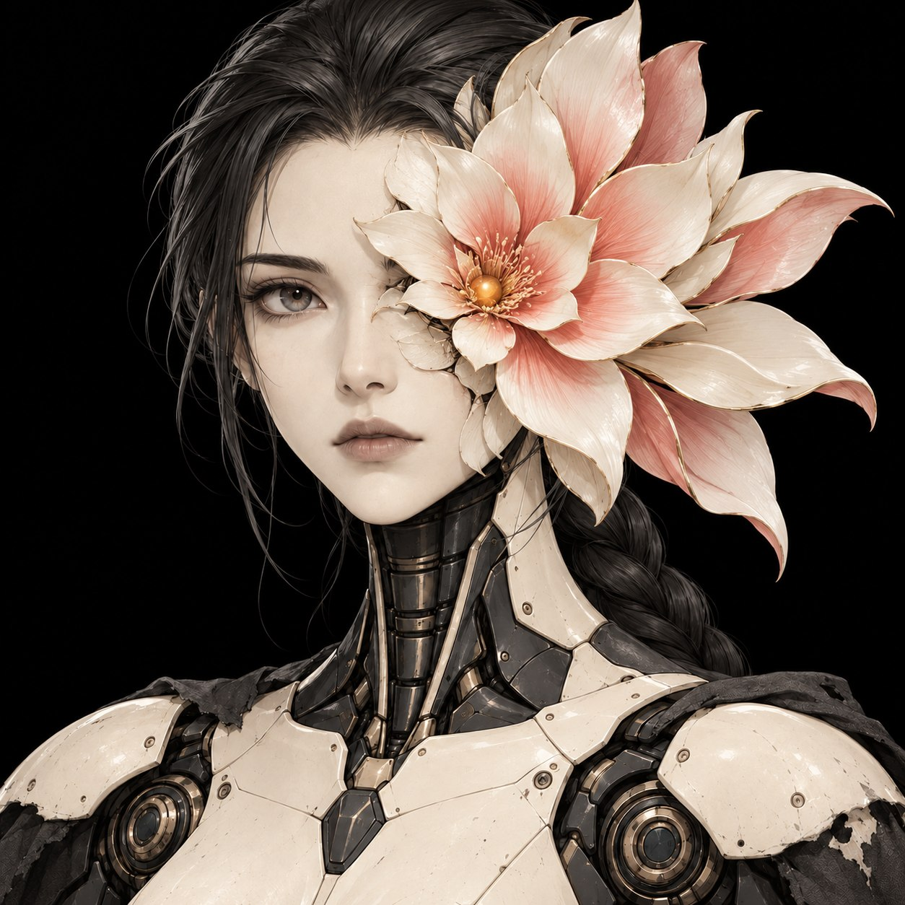
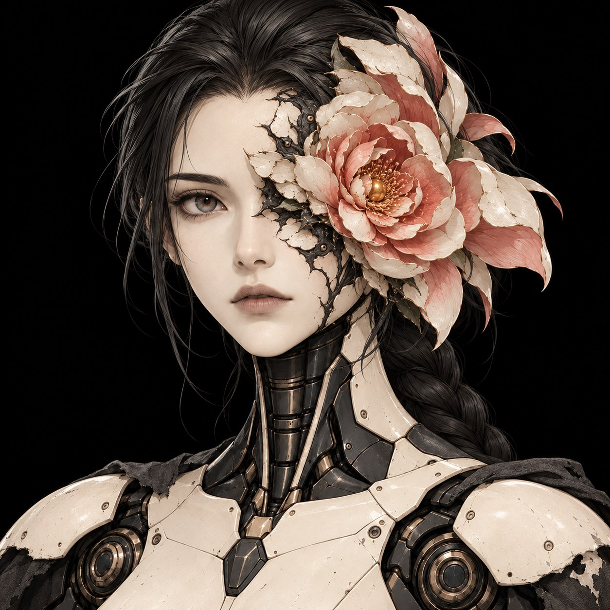

# Квітка замість ока: портрети ГГ

27.10.2026 користувач попросив завантажити останній уточнений портрет ГГ. Попередні два портрети збережені як історія ітерацій. Це розвиток B; готові 3D-моделі та риги ще не створені.

## Поточний портрет: компактна квітка, чистіше обличчя

Квітка на місці лівого ока компактна; останнє уточнення користувача: приблизно на 5% більша за попередню компактну версію й менше тріщин. Лоб і щока переважно гладкі, темний обвід та короткі шви зосереджені біля квітки. Користувач попросив запушити цю версію.

## Попередні ітерації

## 01. Великий лотос

Квітка формує великий асиметричний силует і виступає за межу голови. Збережені темна коса, світла кераміка, графітова шия та рвана накидка.

## 02. Проросла шарувата квітка

Щільна розетка проростає крізь ліву орбіту; навколо неї темні органічні шви й великі керамічні сегменти. Права половина обличчя, друге око, ніс і губи лишаються читабельними.

У фронтальному зображенні ліве око героїні розміщене праворуч для глядача. Для моделювання потрібно узгодити габарит квітки, огляд із тилової камери, перекриття волосся й амплітуду анімації пелюсток. Портрет не визначає колізію або ігрову здібність.

[Обраний B](../../../CHARACTER_DESIGN.md)
