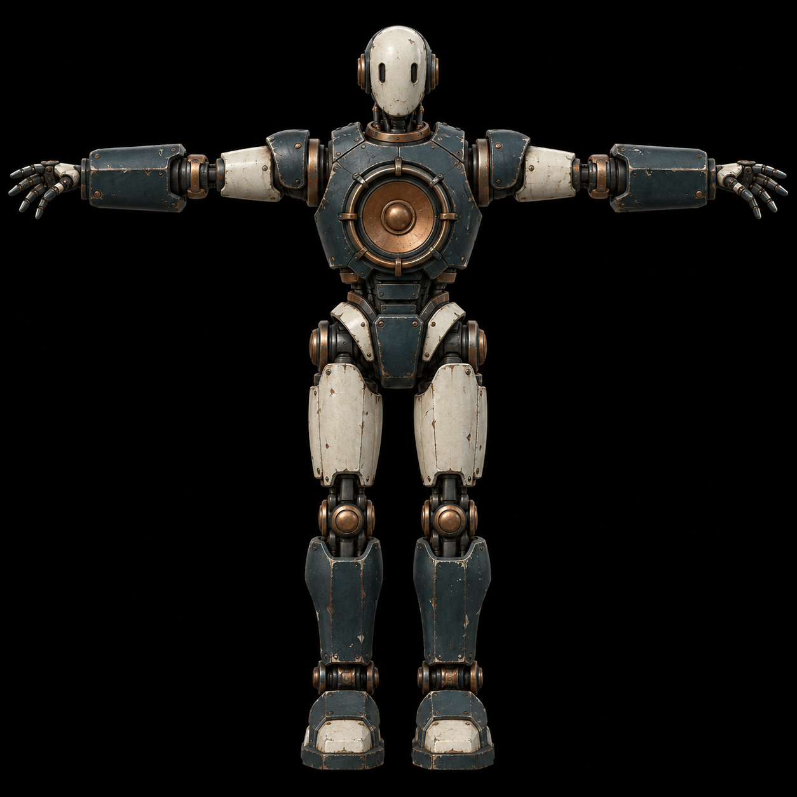
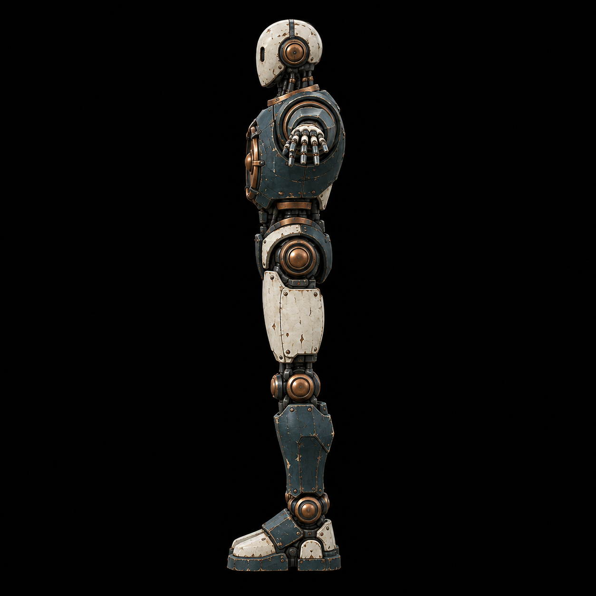
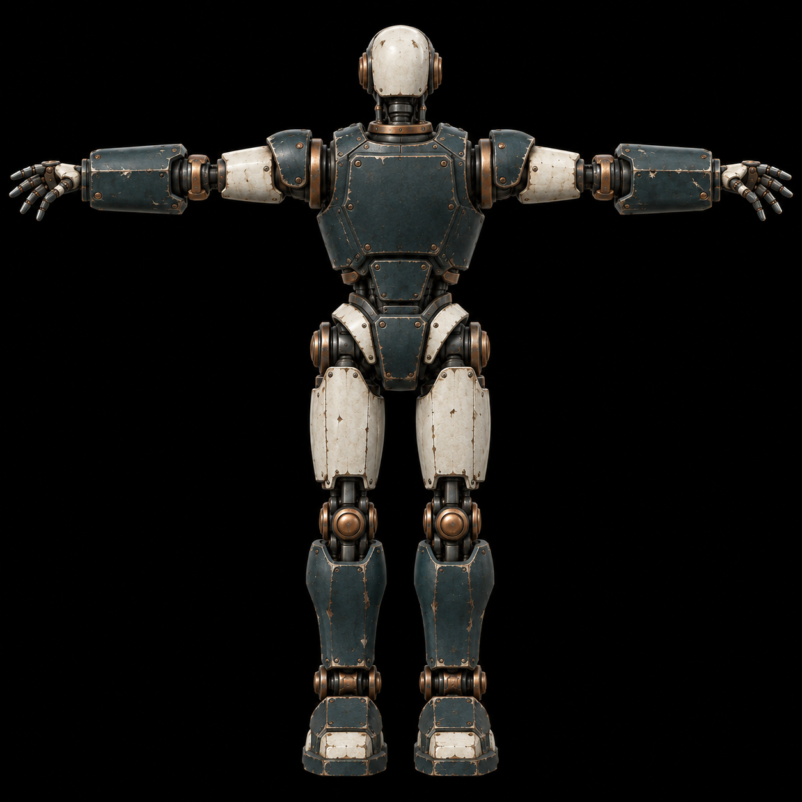

# Перший рядовий ворог · візуальна пропозиція v0.1

Три окремі референси одного акустичного автомата для генерації 3D-моделі. Створено 15.10.2026 на запит користувача.

| Файл | Ракурс |
| --- | --- |
| [01-front.png](01-front.png) | Фронтально |
| [02-left-90.png](02-left-90.png) | Лівий профіль 90° |
| [03-back.png](03-back.png) | Зі спини |

Квадратні PNG 1254 × 1254; чорний фон; Т-поза; близький масштаб; камера з орієнтиром FOV 20°. Кераміка слонової кістки, темний синьо-зелений метал, мідний резонатор у грудях. Зброя відсутня.

Це концепт за матеріальною мовою [GDD](../../../GDD.md) і [артдирекції](../../../ART_DIRECTION.md), а не готова 3D-модель або затвердження нового типу ворога. Фронтальний референс є основним джерелом форми; додаткові ракурси згенеровані з нього, дрібні деталі потрібно звірити під час моделювання.

## Фронтально

## Лівий профіль

## Зі спини

