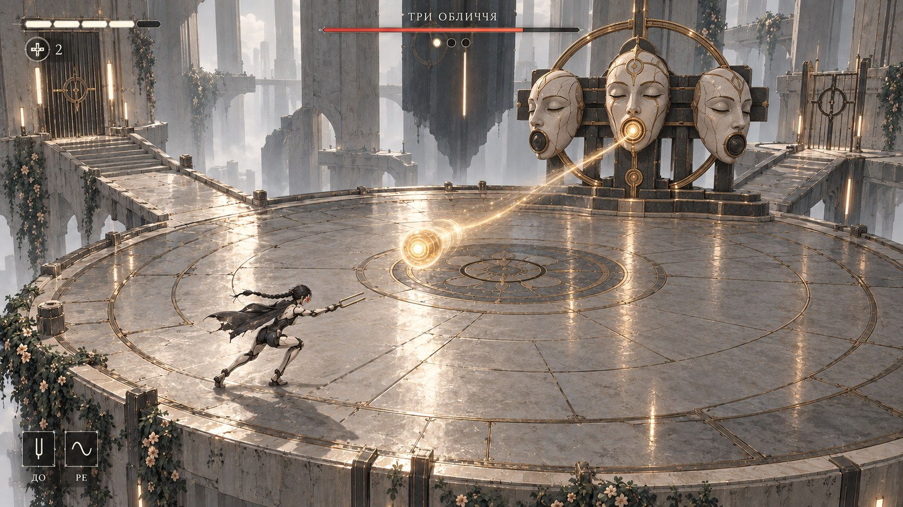

# L01 · «Три обличчя»: кадр бою

27.10.2026. Згенерований концепт геймплею з HUD, не кадр із рушія.

## Корекція після відгуку

Користувач відхилив гуманоїдного квіткового Хранителя в ролі боса: команда не зможе його заанімувати. Цей кадр пропонує повернення до «Трьох облич» з обмеженим набором механічних рухів. Завантаження зображення не означає перевірену анімацію або остаточно погоджений вигляд.

## Запропонований виробничий контракт

- Нерухома основа й траверса на дальньому краю арени; чистий простір для руху героїні.
- Три тверді керамічні маски. Кожна може повертатися навколо одного шарніра. Міміка, ходьба й деформація тіла не потрібні.
- Окреме кільце з одним обертанням. Це декоративний рух, він не змінює колізію арени.
- Заряд, активне джерело, влучання й вимкнення читаються через світіння та ефекти.
- Смерть: припинення атак, згасання джерел і зупинка деталей. Без ragdoll та складного руйнування.

Мінімальна збірка: статичний корпус, три маски з правильними pivot, одне кільце. Повороти можна ставити як зміни transform окремих мешів. Геометрія й pivots ще не створені.

## Бій

Зберігаємо схему P7: фаза 1 із віялом; фаза 2 із кільцем і спрямованим імпульсом; фаза 3 почергово комбінує знайомі атаки. Для фаз змінюється порядок атак та активна маска, нові кінцівки або окремі набори пересування не додаються. Позначений імпульс повертається навичкою до.

Кадр показує лише момент спрямованого імпульсу. Форма ефекту, швидкість, таймінги, читабельність і вікна контратаки потребують перевірки в greybox. Лінії на арені є декором, не розміткою шкоди. HUD і ракурс також попередні.

[Ігровий план L01](../../L01_GAMEPLAY.md)
