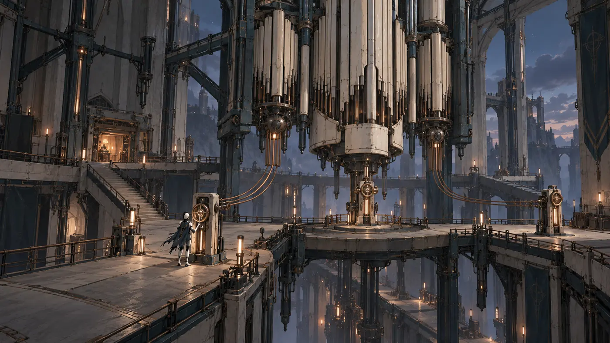
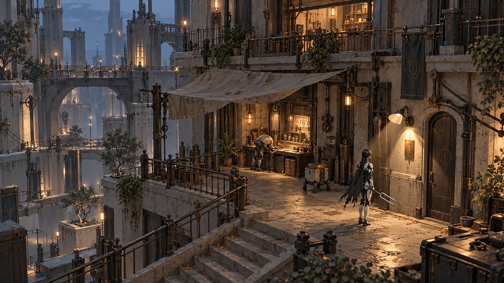
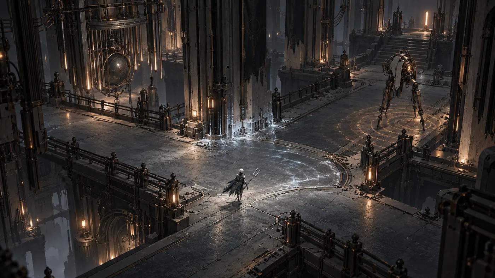
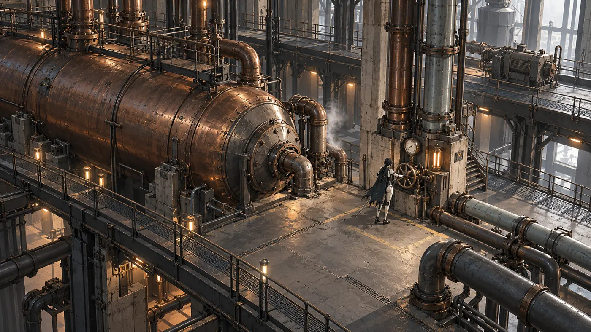
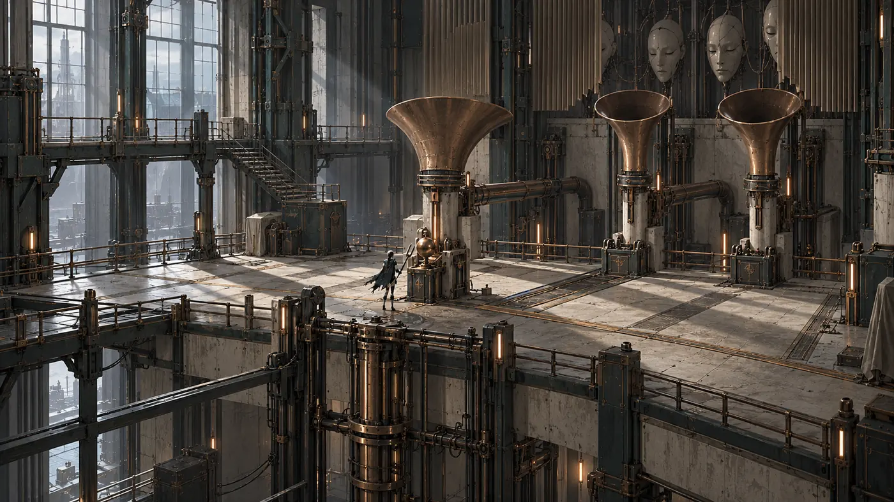
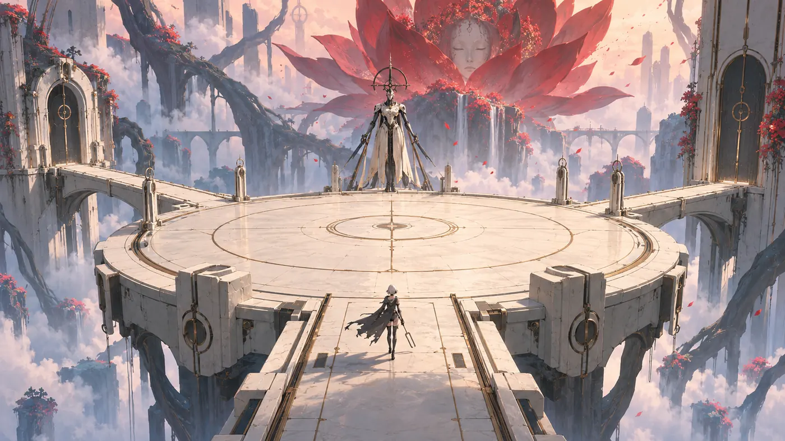

# Gameplay references | Choir of Empty Machines

Тут **усі наявні згенеровані геймплейні кадри**. Нові (27.10) збережені як оптимізовані WebP із оригінальних PNG; попередні PNG залишені. Назви кадрів і місце застосування в [LD v0.2](../../LEVEL_DESIGN_V02.md).

## Нові кадри

| Кадр | Що беремо | Рівень |
|---|---|---|
|  | чиста бойова площина, telegraph, безпечний сектор | D3 |
|  | фонова домінанта, маршрут, hero scale | D1, C5 |
|  | світло як підказка, інтерактивний резонатор | D2, C4 |
|  | історія через сервісні пропси | C2 |
|  | читабельна розвилка main / optional | C4 |
|  | промислові труби, одне джерело тиску | C2 |
|  | сонарний імпульс освітлює тимчасовий шлях | C4 |
|  | дрібний ворог у просторій архітектурі | C2 |
|  | кругова арена, навігація довкола органіки | C3 |
|  | пара резонансних чаш із feedback | D2, C3 |
|  | мости, вода і puzzle node | C3 |

## Початкові PNG (без змін)
- [05 — схема арени](05-arena-plan.png), D6.
- [06 — бій із HUD](06-gameplay-combat.png), D6.
- [07 — дослідження](07-gameplay-exploration.png), D1/D3.
- [08 — взаємодія](08-gameplay-interaction.png), D2/D3.

**Принцип:** у кожному геймплейному кадрі потрібно зчитати *герой / ігрова камера / активна дія / однозначний результат*. Це концепт, а не screen capture робочого прототипу.
