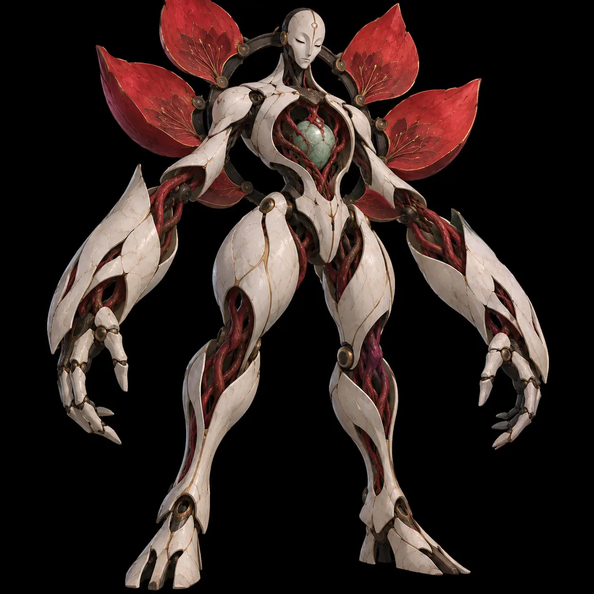

# Візуальний мудборд | Choir of Empty Machines

Це **каталог перегляду**, не пак ліцензованих асетів. Усі наші 29 нових авторських кадрів тепер знаходяться в [references](../references/README.md) (WebP); старі 4 PNG також збережені. Зовнішні кадри показано через посилання на оригінальні джерела, без копіювання до репозиторію. Для аналізу механік див. [LD v0.2](../LEVEL_DESIGN_V02.md).

## 01. Головний міст і акустичні платформи

**Виділяємо:** Наш старий концепт. Масштаб/лінії огляду.

[Відкрити джерело / кадр](../references/01-reference.png)

## 02. Бій проти Трьох облич

**Виділяємо:** Наш старий концепт. Контраст HUD/атак.

[Відкрити джерело / кадр](../references/06-gameplay-combat.png)

## 03. Знайти джерело голосу

**Виділяємо:** Наш старий концепт. Навігаційна логіка.

[Відкрити джерело / кадр](../references/07-gameplay-exploration.png)

## 04. Повторити мотив

**Виділяємо:** Наш старий концепт. Інтерактивне правило.

[Відкрити джерело / кадр](../references/08-gameplay-interaction.png)

## 05. NieR: Automata — factory side-view

**Виділяємо:** Вузький геймплейний переріз серед великих колон.

[Відкрити джерело / кадр](https://img2.gamemad.com/2022/09/23/N9Q8vQNm.jpg)

## 06. COCOON — orb chamber

**Виділяємо:** Центральний інструмент і графічний ритм взаємодії.

[Відкрити джерело / кадр](https://cdn.mos.cms.futurecdn.net/xzEV82VjpAJzMACSVdtxiX.jpg)

## 07. Control — Central Research

**Виділяємо:** Світловий фокус, дерево серед бетону.

[Відкрити джерело / кадр](https://cdn.80.lv/api/upload/content/da/images/60619698266b8/widen_1840x0.jpg)

## 08. Hell's Paradise — рослинна статуя

**Виділяємо:** Органіка на сакральній руїні.

[Відкрити джерело / кадр](https://w.wallhaven.cc/full/6d/wallhaven-6d7v8w.jpg)

## 09. GRIS — біла вежа

**Виділяємо:** Негативний простір і чіткий силует.

[Відкрити джерело / кадр](https://miro.medium.com/v2/resize%3Afit%3A2000/1%2AJicK3vDPVylA6FIClBfUug.jpeg)

## 10. Annihilation — ботанічні фігури

**Виділяємо:** Порожній простір, порушений органічним мотивом.

[Відкрити джерело / кадр](https://ilarge.lisimg.com/image/15842859/740full-annihilation-screenshot.jpg)

## 11. Hollow Knight — контраст герой/фон

**Виділяємо:** Читабельність керованого силуету.

[Відкрити джерело / кадр](https://miro.medium.com/v2/resize%3Afit%3A2544/1%2AaOW3MH-m4RprXntk9B994g.jpeg)

## 12. Ghost in the Shell — нічний канал

**Виділяємо:** Шарувате тло і фокус через світло.

[Відкрити джерело / кадр](https://m.media-amazon.com/images/M/MV5BZWRmMDgyMzUtYjAyMS00ODg5LWE0M2MtNTUwODRhNjkyYTU2XkEyXkFqcGc%40._V1_.jpg)

## Візуальний фільтр

- Архітектура: холодна кераміка і глибокий мідний каркас.
- Природа: квіти, лотос, смарагдова вода як вторгнення у механічний ритм.
- Світло: переважно фізично вмотивоване, з одним композиційним фокусом.
- Геймплей: на активній площині мінімум декору; снаряди, резонатори і герой в окремих тональних групах.

## 13. Оригінальні кадри, додані 27 жовтня

| Кадр | Що виділяємо | Куди беремо |
|---|---|---|
|  | Landmark, маршрут через містки, персонаж як мірило масштабу | D1, C5 |
|  | Telegraph і безпечний сектор без зайвого декору | D3 |
|  | Два джерела з різними станами, puzzle feedback | D2, C3 |
|  | Вода як перешкода й декоративна площина, орієнтири на двох берегах | C3 |
|  | Акцент на матеріалі та одній функціональній машині | C2 |
|  | Тимчасове читання колізії за хвилею, не постійне освітлення | C4 |
|  | Велика композиційна форма + органічна аномалія | C3 |
|  | Ясний головний шлях і далека мета | C3, C5 |
|  | Зіставлення ворожого силуету й архітектури, промисловий ритм | C2 |
|  | Бос як джерело механіки, а не тільки декор | C3 |

### Перевірені сторінки з кадрами правовласників
- [Square Enix Press: NieR: Automata (screenshots / artwork)](https://press.uk.square-enix.com/NieR-Automata): композиція factory і масштаб.
- [Playdead: INSIDE, screenshots](https://playdead.com/inside/): силует, подача шляху та тіні.
- [COCOON: офіційна галерея й механіки](https://www.cocoongame.com/): дієслівна граматика простих задач.
- [Hell’s Paradise: офіційна галерея](https://www.jigokuraku.com/gallery/): приваблива флора та сакральна тривога.
- [Paramount: Annihilation](https://www.paramountmovies.com/movies/annihilation): чудернацька природа як візуальна загроза.
- [Remedy: Control](https://community.remedygames.com/game/control/): масштаб, контраст і геометрична суворість.

Використовуємо **формальні принципи** композиції, світла, камери й механік. Чужі архітектурні плани, персонажів, кадри чи лор не переносимо 1:1.
