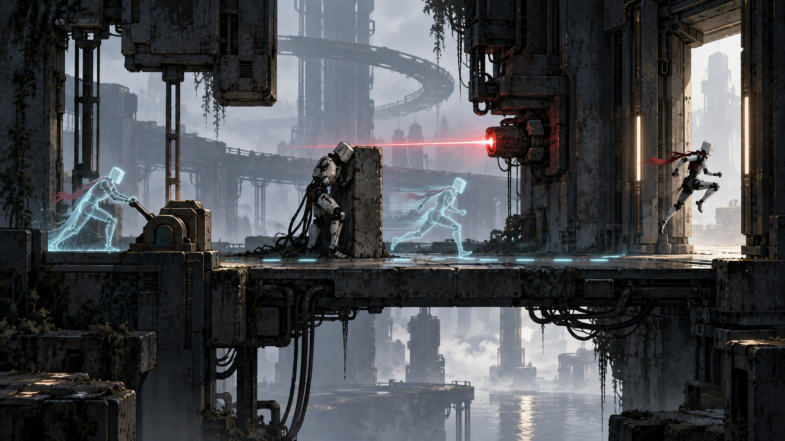
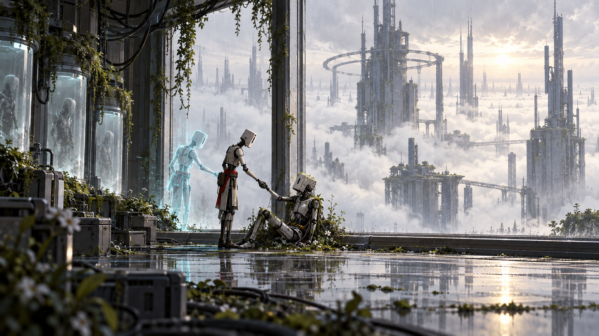

# Твій попередній я

## Задум і досвід гравця
Кожен новий андроїд використовує останні записані дії попередньої копії, щоб пройти далі через мертвий комплекс.

Поступово перетворити власні помилки на взаємодопомогу й побачити в попередній копії особистість.

## Основні опори
1. Механіка виражає конфлікт історії: Запис рухів стає керованим ресурсом головоломки. Минулі тіла зберігають фізичне місце, а повтори існують обмежений час.
2. Стан світу має читатися через простір, звук і поведінку, а не через довгі довідки.
3. Невдача навчає: швидкий повтор, зрозуміла причина, збереження завершених сюжетних кроків.
4. Обсяг визначаємо перевіркою прототипу. Нові системи додаємо, коли вони створюють нове рішення гравця.

## Ігровий цикл
Дії: **записувати, повторювати, утримувати, перемикати, проходити**.

прочитати кімнату → записати допоміжну дію → відтворити копію → виконати нову дію → відкрити наступну частину комплексу.

Короткий цикл триває від окремої дії до завершеної ситуації. За сесію гравець проходить маршрут і отримує нову можливість або розуміння. Кампанія повертає до знайомих місць із новим контекстом; обов’язковий повтор однакових завдань не використовується для збільшення часу.

## Головна механіка
**Запис і відтворення.** Вхід: Почати запис; виконати дію; зупинити; активувати повтор на контрольній точці. Результат: Детермінований повтор рухів взаємодіє з визначеними механізмами. Невдача й обмеження: При зміні кімнати запис інвалідується явно. Повний скидання кімнати завжди доступний..

Ресурс: До 3 активних повторів, кожен до 20 секунд у прототипі. Ліміт формує задачу, а не платний бар’єр.

Усі наведені числові параметри є стартовими значеннями для тесту. Змінюються у таблиці конфігурації, а не зашиваються в логіку.

## Перешкоди й навчання
| Роль | Дія | Сигнал | Рішення |
| --- | --- | --- | --- |
| Турель | Стріляє по прямій | Видима лазерна лінія | Перекрити тілом або укриттям |
| Сканер | Скидає запис у зоні | Повільний сектор | Вимкнути важелем |
| Охоронець | Переслідує найближчу копію | Фіксація цілі | Відволікти повтором |

Нову взаємодію спочатку показуємо в безпечній ситуації, потім у простій задачі, далі поєднуємо з уже знайомою. Колір завжди дублюється формою, рухом або піктограмою.

## Керування та платформи
ПК: рух WASD або стік, головна дія миша або кнопка, взаємодія E, пауза Esc. Точне призначення додаткових дій залежить від жанру. Перепризначення обов’язкове для релізу.

iPhone: окремий тест сенсорного керування, без залежності від правого кліку чи наведення. Інтерфейс враховує safe area; дрібний текст і снаряди перевіряємо на реальному телефоні. Рушій і порядок платформ остаточно не затверджені.

## Прогресія й збереження
Відкриття дають новий спосіб розв’язати ситуацію. Для першого демо обмежуємося двома значущими відкриттями. Автозбереження після безпечного вузла, завершення сцени і ключового рішення. Смерть або скидання повертає локальну задачу, але не видаляє вже відкриті налаштування доступності.

## Тривалість і комерційна модель
Основна вимога для обраного «Хору»: демо не менше 60 хвилин змістовного першого проходження; повна кампанія має ціль 15 годин. Для цієї альтернативної концепції та сама тривалість використовується як сценарій оцінки обсягу, а не як затверджений виробничий план.

Пропозиція: платна завершена гра, без енергетичних таймерів та обов’язкових рекламних пауз. Ціна ще не визначена; $10 згадувались як можливість, а не як ухвалене рішення. Стартовий зовнішній бюджет — 0.

## Умова переходу до виробництва
Один і той самий запис проходить кімнату однаково при різних частотах кадрів і після збереження.

Головний ризик: Недетермінована фізика робить головоломки випадковими та знищує довіру до повторів.

## Питання для наступної редакції
- Чи підтверджуємо саме цей задум і його ключову механіку?
- Яка мінімальна якість керування та звуку досяжна на цільовому iPhone?
- Які сцени можна зробити на власних ресурсах без закупівель?
- Який зміст виправдовує 15 годин без розтягування?

