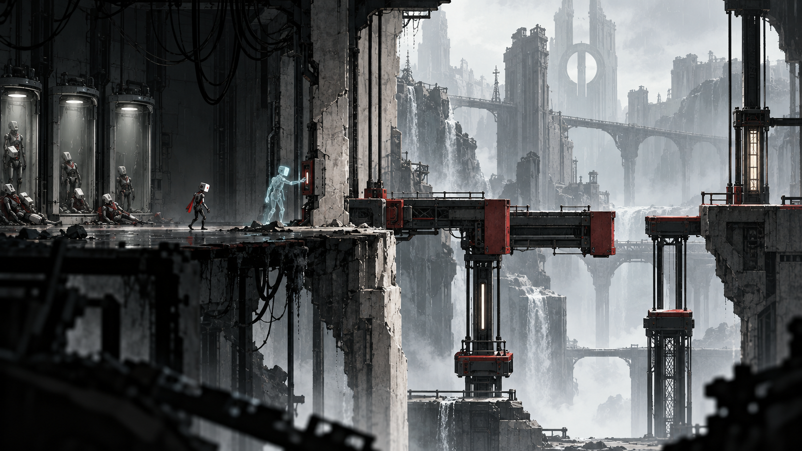

# Рівні та маршрути

## Просторова мова
Запис рухів стає керованим ресурсом головоломки. Минулі тіла зберігають фізичне місце, а повтори існують обмежений час.

Референс задає композицію й атмосферу. Він не є готовим рівнем: прохідні поверхні, колізії, камера, висота персонажа і видимість небезпеки мають окрему перевірку у greybox.

## Структура демо
Маршрут лінійний із двома короткими необов’язковими відгалуженнями. Перед складною ситуацією є точка безпеки. Після неї — тихий простір для осмислення результату. Повернення не повинно вимагати повторного проходження вже доведеної задачі.

| Вузол | Подія | Просторова функція |
| --- | --- | --- |
| D1 | Перша активація | Орієнтація і перший орієнтир |
| D2 | Запис важеля | Безпечне навчання механіки |
| D3 | Кімната з туреллю | Комбінація двох знайомих дій |
| D4 | Два паралельні механізми | Перевірка розуміння |
| D5 | Переслідувач | Кульмінація маршруту |
| D6 | Вихід за допомогою трьох копій | Наслідок і вихід |

## Кампанія як гіпотеза обсягу
Шість розділів по 150 хвилин дають 900 хвилин. Це бюджет контенту, а не оцінка фактичної тривалості неіснуючої гри. Кожен розділ має нове просторове правило, повернення знайомої механіки та сюжетний наслідок.

| Розділ | Локація | Плановий бюджет |
| --- | --- | --- |
| 1 | Відділ активації | 150 хв |
| 2 | Міст копій | 150 хв |
| 3 | Транспортний вузол | 150 хв |
| 4 | Архів помилок | 150 хв |
| 5 | Цех навчання | 150 хв |
| 6 | Вихід без заміни | 150 хв |

## Камера і читабельність
Межі камери описуємо окремими об’ємами. Персонаж та інтерактивні об’єкти відділяються від фону значенням тону. Передній план не перекриває активну небезпеку. Для сенсорного керування нижні кути кадру вважаємо частково закритими пальцями.

## План перевірки
Виміряти час до першої самостійної дії, число втрат маршруту, повернення до вже пройдених задач, читабельність під час руху. Перевірити перезапуск із кожного checkpoint, збереження стану переходів і неможливість потрапити у невідновний стан.

## Умова готовності greybox
Усі обов’язкові вузли прохідні без декору; маршрут читається без постійної стрілки; складність виникає з головної механіки. Один і той самий запис проходить кімнату однаково при різних частотах кадрів і після збереження.
