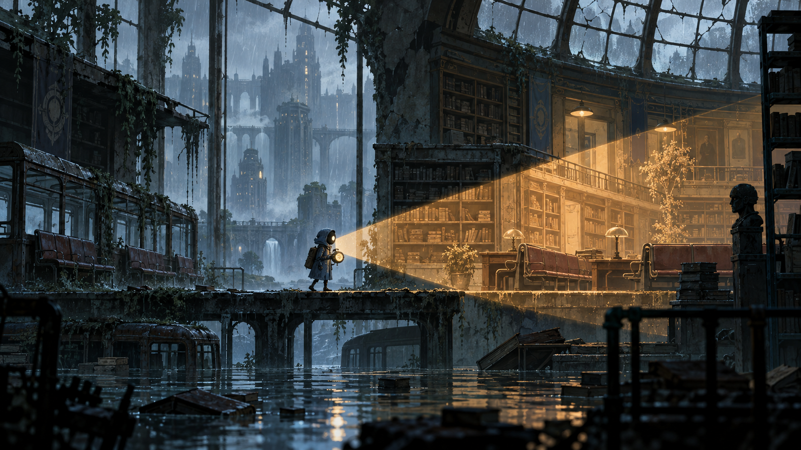

# Архів дощу

**Альтернативна концепція.** Архіваріус сканує затоплене місто та використовує фрагменти його минулого як фізичні маршрути.

- [Геймдизайн](GDD.md)
- [Рівні та маршрути](LEVEL_DESIGN.md)
- [Сюжет і персонажі](NARRATIVE.md)
- [Сценарій демо](DEMO_SCENARIO.md)
- [Катсцени](CUTSCENES.md)
- [Розкадровки](STORYBOARDS.md)
- [Візуальна мова](ART_DIRECTION.md)
- [Звукова система](AUDIO_DESIGN.md)
- [Реєстр ассетів](ASSETS.csv)
- [Інструменти](TOOLS.md)
- [Обсяг і ризики](PRODUCTION.md)
- [Перевірка задуму](PLAYTEST.md)

Це робочі пропозиції v0.1. Підтверджені користувачем рішення й нові авторські деталі розділено в [реєстрі рішень](../../shared/DECISIONS.md).

[Кадри геймплею з UI та поясненнями](GAMEPLAY_CONCEPTS.md)
