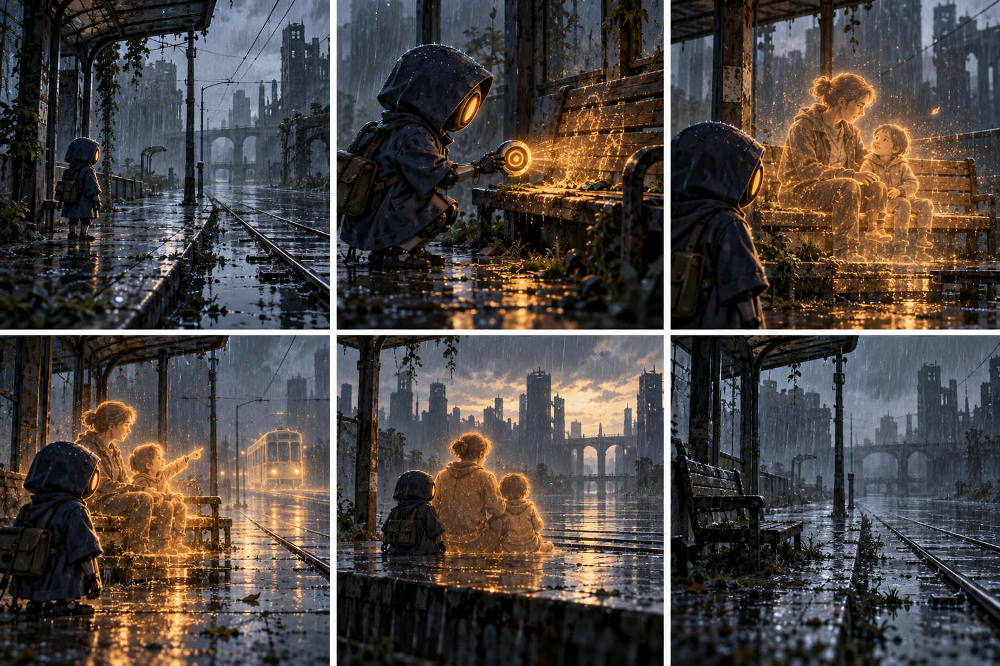

# Розкадровка вступної сцени

| Кадр | Зміст | Камера | Звук | Орієнтовний час |
| --- | --- | --- | --- | --- |
| 1 | Порожня мокра зупинка | Загальний нерухомий | Атмосфера простору | 6 |
| 2 | Сканер знаходить відбиток лави | Середній повільне наближення | Близькі кроки | 5 |
| 3 | З’являються дві постаті | Деталь об’єкта | Перший тематичний звук | 5 |
| 4 | Дитина показує на відсутній трамвай | Крупний жест | Звукова відповідь | 6 |
| 5 | Герой сідає на край платформи | Зворотний середній | Коротка пауза | 7 |
| 6 | Світло згасає і лишається дощ | Повернення у геймплей | Перший мотив і керування | 7 |

## Візуальна послідовність

Ілюстрований аркуш зберігається як `references/04-storyboard.png`. Номери кадрів та їхній зміст визначаються таблицею вище; аркуш є постановочним референсом, а не готовою анімацією.

## Прив’язка до виконання
Початок CS01 → шість кадрів → контрольний стан кінця CS01 → повернення керування. Пропуск переводить безпосередньо у цей контрольний стан.
