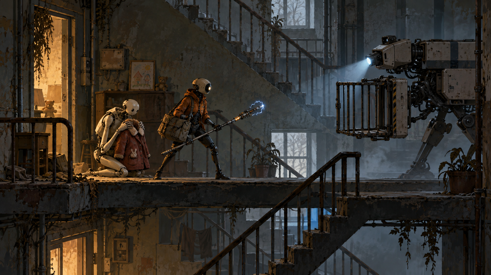

# Служба повернення

## Задум і досвід гравця
Технік забирає покинутих домашніх андроїдів і вирішує, що робити з машинами, які досі чекають людей.

Відчути відповідальність за тих, кого система вважає непотрібними, через конкретні дії в чужому домі.

## Основні опори
1. Механіка виражає конфлікт історії: Рішення ґрунтується на побутових слідах і реальній діагностиці. Відремонтований робот змінює наступні візити в будинок.
2. Стан світу має читатися через простір, звук і поведінку, а не через довгі довідки.
3. Невдача навчає: швидкий повтор, зрозуміла причина, збереження завершених сюжетних кроків.
4. Обсяг визначаємо перевіркою прототипу. Нові системи додаємо, коли вони створюють нове рішення гравця.

## Ігровий цикл
Дії: **оглядати, діагностувати, розмовляти, ремонтувати, захищати, вирішувати**.

отримати адресу → прочитати квартиру → перевірити андроїда → виконати дію → прийняти рішення → побачити наслідок.

Короткий цикл триває від окремої дії до завершеної ситуації. За сесію гравець проходить маршрут і отримує нову можливість або розуміння. Кампанія повертає до знайомих місць із новим контекстом; обов’язковий повтор однакових завдань не використовується для збільшення часу.

## Головна механіка
**Діагностика з наслідком.** Вхід: Огляд трьох доступних вузлів та вибір дії з явним описом. Результат: Ремонт, локальне відключення або супровід змінюють стан персонажа і квартири. Невдача й обмеження: Помилкова діагностика залишає виправний наслідок; незворотне відключення потребує явного підтвердження в самій грі..

Ресурс: Обмежений запас деталей на маршрут. Частину можна отримати повторним використанням безпечного обладнання.

Усі наведені числові параметри є стартовими значеннями для тесту. Змінюються у таблиці конфігурації, а не зашиваються в логіку.

## Перешкоди й навчання
| Роль | Дія | Сигнал | Рішення |
| --- | --- | --- | --- |
| Збиральний дрон | Намагається вивезти ціль | Скануючий прожектор | Перекрити маршрут або відключити |
| Несправний захисник | Захищає чужу квартиру | Попереджувальний жест | Діагностувати причину |
| Дефект мережі | Блокує двері | Збої освітлення | Відновити лінію живлення |

Нову взаємодію спочатку показуємо в безпечній ситуації, потім у простій задачі, далі поєднуємо з уже знайомою. Колір завжди дублюється формою, рухом або піктограмою.

## Керування та платформи
ПК: рух WASD або стік, головна дія миша або кнопка, взаємодія E, пауза Esc. Точне призначення додаткових дій залежить від жанру. Перепризначення обов’язкове для релізу.

iPhone: окремий тест сенсорного керування, без залежності від правого кліку чи наведення. Інтерфейс враховує safe area; дрібний текст і снаряди перевіряємо на реальному телефоні. Рушій і порядок платформ остаточно не затверджені.

## Прогресія й збереження
Відкриття дають новий спосіб розв’язати ситуацію. Для першого демо обмежуємося двома значущими відкриттями. Автозбереження після безпечного вузла, завершення сцени і ключового рішення. Смерть або скидання повертає локальну задачу, але не видаляє вже відкриті налаштування доступності.

## Тривалість і комерційна модель
Основна вимога для обраного «Хору»: демо не менше 60 хвилин змістовного першого проходження; повна кампанія має ціль 15 годин. Для цієї альтернативної концепції та сама тривалість використовується як сценарій оцінки обсягу, а не як затверджений виробничий план.

Пропозиція: платна завершена гра, без енергетичних таймерів та обов’язкових рекламних пауз. Ціна ще не визначена; $10 згадувались як можливість, а не як ухвалене рішення. Стартовий зовнішній бюджет — 0.

## Умова переходу до виробництва
Рішення змінює наступну сцену відчутним способом, а гравець може пояснити свій вибір знайденими доказами.

Головний ризик: Великі діалогові дерева і різні наслідки збільшують кількість сценарних станів швидше за число сцен.

## Питання для наступної редакції
- Чи підтверджуємо саме цей задум і його ключову механіку?
- Яка мінімальна якість керування та звуку досяжна на цільовому iPhone?
- Які сцени можна зробити на власних ресурсах без закупівель?
- Який зміст виправдовує 15 годин без розтягування?

