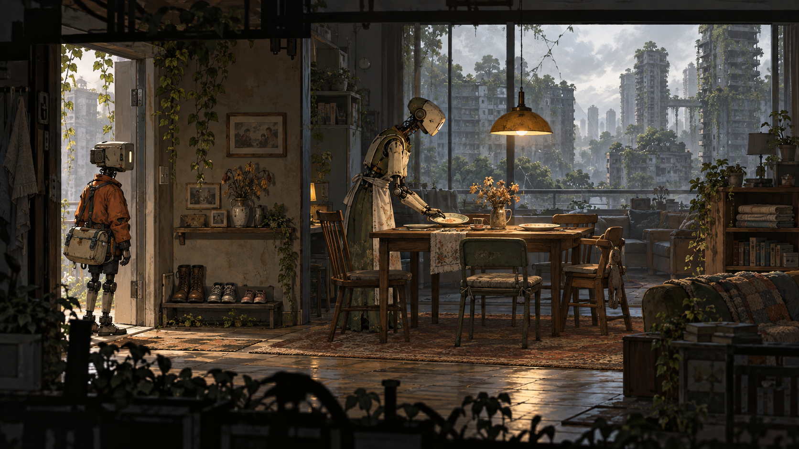

# Рівні та маршрути

## Просторова мова
Рішення ґрунтується на побутових слідах і реальній діагностиці. Відремонтований робот змінює наступні візити в будинок.

Референс задає композицію й атмосферу. Він не є готовим рівнем: прохідні поверхні, колізії, камера, висота персонажа і видимість небезпеки мають окрему перевірку у greybox.

## Структура демо
Маршрут лінійний із двома короткими необов’язковими відгалуженнями. Перед складною ситуацією є точка безпеки. Після неї — тихий простір для осмислення результату. Повернення не повинно вимагати повторного проходження вже доведеної задачі.

| Вузол | Подія | Просторова функція |
| --- | --- | --- |
| D1 | Видача першої адреси | Орієнтація і перший орієнтир |
| D2 | Квартира з накритим столом | Безпечне навчання механіки |
| D3 | Діагностика домашнього робота | Комбінація двох знайомих дій |
| D4 | Друга адреса і нестача деталей | Перевірка розуміння |
| D5 | Зустріч зі збиральним дроном | Кульмінація маршруту |
| D6 | Повернення до першої квартири | Наслідок і вихід |

## Кампанія як гіпотеза обсягу
Шість розділів по 150 хвилин дають 900 хвилин. Це бюджет контенту, а не оцінка фактичної тривалості неіснуючої гри. Кожен розділ має нове просторове правило, повернення знайомої механіки та сюжетний наслідок.

| Розділ | Локація | Плановий бюджет |
| --- | --- | --- |
| 1 | Перший маршрут | 150 хв |
| 2 | Будинок очікування | 150 хв |
| 3 | Район без диспетчера | 150 хв |
| 4 | Центр повернення | 150 хв |
| 5 | Ремонтна мережа | 150 хв |
| 6 | Остання адреса | 150 хв |

## Камера і читабельність
Межі камери описуємо окремими об’ємами. Персонаж та інтерактивні об’єкти відділяються від фону значенням тону. Передній план не перекриває активну небезпеку. Для сенсорного керування нижні кути кадру вважаємо частково закритими пальцями.

## План перевірки
Виміряти час до першої самостійної дії, число втрат маршруту, повернення до вже пройдених задач, читабельність під час руху. Перевірити перезапуск із кожного checkpoint, збереження стану переходів і неможливість потрапити у невідновний стан.

## Умова готовності greybox
Усі обов’язкові вузли прохідні без декору; маршрут читається без постійної стрілки; складність виникає з головної механіки. Рішення змінює наступну сцену відчутним способом, а гравець може пояснити свій вибір знайденими доказами.
