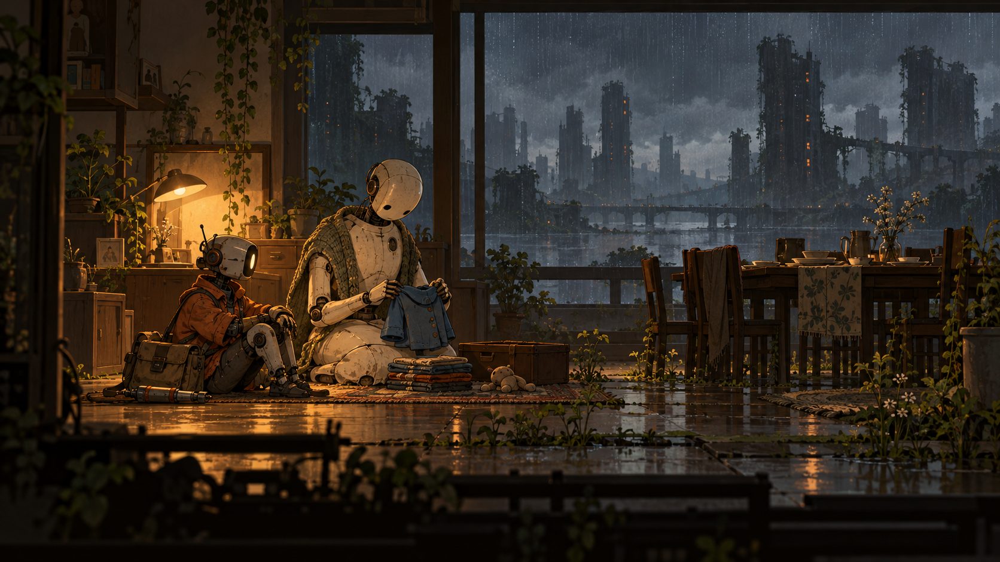

# Сюжет і персонажі

## Передумова
Технік забирає покинутих домашніх андроїдів і вирішує, що робити з машинами, які досі чекають людей.

## Герой
Муніципальний технік у вицвілій помаранчевій куртці, із сумкою та інструментом для безпечного відключення.

## Другий голос
Диспетчер служби, який розмовляє ввічливою бюрократичною мовою та поступово втрачає зв’язок із реальністю на місці.

## Конфлікт
Інструкція вимагає повернення всіх одиниць, але деякі з них підтримують безпеку будинку і життя інших машин.

## Сюжетна арка
Акт 1 ставить зрозуміле практичне завдання. Акт 2 показує перший наслідок виконання наказу. Акт 3 додає суперечливий доказ. Акт 4 дозволяє перевірити іншу версію подій через дію. Акт 5 ставить ціну фінального рішення. Акт 6 завершує конфлікт результатом, видимим у світі.

## Відкриття
Люди пішли, а служба роками виконує автоматично продовжені договори. Жоден диспетчер не має повної картини.

## Завершення
Технік або завершує маршрут повернення, або перетворює службу на мережу взаємного ремонту. Раніше зроблені вчинки визначають, хто допоможе.

## Демо
Демо має власну малу завершену історію. Воно відповідає на локальне запитання й відкриває ширший конфлікт. Домашній робот складає дитяче пальто. Технік відкладає інструмент відключення і сідає поруч; диспетчер просить підтвердити завершення заявки.

## Принцип діалогу
Репліки короткі, прив’язані до спостереження або дії. Гравець не мусить слухати довгий монолог під час складної взаємодії. Субтитри мають ім’я або позначення джерела, історію прочитаних реплік і регулювання розміру. Під час повторної спроби вже почуту вступну сцену можна пропустити.

## Виробничий статус
Імена, відкриття й фінал у цьому файлі — запропонована авторська версія v0.1. Затверджено атмосферний напрямок, а не конкретний текст історії. Спочатку перевіряємо коротку сцену і механіку, потім розширюємо сценарій.
