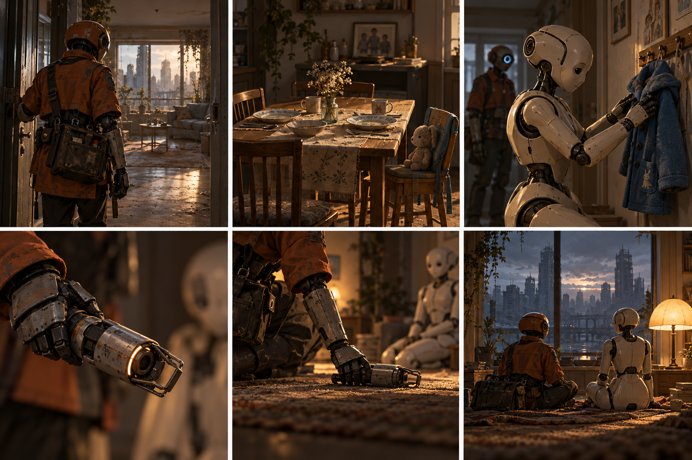

# Розкадровка вступної сцени

| Кадр | Зміст | Камера | Звук | Орієнтовний час |
| --- | --- | --- | --- | --- |
| 1 | Технік входить у квартиру | Загальний нерухомий | Атмосфера простору | 6 |
| 2 | Три порожні місця за столом | Середній повільне наближення | Близькі кроки | 5 |
| 3 | Робот розправляє дитяче пальто | Деталь об’єкта | Перший тематичний звук | 5 |
| 4 | Інструмент відключення в руці | Крупний жест | Звукова відповідь | 6 |
| 5 | Технік кладе інструмент на підлогу | Зворотний середній | Коротка пауза | 7 |
| 6 | Два роботи сидять під лампою | Повернення у геймплей | Перший мотив і керування | 7 |

## Візуальна послідовність

Ілюстрований аркуш зберігається як `references/04-storyboard.png`. Номери кадрів та їхній зміст визначаються таблицею вище; аркуш є постановочним референсом, а не готовою анімацією.

## Прив’язка до виконання
Початок CS01 → шість кадрів → контрольний стан кінця CS01 → повернення керування. Пропуск переводить безпосередньо у цей контрольний стан.
